# SchoolConcept — IS-HINTEL

Manuel détaillé des procédures et support de formation

Édition 2.0 · 21 octobre 2026

Scolarité · Pédagogie · Ressources humaines · Comptabilité · Administration

Accès à l’application : [https://ish.informatique-ht.cm](https://ish.informatique-ht.cm)

Application hébergée dans le cloud — usage interne

## Sommaire

1. Prendre en main le logiciel
2. Administration — configurer le logiciel dans le bon ordre
3. Scolarité — créer, corriger, inscrire et retrouver les dossiers
4. Versements — encaisser après l’inscription et contrôler les paiements
5. Notes — préparer, créer, modifier, contrôler et délibérer
6. PV, relevés, attestations et historiques — procédure par tutelle
7. Personnel et emplois du temps — préparer, programmer, modifier et contrôler
8. Comptabilité — dépenses, paiements du personnel, budgets et états
9. Contrôles d’accès, discipline, publication et corrections
10. Trouver une information — quel module et quel état utiliser ?
11. Résoudre les difficultés courantes
12. Organiser la formation des utilisateurs

### Index des procédures

## 1. Prendre en main le logiciel

Ce guide s’adresse aux agents de scolarité, caissiers, responsables pédagogiques, enseignants, gestionnaires du personnel, comptables et administrateurs. Il explique les opérations du logiciel installé à l’INSTITUT SUPÉRIEUR HINTEL, à partir des interfaces réellement consultées le 21 octobre 2026.

Les captures utilisent un compte disposant de droits étendus. Certains boutons peuvent être absents avec votre compte : les fonctions disponibles dépendent des rôles, des permissions et du campus autorisé. Les effectifs, noms et montants figurant dans les captures sont ceux de l’installation consultée ; ils ne constituent pas des valeurs à reproduire.

La navigation et l’ouverture des formulaires ont été vérifiées en session réelle. Les procédures d’enregistrement, d’importation, de suppression, de paiement, de publication et de génération sauvegardée décrivent les formulaires et le code du projet ; leurs validations finales n’ont pas été exécutées pendant la rédaction. Les pages en erreur sont signalées dans l’inventaire des interfaces.

Le guide et ses images sont destinés à la formation interne : plusieurs écrans contiennent des informations sur les étudiants, le personnel et les opérations financières. Aucun mot de passe n’est reproduit dans ce document.

Cette édition ajoute les dépendances de configuration et des procédures par opération et par tutelle. Les aperçus locaux portent une légende distincte : ils illustrent les vues du projet sans sauvegarder de nouvelles générations. Les attestations pédagogiques utilisent un nom et des résultats fictifs clairement signalés. Les historiques présentés sont ceux de la session réelle.

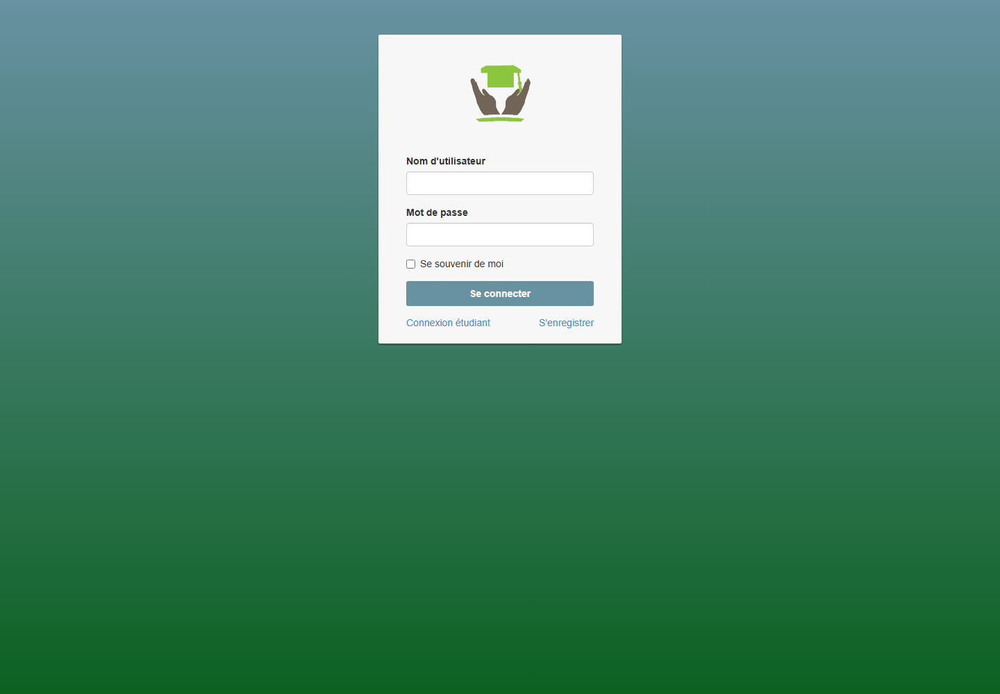

*Figure 1 — Connexion du personnel. Utiliser ses identifiants personnels.*

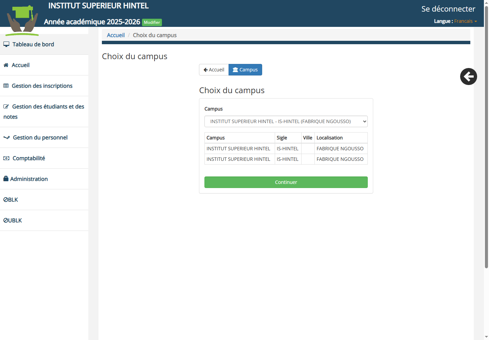

*Figure 2 — Choix du campus après authentification.*

### P001 — Se connecter et choisir son campus

1. Depuis un ordinateur connecté à Internet, ouvrir le navigateur et saisir l’adresse https://ish.informatique-ht.cm. L’application est hébergée dans le cloud et s’utilise directement depuis cette adresse, sans lancer de serveur local sur le poste de l’utilisateur.
2. Saisir le nom d’utilisateur et le mot de passe personnels. Cocher « Se souvenir de moi » uniquement sur son poste individuel, puis cliquer sur « Se connecter ».
3. Si « Choix du campus » apparaît, sélectionner le campus et cliquer sur « Continuer ». Lors de la consultation, deux entrées de campus avaient le même libellé ; demander au responsable quel campus utiliser si cette situation persiste.
4. Vérifier le nom de l’établissement et l’année académique dans le bandeau supérieur. La session consultée affichait 2025-2026. Ne pas supposer que l’année affichée correspond à l’année civile actuelle.
5. Ouvrir le module souhaité depuis les grandes tuiles de l’accueil ou le menu latéral. En fin de travail, cliquer sur « Se déconnecter ».

Résultat à contrôler : L’accueil est affiché dans le contexte du campus choisi. Le compte et le contexte doivent être vérifiés avant toute opération.

### P002 — Se repérer et retrouver une information

1. Utiliser le menu de gauche pour changer de module et le fil de navigation en haut du contenu pour remonter à une rubrique.
2. Dans un champ « Effectuer une recherche », saisir le matricule ou une partie du nom puis cliquer sur « Chercher ». Comparer le matricule, le nom et la date de naissance avant d’ouvrir « Actions ».
3. Dans les tableaux qui proposent « Search », saisir un mot pour filtrer les lignes ; utiliser les pages du tableau lorsque des boutons de pagination sont présents. Ce filtre local ne remplace pas la recherche principale du logiciel.
4. Choisir les filtres dans leur ordre logique : campus, année, cycle, niveau, filière, spécialité, puis matière ou session. Attendre le chargement des listes dépendantes avant de continuer.
5. Si un tableau est vide, contrôler les filtres et les droits avant de créer un nouvel enregistrement. Faire défiler la page pour accéder aux champs et boutons situés plus bas.

Résultat à contrôler : L’agent retrouve le bon dossier et sait dans quel contexte il travaille.

### P003 — Modifier son mot de passe et comprendre le changement d’année

1. Depuis l’accueil, ouvrir « Modifier le mot de passe ».
2. Renseigner l’ancien mot de passe, le nouveau et sa confirmation. Le formulaire est contrôlé côté application ; le code impose au moins six caractères au nouveau mot de passe. Choisir un mot de passe personnel suffisamment long.
3. Valider, vérifier le message affiché, puis utiliser le nouveau mot de passe lors de la prochaine connexion.
4. Le bouton « Modifier » situé à côté de l’année académique ouvre un réglage d’administration. Il met à jour l’année de travail de l’application ; il ne sert pas simplement à filtrer son écran personnel. Le réserver au responsable habilité.
5. Pour consulter les années antérieures d’un étudiant, privilégier « Historique étudiant » et les historiques de relevés.

Résultat à contrôler : Le compte reste personnel et l’année de travail est modifiée uniquement dans le cadre de la préparation d’une rentrée.

## 2. Administration — configurer le logiciel dans le bon ordre

Commencer par ce chapitre avant d’inscrire les étudiants ou de saisir des notes. Une liste vide provient souvent d’un paramètre préalable manquant. Le campus et l’année définissent le contexte ; le cycle, le niveau académique, la filière et la spécialité identifient le parcours. Les matières appartiennent à un programme de spécialité ; leurs sessions d’examen définissent les évaluations utilisables.

Une tutelle possède ses informations d’en-tête, ses spécialités associées et ses paramètres d’évaluation. Choisir un format de PV ne remplace pas ce paramétrage. Les formats BTS, HND, Soa, Ngaoundéré, Ebolowa et Bamenda existent dans le circuit des PV ; les attestations disposent de trois circuits spécifiques : Soa, Ngaoundéré et Ebolowa.

Les procédures de suppression décrivent les actions proposées par le projet ; elles ne doivent pas être exécutées pour apprendre sur des dossiers de travail. Une désinscription, une désactivation de personnel et une suppression d’historique ont des effets distincts. Si une action n’est pas proposée par l’interface ou le compte, le guide ne la remplace pas par une adresse à saisir.

### P004 — Vérifier l’établissement et préparer le campus

Responsable : Administrateur

Chemin : Administration → Campus

Prérequis : Compte habilité ; identité et coordonnées approuvées de l’établissement.

1. Ouvrir « Campus » et rechercher si le site existe déjà. Comparer nom, sigle et localisation ; deux campus peuvent porter un libellé semblable.
2. Utiliser le formulaire de création pour un nouveau campus ; renseigner les champs d’identité et de contact proposés. Prévoir un libellé qui distingue clairement chaque site.
3. Après validation, utiliser « Utilisateurs » sur la ligne du campus pour sélectionner les agents autorisés, puis enregistrer leurs affectations.
4. Ouvrir « Spécialités » sur cette même ligne et associer uniquement les formations proposées sur ce site.
5. Se reconnecter ou repasser par le choix du campus, sélectionner le site préparé et vérifier son nom dans le bandeau.

Point de contrôle : Ne pas supprimer un campus contenant des inscriptions ou des mouvements pour corriger son seul libellé ; corriger ses informations et vérifier ses rattachements.

Résultat à contrôler : Les agents retrouvent les formations du campus attendu.

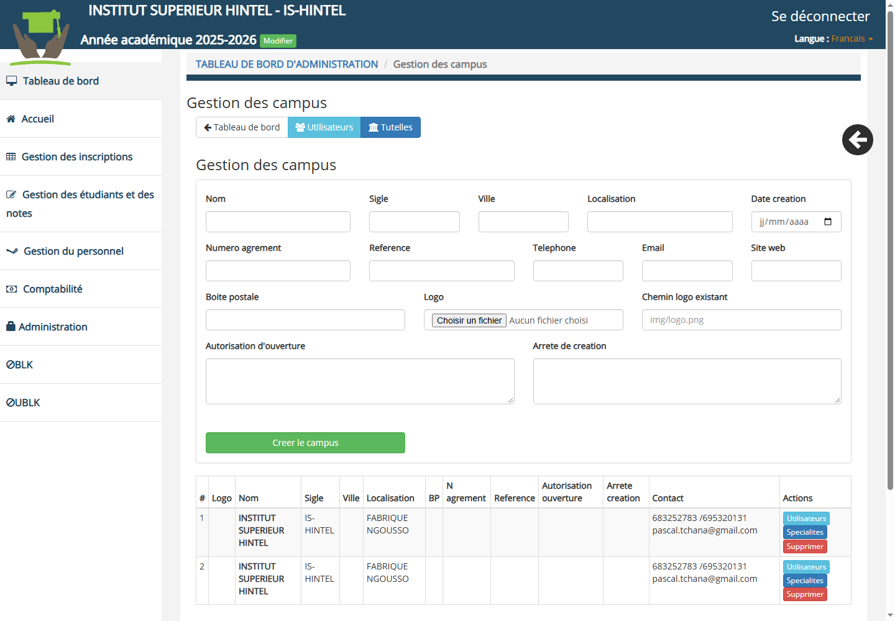

*Figure 3 — Campus : les actions Utilisateurs et Spécialités servent aux affectations.*

### P005 — Préparer une nouvelle année académique

Responsable : Administrateur responsable de la rentrée

Chemin : Bandeau supérieur → Année académique → Modifier

Prérequis : Date de bascule approuvée ; utilisateurs informés ; référentiels, tarifs et paramètres d’examen préparés pour la rentrée.

1. Terminer les contrôles de l’année sortante et conserver les états validés nécessaires.
2. Vérifier les cycles, niveaux, spécialités et affectations de campus. Préparer les tarifs qui seront utilisés dans le nouveau contexte.
3. Cliquer sur « Modifier » à côté de l’année. Saisir les deux années du nouvel exercice, dans l’ordre, puis confirmer.
4. Contrôler le bandeau à l’accueil et dans les modules avant d’effectuer une inscription ou une saisie.
5. Configurer ou vérifier les sessions d’examen de la nouvelle année. Les sessions de l’année précédente ne garantissent pas l’ouverture de la nouvelle grille.

Point de contrôle : Ce réglage modifie le paramètre de l’application. Utiliser les historiques pour consulter une ancienne année plutôt que changer ce réglage pour une simple recherche.

Résultat à contrôler : Le contexte de travail correspond à l’année de rentrée.

### P006 — Créer ou modifier : Cycles

Responsable : Administrateur

Chemin : Administration → Cycles

Prérequis : Connaître les libellés et l’ordre des cycles ; vérifier les référentiels de rattachement.

1. Ouvrir la rubrique et rechercher le libellé pour éviter un doublon.
2. Pour créer, utiliser le bouton d’ajout de la rubrique ou le formulaire de création visible. Pour modifier, sélectionner l’action d’édition sur la ligne existante ; conserver le même enregistrement.
3. Renseigner les libellés et l’ordre des cycles. Comparer les rattachements avec le parcours approuvé avant de confirmer.
4. Valider, rechercher à nouveau la ligne et vérifier les champs affichés.
5. Ouvrir ensuite un formulaire utilisant cette donnée : elle doit être disponible pour les niveaux académiques.

Résultat à contrôler : Le référentiel existe une seule fois et ses dépendances restent cohérentes.

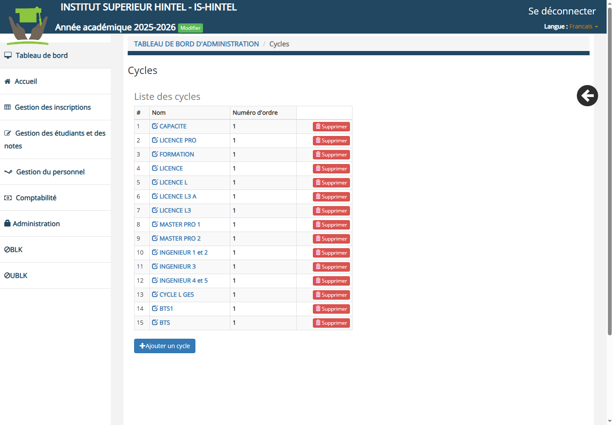

*Figure 4 — Référentiel « Cycles » : liste et accès aux formulaires.*

### P007 — Retirer une donnée du référentiel : Cycles

Responsable : Administrateur

Chemin : Administration → Cycles → ligne concernée → Supprimer

Prérequis : Donnée erronée ou inutilisée identifiée ; décision de retrait validée. Aucun niveau ni parcours ne doit encore utiliser le cycle à retirer.

1. Retrouver la ligne et contrôler son nom et son rattachement. Ne pas agir sur une ligne simplement parce qu’elle porte un nom proche.
2. Si une correction du libellé suffit, utiliser la modification plutôt qu’un retrait.
3. Utiliser « Supprimer » uniquement lorsqu’il est présent sur cette rubrique et autorisé au compte. Lire la confirmation éventuellement affichée ; annuler si le périmètre est incertain.
4. Après suppression autorisée, rechercher à nouveau la donnée et vérifier les formulaires dépendants. Si l’application refuse le retrait, relever son message et faire contrôler les dépendances.

Point de contrôle : Certaines rubriques ne proposent pas de suppression dans leur écran. Dans ce cas, demander au responsable d’évaluer la correction ; ne pas saisir une adresse de suppression manuellement.

Résultat à contrôler : Le retrait ne laisse pas de parcours métier incohérent.

### P008 — Créer ou modifier : Niveau

Responsable : Administrateur

Chemin : Administration → Niveau

Prérequis : Connaître le nom du niveau et son cycle de rattachement ; vérifier les référentiels de rattachement.

1. Ouvrir la rubrique et rechercher le libellé pour éviter un doublon.
2. Pour créer, utiliser le bouton d’ajout de la rubrique ou le formulaire de création visible. Pour modifier, sélectionner l’action d’édition sur la ligne existante ; conserver le même enregistrement.
3. Renseigner le nom du niveau et son cycle de rattachement. Comparer les rattachements avec le parcours approuvé avant de confirmer.
4. Valider, rechercher à nouveau la ligne et vérifier les champs affichés.
5. Ouvrir ensuite un formulaire utilisant cette donnée : elle doit être disponible pour les inscriptions et programmes du bon cycle.

Résultat à contrôler : Le référentiel existe une seule fois et ses dépendances restent cohérentes.

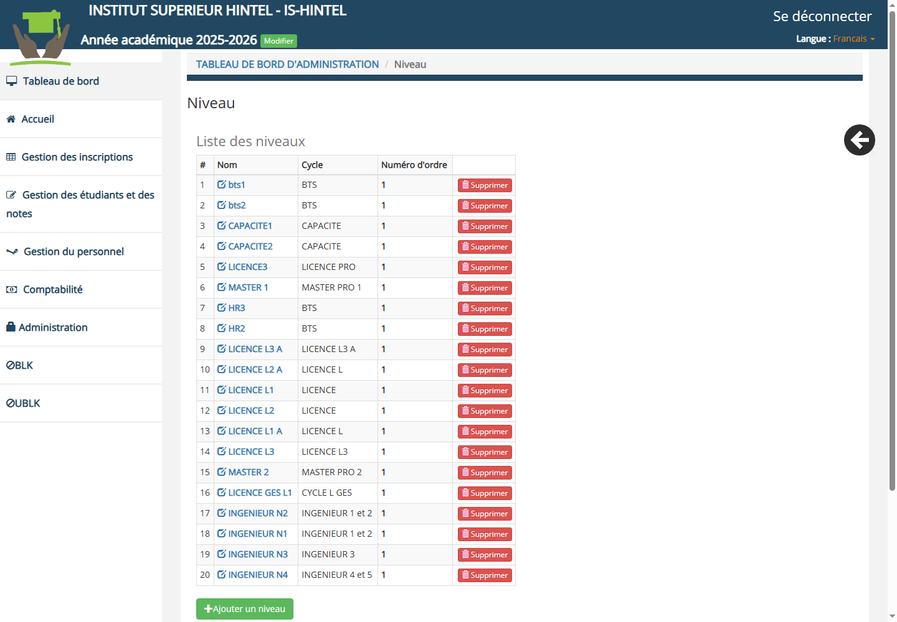

*Figure 5 — Référentiel « Niveau » : liste et accès aux formulaires.*

### P009 — Retirer une donnée du référentiel : Niveau

Responsable : Administrateur

Chemin : Administration → Niveau → ligne concernée → Supprimer

Prérequis : Donnée erronée ou inutilisée identifiée ; décision de retrait validée. Vérifier programmes et inscriptions qui utilisent ce niveau.

1. Retrouver la ligne et contrôler son nom et son rattachement. Ne pas agir sur une ligne simplement parce qu’elle porte un nom proche.
2. Si une correction du libellé suffit, utiliser la modification plutôt qu’un retrait.
3. Utiliser « Supprimer » uniquement lorsqu’il est présent sur cette rubrique et autorisé au compte. Lire la confirmation éventuellement affichée ; annuler si le périmètre est incertain.
4. Après suppression autorisée, rechercher à nouveau la donnée et vérifier les formulaires dépendants. Si l’application refuse le retrait, relever son message et faire contrôler les dépendances.

Point de contrôle : Certaines rubriques ne proposent pas de suppression dans leur écran. Dans ce cas, demander au responsable d’évaluer la correction ; ne pas saisir une adresse de suppression manuellement.

Résultat à contrôler : Le retrait ne laisse pas de parcours métier incohérent.

### P010 — Créer ou modifier : Filières

Responsable : Administrateur

Chemin : Administration → Filières

Prérequis : Connaître le nom de la filière et les autres informations proposées ; vérifier les référentiels de rattachement.

1. Ouvrir la rubrique et rechercher le libellé pour éviter un doublon.
2. Pour créer, utiliser le bouton d’ajout de la rubrique ou le formulaire de création visible. Pour modifier, sélectionner l’action d’édition sur la ligne existante ; conserver le même enregistrement.
3. Renseigner le nom de la filière et les autres informations proposées. Comparer les rattachements avec le parcours approuvé avant de confirmer.
4. Valider, rechercher à nouveau la ligne et vérifier les champs affichés.
5. Ouvrir ensuite un formulaire utilisant cette donnée : elle doit être disponible pour le regroupement des spécialités.

Résultat à contrôler : Le référentiel existe une seule fois et ses dépendances restent cohérentes.

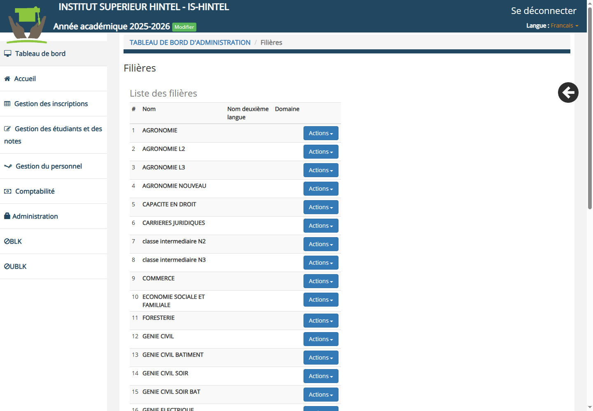

*Figure 6 — Référentiel « Filières » : liste et accès aux formulaires.*

### P011 — Retirer une donnée du référentiel : Filières

Responsable : Administrateur

Chemin : Administration → Filières → ligne concernée → Supprimer

Prérequis : Donnée erronée ou inutilisée identifiée ; décision de retrait validée. Contrôler toutes les spécialités rattachées à cette filière.

1. Retrouver la ligne et contrôler son nom et son rattachement. Ne pas agir sur une ligne simplement parce qu’elle porte un nom proche.
2. Si une correction du libellé suffit, utiliser la modification plutôt qu’un retrait.
3. Utiliser « Supprimer » uniquement lorsqu’il est présent sur cette rubrique et autorisé au compte. Lire la confirmation éventuellement affichée ; annuler si le périmètre est incertain.
4. Après suppression autorisée, rechercher à nouveau la donnée et vérifier les formulaires dépendants. Si l’application refuse le retrait, relever son message et faire contrôler les dépendances.

Point de contrôle : Certaines rubriques ne proposent pas de suppression dans leur écran. Dans ce cas, demander au responsable d’évaluer la correction ; ne pas saisir une adresse de suppression manuellement.

Résultat à contrôler : Le retrait ne laisse pas de parcours métier incohérent.

### P012 — Créer ou modifier : Spécialité(s)

Responsable : Administrateur

Chemin : Administration → Spécialité(s)

Prérequis : Connaître le nom de la spécialité, sa filière et ses paramètres proposés ; vérifier les référentiels de rattachement.

1. Ouvrir la rubrique et rechercher le libellé pour éviter un doublon.
2. Pour créer, utiliser le bouton d’ajout de la rubrique ou le formulaire de création visible. Pour modifier, sélectionner l’action d’édition sur la ligne existante ; conserver le même enregistrement.
3. Renseigner le nom de la spécialité, sa filière et ses paramètres proposés. Comparer les rattachements avec le parcours approuvé avant de confirmer.
4. Valider, rechercher à nouveau la ligne et vérifier les champs affichés.
5. Ouvrir ensuite un formulaire utilisant cette donnée : elle doit être disponible pour les inscriptions, programmes et cours.

Résultat à contrôler : Le référentiel existe une seule fois et ses dépendances restent cohérentes.

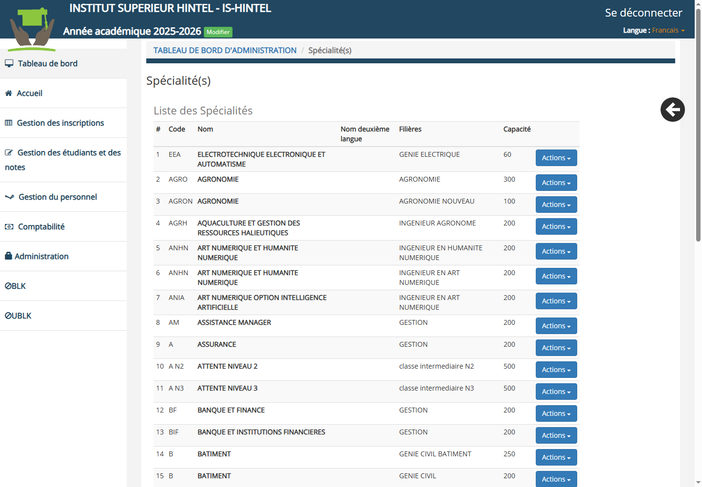

*Figure 7 — Référentiel « Spécialité(s) » : liste et accès aux formulaires.*

### P013 — Retirer une donnée du référentiel : Spécialité(s)

Responsable : Administrateur

Chemin : Administration → Spécialité(s) → ligne concernée → Supprimer

Prérequis : Donnée erronée ou inutilisée identifiée ; décision de retrait validée. Contrôler ses inscriptions, matières de programme, tutelles et campus.

1. Retrouver la ligne et contrôler son nom et son rattachement. Ne pas agir sur une ligne simplement parce qu’elle porte un nom proche.
2. Si une correction du libellé suffit, utiliser la modification plutôt qu’un retrait.
3. Utiliser « Supprimer » uniquement lorsqu’il est présent sur cette rubrique et autorisé au compte. Lire la confirmation éventuellement affichée ; annuler si le périmètre est incertain.
4. Après suppression autorisée, rechercher à nouveau la donnée et vérifier les formulaires dépendants. Si l’application refuse le retrait, relever son message et faire contrôler les dépendances.

Point de contrôle : Certaines rubriques ne proposent pas de suppression dans leur écran. Dans ce cas, demander au responsable d’évaluer la correction ; ne pas saisir une adresse de suppression manuellement.

Résultat à contrôler : Le retrait ne laisse pas de parcours métier incohérent.

### P014 — Créer ou modifier : Matières

Responsable : Administrateur

Chemin : Administration → Matières

Prérequis : Connaître le nom de matière et le nom dans la deuxième langue lorsqu’il est utilisé ; vérifier les référentiels de rattachement.

1. Ouvrir la rubrique et rechercher le libellé pour éviter un doublon.
2. Pour créer, utiliser le bouton d’ajout de la rubrique ou le formulaire de création visible. Pour modifier, sélectionner l’action d’édition sur la ligne existante ; conserver le même enregistrement.
3. Renseigner le nom de matière et le nom dans la deuxième langue lorsqu’il est utilisé. Comparer les rattachements avec le parcours approuvé avant de confirmer.
4. Valider, rechercher à nouveau la ligne et vérifier les champs affichés.
5. Ouvrir ensuite un formulaire utilisant cette donnée : elle doit être disponible pour les programmes et les notes.

Résultat à contrôler : Le référentiel existe une seule fois et ses dépendances restent cohérentes.

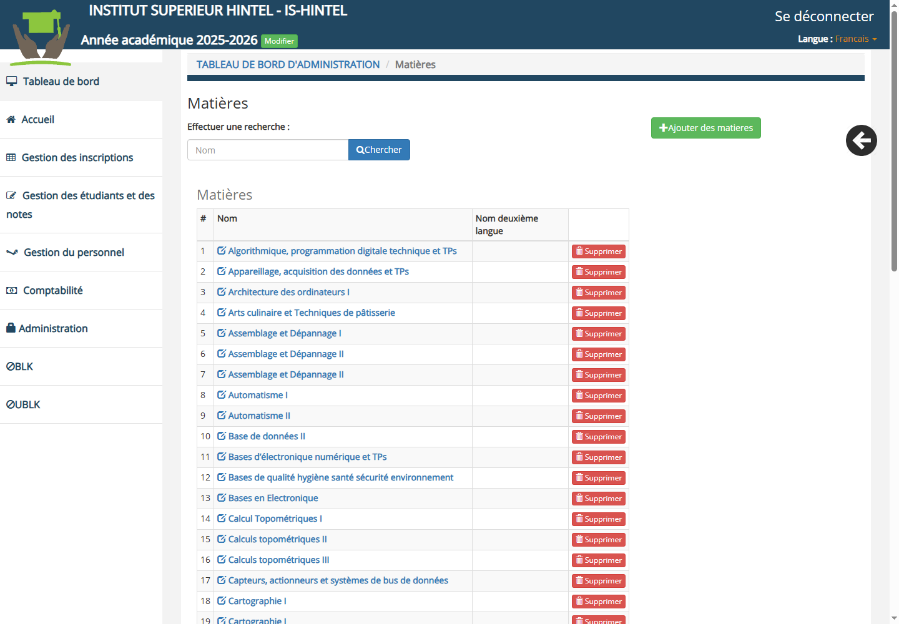

*Figure 8 — Référentiel « Matières » : liste et accès aux formulaires.*

### P015 — Retirer une donnée du référentiel : Matières

Responsable : Administrateur

Chemin : Administration → Matières → ligne concernée → Supprimer

Prérequis : Donnée erronée ou inutilisée identifiée ; décision de retrait validée. Vérifier les programmes et notes existantes avant tout retrait.

1. Retrouver la ligne et contrôler son nom et son rattachement. Ne pas agir sur une ligne simplement parce qu’elle porte un nom proche.
2. Si une correction du libellé suffit, utiliser la modification plutôt qu’un retrait.
3. Utiliser « Supprimer » uniquement lorsqu’il est présent sur cette rubrique et autorisé au compte. Lire la confirmation éventuellement affichée ; annuler si le périmètre est incertain.
4. Après suppression autorisée, rechercher à nouveau la donnée et vérifier les formulaires dépendants. Si l’application refuse le retrait, relever son message et faire contrôler les dépendances.

Point de contrôle : Certaines rubriques ne proposent pas de suppression dans leur écran. Dans ce cas, demander au responsable d’évaluer la correction ; ne pas saisir une adresse de suppression manuellement.

Résultat à contrôler : Le retrait ne laisse pas de parcours métier incohérent.

### P016 — Créer ou modifier : Salles

Responsable : Administrateur

Chemin : Administration → Salles

Prérequis : Connaître le nom identifiant le local ; vérifier les référentiels de rattachement.

1. Ouvrir la rubrique et rechercher le libellé pour éviter un doublon.
2. Pour créer, utiliser le bouton d’ajout de la rubrique ou le formulaire de création visible. Pour modifier, sélectionner l’action d’édition sur la ligne existante ; conserver le même enregistrement.
3. Renseigner le nom identifiant le local. Comparer les rattachements avec le parcours approuvé avant de confirmer.
4. Valider, rechercher à nouveau la ligne et vérifier les champs affichés.
5. Ouvrir ensuite un formulaire utilisant cette donnée : elle doit être disponible pour la préparation des cours et horaires.

Résultat à contrôler : Le référentiel existe une seule fois et ses dépendances restent cohérentes.

*Figure 9 — Référentiel « Salles » : liste et accès aux formulaires.*

### P017 — Retirer une donnée du référentiel : Salles

Responsable : Administrateur

Chemin : Administration → Salles → ligne concernée → Supprimer

Prérequis : Donnée erronée ou inutilisée identifiée ; décision de retrait validée. Vérifier les séances et emplois du temps faisant référence au local.

1. Retrouver la ligne et contrôler son nom et son rattachement. Ne pas agir sur une ligne simplement parce qu’elle porte un nom proche.
2. Si une correction du libellé suffit, utiliser la modification plutôt qu’un retrait.
3. Utiliser « Supprimer » uniquement lorsqu’il est présent sur cette rubrique et autorisé au compte. Lire la confirmation éventuellement affichée ; annuler si le périmètre est incertain.
4. Après suppression autorisée, rechercher à nouveau la donnée et vérifier les formulaires dépendants. Si l’application refuse le retrait, relever son message et faire contrôler les dépendances.

Point de contrôle : Certaines rubriques ne proposent pas de suppression dans leur écran. Dans ce cas, demander au responsable d’évaluer la correction ; ne pas saisir une adresse de suppression manuellement.

Résultat à contrôler : Le retrait ne laisse pas de parcours métier incohérent.

### P018 — Créer ou modifier : Fonctions

Responsable : Administrateur

Chemin : Administration → Fonctions

Prérequis : Connaître le libellé de la fonction ; vérifier les référentiels de rattachement.

1. Ouvrir la rubrique et rechercher le libellé pour éviter un doublon.
2. Pour créer, utiliser le bouton d’ajout de la rubrique ou le formulaire de création visible. Pour modifier, sélectionner l’action d’édition sur la ligne existante ; conserver le même enregistrement.
3. Renseigner le libellé de la fonction. Comparer les rattachements avec le parcours approuvé avant de confirmer.
4. Valider, rechercher à nouveau la ligne et vérifier les champs affichés.
5. Ouvrir ensuite un formulaire utilisant cette donnée : elle doit être disponible pour les affectations du personnel.

Résultat à contrôler : Le référentiel existe une seule fois et ses dépendances restent cohérentes.

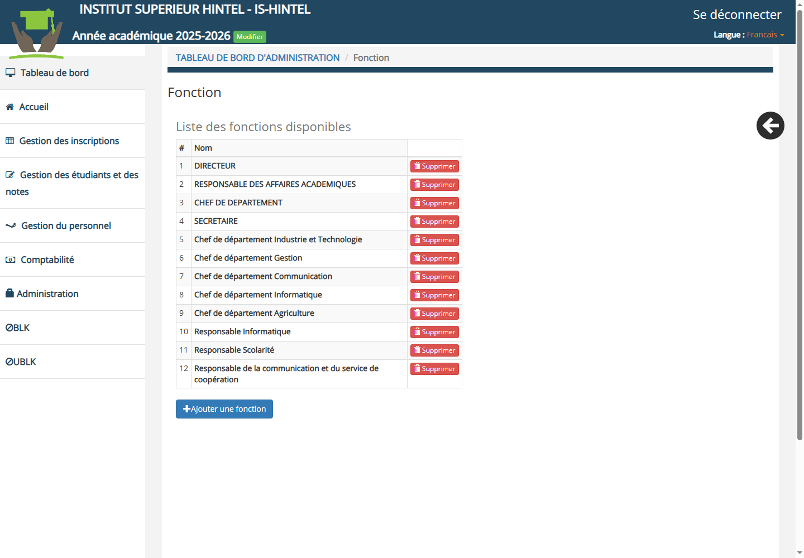

*Figure 10 — Référentiel « Fonctions » : liste et accès aux formulaires.*

### P019 — Retirer une donnée du référentiel : Fonctions

Responsable : Administrateur

Chemin : Administration → Fonctions → ligne concernée → Supprimer

Prérequis : Donnée erronée ou inutilisée identifiée ; décision de retrait validée. Vérifier les affectations des personnels concernés.

1. Retrouver la ligne et contrôler son nom et son rattachement. Ne pas agir sur une ligne simplement parce qu’elle porte un nom proche.
2. Si une correction du libellé suffit, utiliser la modification plutôt qu’un retrait.
3. Utiliser « Supprimer » uniquement lorsqu’il est présent sur cette rubrique et autorisé au compte. Lire la confirmation éventuellement affichée ; annuler si le périmètre est incertain.
4. Après suppression autorisée, rechercher à nouveau la donnée et vérifier les formulaires dépendants. Si l’application refuse le retrait, relever son message et faire contrôler les dépendances.

Point de contrôle : Certaines rubriques ne proposent pas de suppression dans leur écran. Dans ce cas, demander au responsable d’évaluer la correction ; ne pas saisir une adresse de suppression manuellement.

Résultat à contrôler : Le retrait ne laisse pas de parcours métier incohérent.

### P020 — Créer ou modifier : Jours

Responsable : Administrateur

Chemin : Administration → Jours

Prérequis : Connaître le nom du jour et son observation ; vérifier les référentiels de rattachement.

1. Ouvrir la rubrique et rechercher le libellé pour éviter un doublon.
2. Pour créer, utiliser le bouton d’ajout de la rubrique ou le formulaire de création visible. Pour modifier, sélectionner l’action d’édition sur la ligne existante ; conserver le même enregistrement.
3. Renseigner le nom du jour et son observation. Comparer les rattachements avec le parcours approuvé avant de confirmer.
4. Valider, rechercher à nouveau la ligne et vérifier les champs affichés.
5. Ouvrir ensuite un formulaire utilisant cette donnée : elle doit être disponible pour l’organisation des enseignements.

Résultat à contrôler : Le référentiel existe une seule fois et ses dépendances restent cohérentes.

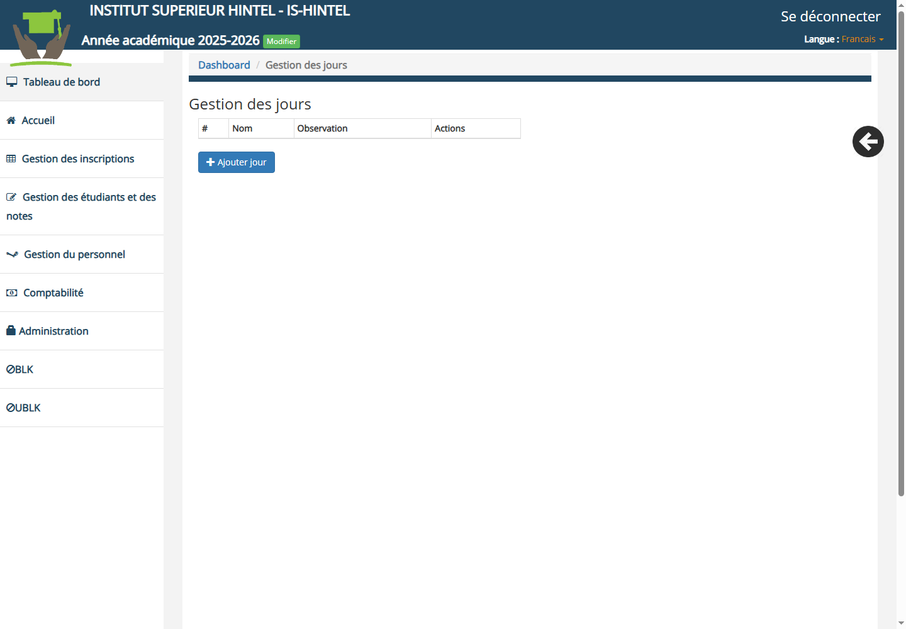

*Figure 11 — Référentiel « Jours » : liste et accès aux formulaires.*

### P021 — Retirer une donnée du référentiel : Jours

Responsable : Administrateur

Chemin : Administration → Jours → ligne concernée → Supprimer

Prérequis : Donnée erronée ou inutilisée identifiée ; décision de retrait validée. Vérifier l’utilisation du jour dans les plannings.

1. Retrouver la ligne et contrôler son nom et son rattachement. Ne pas agir sur une ligne simplement parce qu’elle porte un nom proche.
2. Si une correction du libellé suffit, utiliser la modification plutôt qu’un retrait.
3. Utiliser « Supprimer » uniquement lorsqu’il est présent sur cette rubrique et autorisé au compte. Lire la confirmation éventuellement affichée ; annuler si le périmètre est incertain.
4. Après suppression autorisée, rechercher à nouveau la donnée et vérifier les formulaires dépendants. Si l’application refuse le retrait, relever son message et faire contrôler les dépendances.

Point de contrôle : Certaines rubriques ne proposent pas de suppression dans leur écran. Dans ce cas, demander au responsable d’évaluer la correction ; ne pas saisir une adresse de suppression manuellement.

Résultat à contrôler : Le retrait ne laisse pas de parcours métier incohérent.

### P022 — Créer ou modifier : Horaires

Responsable : Administrateur

Chemin : Administration → Horaires

Prérequis : Connaître l’intervalle, le type cours/pause, le nombre d’heures et le numéro d’ordre ; vérifier les référentiels de rattachement.

1. Ouvrir la rubrique et rechercher le libellé pour éviter un doublon.
2. Pour créer, utiliser le bouton d’ajout de la rubrique ou le formulaire de création visible. Pour modifier, sélectionner l’action d’édition sur la ligne existante ; conserver le même enregistrement.
3. Renseigner l’intervalle, le type cours/pause, le nombre d’heures et le numéro d’ordre. Comparer les rattachements avec le parcours approuvé avant de confirmer.
4. Valider, rechercher à nouveau la ligne et vérifier les champs affichés.
5. Ouvrir ensuite un formulaire utilisant cette donnée : elle doit être disponible pour l’ancien circuit d’emploi du temps.

Résultat à contrôler : Le référentiel existe une seule fois et ses dépendances restent cohérentes.

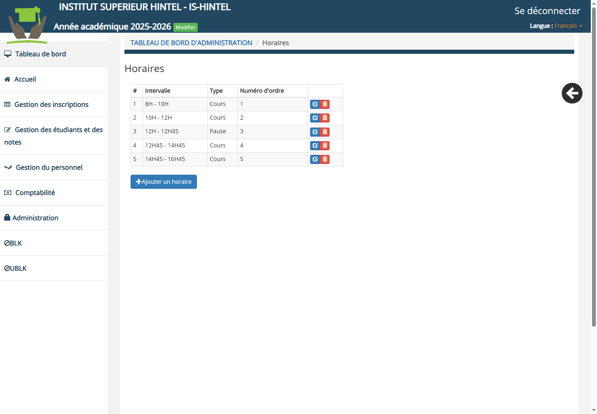

*Figure 12 — Référentiel « Horaires » : liste et accès aux formulaires.*

### P023 — Retirer une donnée du référentiel : Horaires

Responsable : Administrateur

Chemin : Administration → Horaires → ligne concernée → Supprimer

Prérequis : Donnée erronée ou inutilisée identifiée ; décision de retrait validée. Vérifier les cours qui utilisent cet intervalle.

1. Retrouver la ligne et contrôler son nom et son rattachement. Ne pas agir sur une ligne simplement parce qu’elle porte un nom proche.
2. Si une correction du libellé suffit, utiliser la modification plutôt qu’un retrait.
3. Utiliser « Supprimer » uniquement lorsqu’il est présent sur cette rubrique et autorisé au compte. Lire la confirmation éventuellement affichée ; annuler si le périmètre est incertain.
4. Après suppression autorisée, rechercher à nouveau la donnée et vérifier les formulaires dépendants. Si l’application refuse le retrait, relever son message et faire contrôler les dépendances.

Point de contrôle : Certaines rubriques ne proposent pas de suppression dans leur écran. Dans ce cas, demander au responsable d’évaluer la correction ; ne pas saisir une adresse de suppression manuellement.

Résultat à contrôler : Le retrait ne laisse pas de parcours métier incohérent.

### P024 — Créer ou modifier : Frais

Responsable : Administrateur

Chemin : Administration → Frais

Prérequis : Connaître la nature des frais et les autres valeurs demandées par le formulaire ; vérifier les référentiels de rattachement.

1. Ouvrir la rubrique et rechercher le libellé pour éviter un doublon.
2. Pour créer, utiliser le bouton d’ajout de la rubrique ou le formulaire de création visible. Pour modifier, sélectionner l’action d’édition sur la ligne existante ; conserver le même enregistrement.
3. Renseigner la nature des frais et les autres valeurs demandées par le formulaire. Comparer les rattachements avec le parcours approuvé avant de confirmer.
4. Valider, rechercher à nouveau la ligne et vérifier les champs affichés.
5. Ouvrir ensuite un formulaire utilisant cette donnée : elle doit être disponible pour les paiements distincts de la pension.

Résultat à contrôler : Le référentiel existe une seule fois et ses dépendances restent cohérentes.

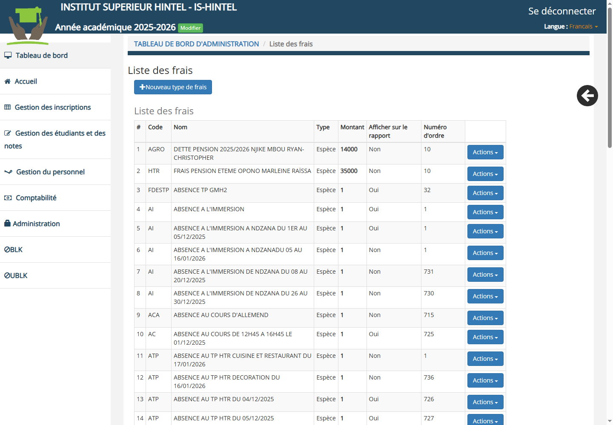

*Figure 13 — Référentiel « Frais » : liste et accès aux formulaires.*

### P025 — Retirer une donnée du référentiel : Frais

Responsable : Administrateur

Chemin : Administration → Frais → ligne concernée → Supprimer

Prérequis : Donnée erronée ou inutilisée identifiée ; décision de retrait validée. Vérifier les paiements déjà rattachés à la catégorie de frais.

1. Retrouver la ligne et contrôler son nom et son rattachement. Ne pas agir sur une ligne simplement parce qu’elle porte un nom proche.
2. Si une correction du libellé suffit, utiliser la modification plutôt qu’un retrait.
3. Utiliser « Supprimer » uniquement lorsqu’il est présent sur cette rubrique et autorisé au compte. Lire la confirmation éventuellement affichée ; annuler si le périmètre est incertain.
4. Après suppression autorisée, rechercher à nouveau la donnée et vérifier les formulaires dépendants. Si l’application refuse le retrait, relever son message et faire contrôler les dépendances.

Point de contrôle : Certaines rubriques ne proposent pas de suppression dans leur écran. Dans ce cas, demander au responsable d’évaluer la correction ; ne pas saisir une adresse de suppression manuellement.

Résultat à contrôler : Le retrait ne laisse pas de parcours métier incohérent.

### P026 — Configurer une tutelle et lui affecter les spécialités

Responsable : Administrateur pédagogique

Chemin : Administration → Tutelles académiques

Prérequis : Identité, faculté, logos et coordonnées officiels ; spécialités déjà créées.

1. Ouvrir le formulaire de tutelle ; saisir nom, ville, ministère, faculté, coordonnées et localisation.
2. Ajouter les logos et les libellés francophones et anglophones utilisés par les documents. Vérifier leur orthographe avec les informations institutionnelles.
3. Valider puis ouvrir « Spécialités » sur la ligne de la tutelle pour préparer ses rattachements.
4. Affecter les spécialités concernées ; vérifier ensuite leurs campus et leurs programmes.
5. Consulter un document de cette tutelle et contrôler les logos, la faculté, les noms, les intitulés de parcours et les signatures attendues.

Résultat à contrôler : La tutelle peut être retrouvée dans le paramétrage des évaluations et les documents.

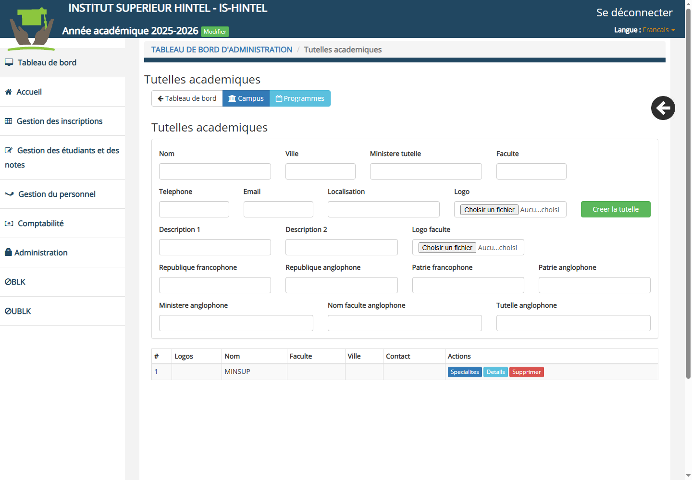

*Figure 14 — Tutelles académiques : identité, logos et accès aux spécialités.*

### P027 — Créer le programme d’une spécialité

Responsable : Administrateur pédagogique

Chemin : Administration → Programme de Spécialité → spécialité → cycle et niveau

Prérequis : Matières, filière, spécialité, cycle et niveau déjà créés ; liste approuvée des matières, codes, semestres, coefficients et barèmes.

1. Ouvrir « Programme de Spécialité », sélectionner la spécialité puis le cycle et le niveau. Vérifier ces trois repères sur l’écran du programme.
2. Dans les matières disponibles, retrouver et sélectionner les enseignements à ajouter au programme.
3. Pour chaque matière retenue, compléter les champs du programme : code, coefficient, maximum, semestre et type selon les colonnes proposées.
4. Contrôler que le semestre et les valeurs correspondent à la maquette de formation, puis valider.
5. Vérifier la liste des matières déjà rattachées. Préparer les groupes de matières ou modules si le programme les utilise.
6. Configurer ensuite les sessions d’examen de ces matières pour l’année et la tutelle avant de demander la saisie des notes.

Résultat à contrôler : Les matières du groupe sont sélectionnables dans les notes et dans les cours.

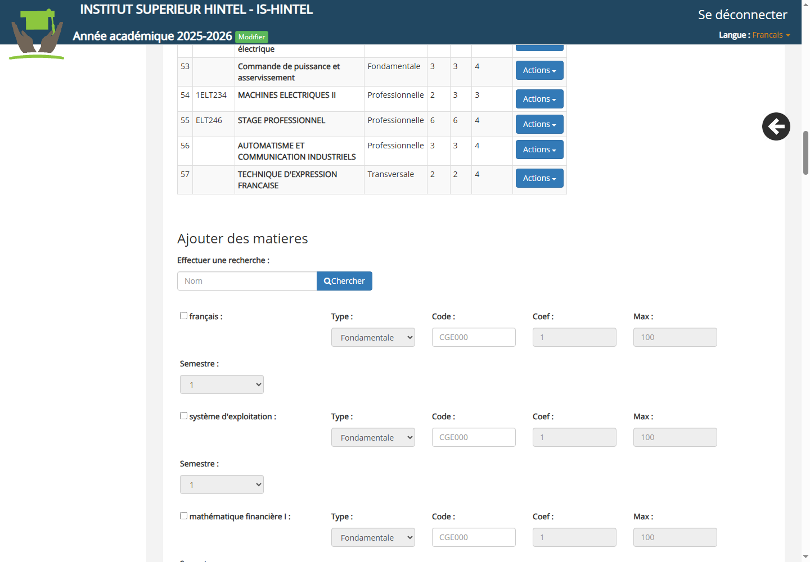

*Figure 15 — Programme : matières rattachées et valeurs utilisées dans les calculs.*

### P028 — Modifier ou retirer une matière du programme

Responsable : Administrateur pédagogique

Chemin : Administration → Programme de Spécialité → même spécialité, cycle et niveau

Prérequis : Programme existant ; impact pédagogique vérifié si des notes sont déjà saisies.

1. Ouvrir exactement le même contexte de programme, puis identifier la matière dans les enseignements rattachés.
2. Pour une correction, utiliser son formulaire d’édition et modifier le code, le semestre, le coefficient ou le maximum attendu, puis valider.
3. Pour un retrait, vérifier l’absence de notes et de cours qui doivent être conservés, puis utiliser l’action de suppression de la ligne de programme si le retrait est autorisé.
4. Contrôler les sessions d’examen et les documents dépendants. Les résultats calculés peuvent évoluer après un changement de programme.
5. Revoir les documents sauvegardés séparément ; une ancienne génération n’est pas nécessairement actualisée par la correction du programme.

Résultat à contrôler : La maquette du parcours reste cohérente avec les données déjà utilisées.

### P029 — Configurer les sessions d’examen d’une matière ou d’une tutelle

Responsable : Administrateur pédagogique

Chemin : Administration → Programme de Spécialité → Sessions ; ou Sessions examens globales

Prérequis : Programme complet ; année de travail vérifiée ; tutelle rattachée à la spécialité ; répartition approuvée des CC, TP, session normale et rattrapage.

1. Pour une matière, ouvrir ses sessions depuis la ligne du programme ; vérifier matière, spécialité, cycle, niveau, année et tutelle.
2. Pour un ensemble de matières, ouvrir « Sessions examens globales », choisir année, tutelle et les filtres de cycle, filière, spécialité, niveau et semestre.
3. Lire les compteurs de programmes ciblés et de sessions existantes avant de préparer une application globale.
4. Renseigner les pondérations de chaque semestre : CC, TP, session normale et rattrapage selon les champs proposés. Une pondération nulle peut rendre une saisie indisponible.
5. Contrôler les règles de calcul approuvées pour la tutelle ; confirmer seulement après vérification du périmètre.
6. Retourner dans les sessions d’une matière du groupe pour vérifier la configuration obtenue, puis ouvrir sa grille de notes.
7. Pour corriger ou retirer une session, revenir à la même matière et à la même année ; vérifier d’abord les notes qui utilisent ces paramètres.

Résultat à contrôler : Les évaluations réellement prévues deviennent utilisables et leurs pondérations sont contrôlées.

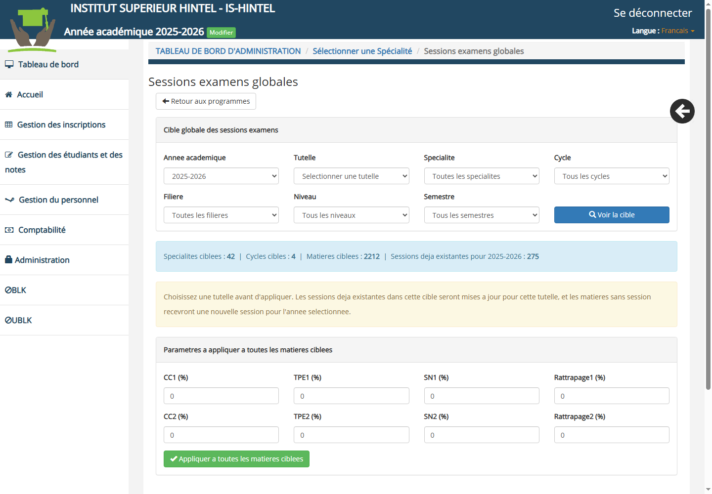

*Figure 16 — Sessions globales : filtres de tutelle et périmètre avant application.*

### P030 — Préparer les tarifs et profils de scolarité

Responsable : Administrateur de la scolarité

Chemin : Administration → Scolarité

Prérequis : Parcours configurés ; montants, tranches et règles ancien/nouveau approuvés.

1. Choisir d’abord « Ancien style de scolarité » ou « Nouveau style de scolarité ». Ce choix organise les profils ; il est distinct du type d’étudiant ancien/nouveau.
2. Afficher les profils du style retenu et ouvrir l’ajout ou la modification du barème concerné.
3. Renseigner le contexte de parcours, les catégories et les montants proposés par le formulaire ; vérifier les tranches et les éventuels frais.
4. Valider puis ouvrir une préparation d’inscription avec le même profil, cycle, spécialité, niveau et type de scolarité.
5. Vérifier le tarif récupéré. Si aucun tarif ne correspond, corriger ce paramétrage avant de continuer l’inscription.

Résultat à contrôler : Le formulaire d’inscription retrouve le barème correspondant.

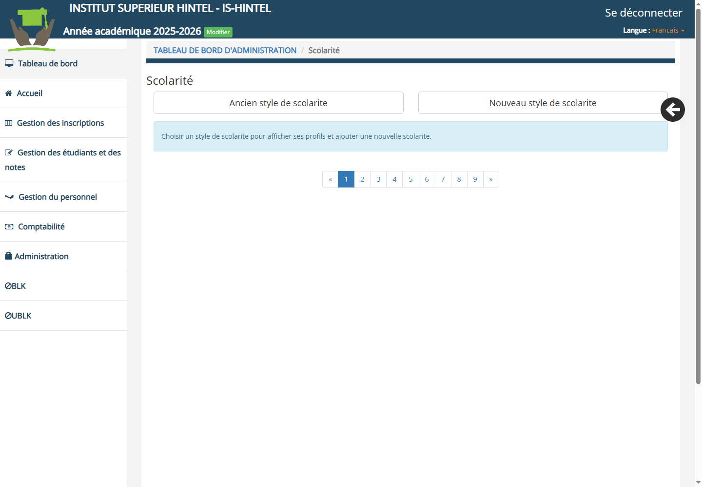

*Figure 17 — Scolarité : choisir le style avant de préparer ou modifier un profil.*

### P031 — Préparer banques, caisses et droits d’encaissement

Responsable : Administrateur financier

Chemin : Administration → Banques / Caisses → Affectations

Prérequis : Campus et utilisateurs existants ; comptes et caisses identifiés.

1. Créer ou vérifier les banques et leurs comptes. Distinguer les comptes par leurs libellés et leurs références.
2. Créer ou modifier les caisses en distinguant entrée et sortie ; vérifier les valeurs de référence proposées par le formulaire.
3. Ouvrir les affectations financières et sélectionner les utilisateurs autorisés pour chaque caisse ou banque.
4. Dans un formulaire de paiement, vérifier que l’agent retrouve la bonne caisse d’entrée ou la bonne banque.
5. Contrôler un état financier du même périmètre. Avant de retirer une source financière, examiner ses mouvements et ses affectations.

Résultat à contrôler : Les paiements peuvent être affectés à une source autorisée et contrôlée.

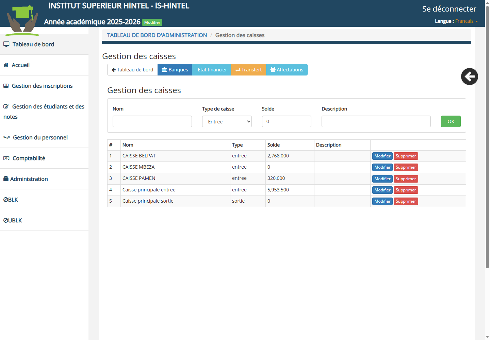

*Figure 18 — Caisses et accès aux affectations.*

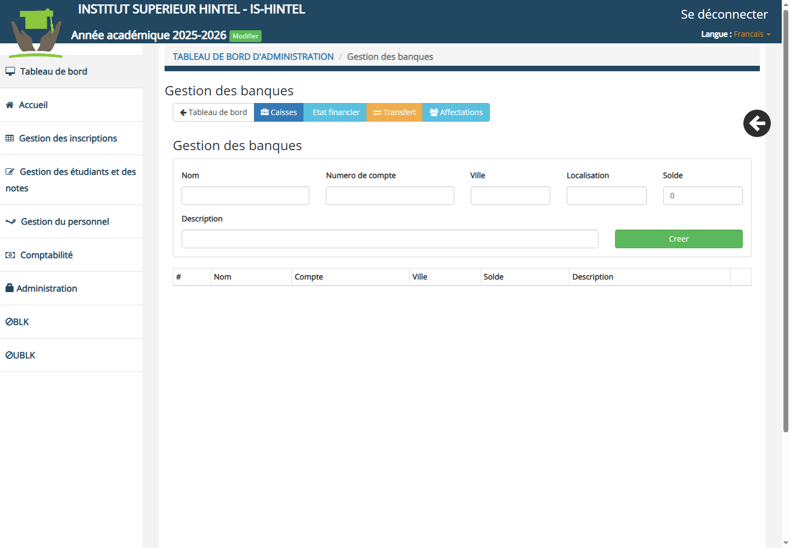

*Figure 19 — Banques et comptes de réception.*

### P032 — Modifier ou retirer un campus, une tutelle ou un tarif

Responsable : Administrateur habilité

Chemin : Administration → Campus / Tutelles académiques / Scolarité

Prérequis : Enregistrement exact identifié ; décisions et dépendances contrôlées.

1. Pour une correction, ouvrir l’édition de la ligne existante ; modifier les libellés, contacts, logos ou montants justifiés et vérifier le résultat dans la liste.
2. Avant de retirer un campus, examiner ses utilisateurs, spécialités, inscriptions et mouvements ; avant de retirer une tutelle, vérifier spécialités, sessions et documents.
3. Avant de retirer un tarif, identifier les inscriptions qui utilisent ce profil ; une modification de tarif peut changer l’interprétation d’une situation financière.
4. Utiliser « Supprimer » sur la ligne uniquement lorsque le retrait est approuvé et disponible, lire la confirmation éventuelle puis vérifier les listes et formulaires dépendants.
5. Si une dépendance empêche le retrait, relever le message et préparer la correction avec le responsable ; ne pas supprimer les dossiers dépendants pour forcer le retrait.

Résultat à contrôler : Le référentiel est corrigé ou retiré avec ses dépendances examinées.

### P033 — Corriger ou retirer une banque ou une caisse

Responsable : Administrateur financier

Chemin : Administration → Banques / Caisses

Prérequis : Source identifiée ; soldes, mouvements et utilisateurs autorisés examinés.

1. Ouvrir l’édition de la bonne source pour corriger son nom ou les informations autorisées.
2. Comparer ses coordonnées et son type entrée/sortie avec l’organisation du service, puis contrôler les formulaires de paiement.
3. Avant une suppression, consulter l’état financier et les affectations de la source.
4. Utiliser l’action « Supprimer » de la ligne seulement après décision du responsable ; vérifier les listes et destinations encore disponibles.
5. Conserver les justificatifs et faire examiner tout mouvement historique qui se rapporte à cette source.

Résultat à contrôler : Les sources financières restent reconnaissables et les opérations peuvent être expliquées.

| Ordre | Créer ou vérifier | Nécessaire pour |
| --- | --- | --- |
| 1 | Campus : identité, sigle, localisation et coordonnées | Reconnaître le site de travail et les en-têtes de documents. |
| 2 | Comptes autorisés, rôles et affectations aux campus | Permettre aux agents d’ouvrir leurs modules. |
| 3 | Année académique de travail | Rattacher inscriptions, notes, tarifs et cours au bon exercice. |
| 4 | Cycles puis niveaux académiques ; filières puis spécialités | Proposer des parcours cohérents dans les formulaires. |
| 5 | Affectations des spécialités aux campus et aux tutelles | Retrouver les bons groupes et la bonne tutelle. |
| 6 | Matières puis programmes : matière, cycle, niveau, semestre, code, coefficient et barème | Saisir des notes, programmer des cours et calculer les résultats. |
| 7 | Sessions d’examen : année, tutelle, programme, pondérations CC/TP/examen/rattrapage | Ouvrir la grille correspondant à une évaluation et calculer ses résultats. |
| 8 | Barèmes de scolarité, profils ancien/nouveau, frais | Déterminer les montants des inscriptions et règlements. |
| 9 | Banques, caisses d’entrée/sortie et affectations des utilisateurs | Recevoir les paiements et tracer les mouvements financiers. |
| 10 | Personnel, fonctions, taux ou salaires ; salles, jours et plages horaires | Affecter les enseignants, établir les emplois du temps et préparer les rémunérations. |
| 11 | Étudiants puis inscriptions annuelles | Constituer les groupes utilisables en scolarité et pédagogie. |
| 12 | Notes contrôlées, délibérations et décision de publication | Produire les PV, relevés, attestations et historiques exploitables. |

## 3. Scolarité — créer, corriger, inscrire et retrouver les dossiers

Dépendances : configuration du campus et du parcours → fiche étudiant → inscription annuelle → paiements, listes et documents. Un étudiant peut être enregistré sans être inscrit dans l’année active. Ne pas recréer sa fiche pour une réinscription.

Les fiches d’identité et les inscriptions doivent être corrigées dans leur formulaire respectif. La modification d’une adresse ou d’un téléphone n’est pas une modification de spécialité ; un changement de parcours se traite dans l’inscription.

### P034 — Rechercher avant toute création

Responsable : Agent de scolarité

Chemin : Gestion des inscriptions → Inscription / Paiement / Opérations sur les étudiants

Prérequis : Nom ou matricule ; campus et année vérifiés.

1. Saisir d’abord le matricule, puis utiliser le nom si nécessaire ; cliquer sur « Chercher ».
2. Comparer nom complet, matricule, date et lieu de naissance.
3. Ouvrir « Actions » sur la ligne exacte ; choisir « Voir/Modifier », « Inscrire », « Ajouter un payement », « Paiement de frais » ou « Liste des versements » selon le besoin.
4. Si le dossier est introuvable, vérifier le campus et l’historique avant de créer une nouvelle identité.

Résultat à contrôler : Le bon dossier est identifié sans doublon.

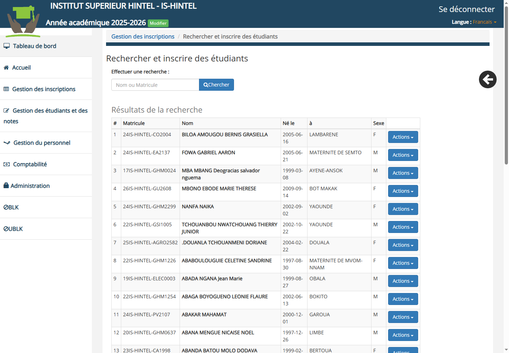

*Figure 20 — Recherche : choisir l’action sur la bonne ligne.*

### P035 — Créer une fiche étudiant puis poursuivre vers l’inscription

Responsable : Agent de scolarité

Chemin : Gestion des inscriptions → Enregistrer un étudiant

Prérequis : Recherche sans dossier correspondant ; pièces d’identité, contacts et informations de scolarité antérieure.

1. Renseigner nom, naissance, sexe, nationalité et résidence en respectant les champs obligatoires.
2. Ajouter les contacts de l’étudiant et la photo lorsqu’elle est disponible.
3. Compléter les études antérieures, le financement et les renseignements complémentaires connus.
4. Faire défiler jusqu’aux sections père, mère et tuteur ; vérifier les contacts et le lien du tuteur.
5. Relire l’ensemble puis confirmer. Vérifier le message de succès.
6. Utiliser l’action d’inscription proposée ou rechercher la fiche puis « Actions → Inscrire ». La fiche seule ne constitue pas l’inscription annuelle.

Résultat à contrôler : L’identité existe ; l’agent poursuit l’inscription sur ce même dossier.

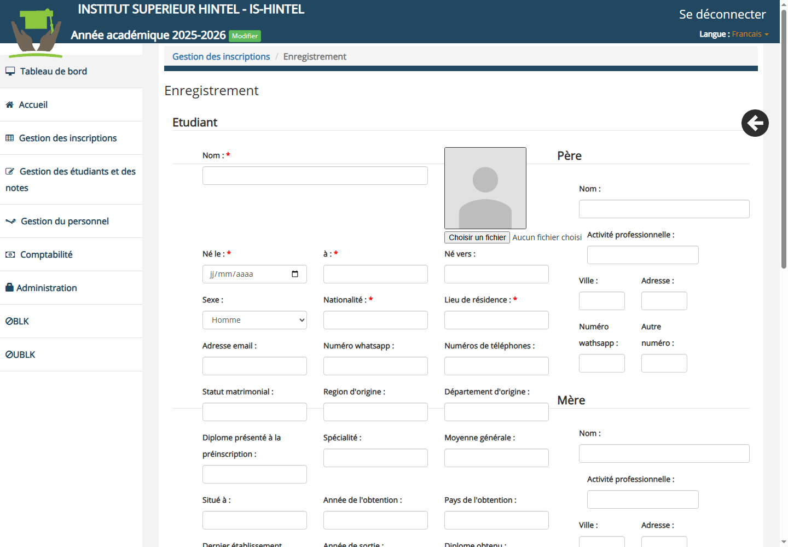

*Figure 21 — Création d’une fiche étudiant ; les sections familiales se trouvent plus bas.*

### P036 — Modifier les renseignements d’un étudiant

Responsable : Agent habilité

Chemin : Recherche étudiant → Actions → Voir/Modifier

Prérequis : Pièce ou demande justifiant la correction ; dossier exact retrouvé.

1. Vérifier le nom et le matricule de la fiche ouverte.
2. Corriger les seuls renseignements concernés : identité, naissance, contacts, photo ou données familiales selon le formulaire.
3. Vérifier les sections situées en bas de page puis confirmer.
4. Rechercher de nouveau le dossier pour contrôler l’information enregistrée.
5. Si la correction concerne une inscription, revenir à son formulaire spécifique plutôt que modifier seulement la fiche.

Résultat à contrôler : La fiche existante est corrigée et l’identité reste unique.

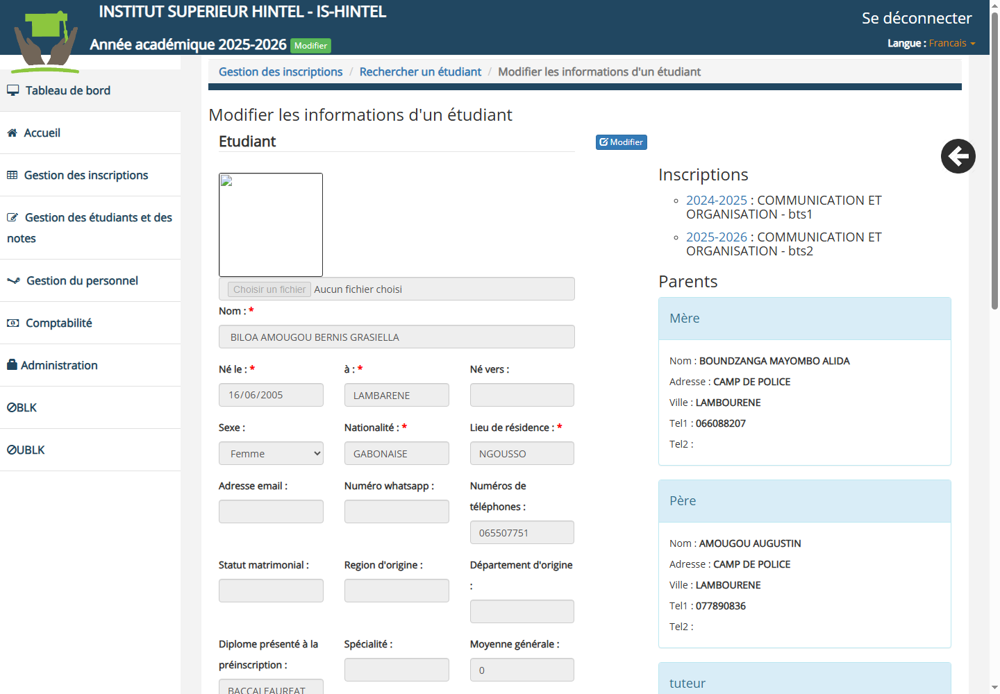

*Figure 22 — Voir/Modifier : identité et informations du dossier existant.*

### P037 — Créer une inscription ou réinscrire pour l’année

Responsable : Agent de scolarité

Chemin : Inscrire un étudiant enregistré → recherche → Actions → Inscrire

Prérequis : Fiche existante ; campus, année, parcours et tarif préparés ; caisse ou banque autorisée si règlement initial.

1. Vérifier l’identité en tête du formulaire.
2. Choisir le style/profil de scolarité, puis cycle, filière, spécialité et niveau académique.
3. Choisir le type de scolarité « Ancien » ou « Nouveau » d’après la situation de l’étudiant ; vérifier le campus affiché.
4. Contrôler le tarif récupéré et les informations de règlement initial proposées. En cas de tarif absent, revenir au paramétrage.
5. Compléter le mode et la source financière nécessaires, relire puis confirmer une seule fois.
6. Vérifier le succès, le matricule et le reçu proposé, puis retrouver l’étudiant dans la liste du parcours.

Résultat à contrôler : L’inscription est rattachée au bon parcours de l’année active.

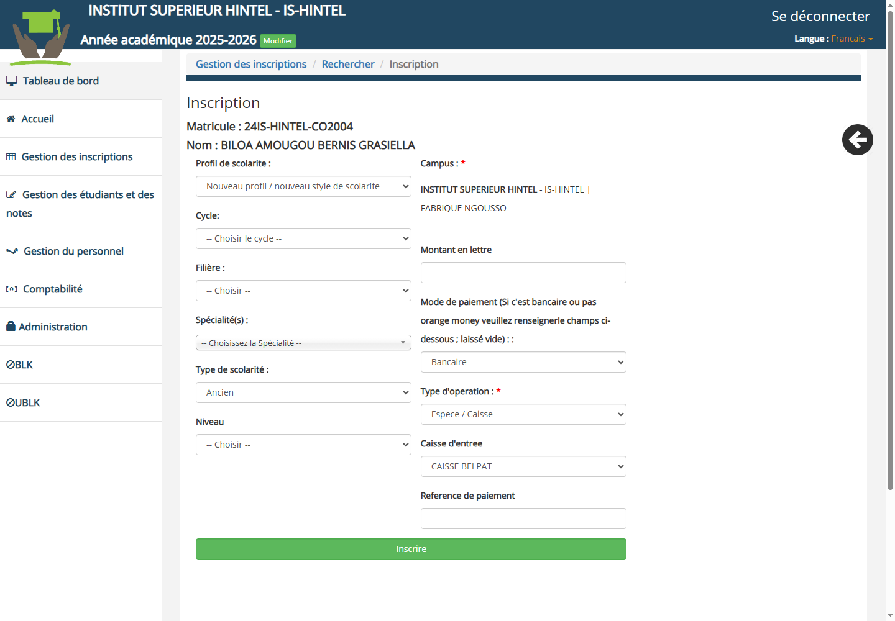

*Figure 23 — Inscription : le profil, le type d’étudiant et le parcours se contrôlent séparément.*

### P038 — Corriger l’inscription annuelle

Responsable : Agent habilité à modifier les inscriptions

Chemin : Dossier inscrit / listes → opération de modification de l’inscription

Prérequis : Inscription de l’année retrouvée ; changement de parcours ou de type approuvé.

1. Retrouver le dossier et l’inscription de l’année active ; vérifier le campus.
2. Ouvrir la modification de l’inscription lorsque l’action est disponible pour le compte.
3. Corriger cycle, filière, spécialité, niveau ou type ancien/nouveau ; contrôler la compatibilité des listes.
4. Valider puis vérifier la liste du groupe de destination.
5. Faire vérifier séparément la scolarité, les versements et les résultats si le changement de parcours a des conséquences sur ces données.

Résultat à contrôler : Le parcours de l’inscription existante est corrigé sans inscription concurrente.

### P039 — Désinscrire puis rétablir une inscription

Responsable : Responsable de scolarité

Chemin : Listes / opérations sur l’étudiant → désinscription ou rétablissement

Prérequis : Étudiant, campus et année vérifiés ; décision administrative.

1. Vérifier que l’action concerne l’inscription de l’année, et non la fiche complète.
2. Utiliser la désinscription prévue par l’interface et confirmer si demandé. Le code marque l’inscription comme désinscrite.
3. Contrôler les listes d’inscrits et de désinscrits.
4. Pour un retour autorisé, utiliser l’action de rétablissement de l’inscription puis contrôler son retour dans la liste.

Point de contrôle : La suppression définitive de la fiche étudiant est une autre action. Son impact sur les inscriptions, notes, parents et paiements doit être examiné par le responsable ; ne pas l’utiliser pour une simple désinscription.

Résultat à contrôler : Le statut annuel est changé ou rétabli sans effacer l’identité.

### P040 — Importer les fiches et les inscriptions en deux étapes

Responsable : Agent habilité aux imports

Chemin : Importer les étudiants ; puis Importer les inscriptions

Prérequis : Modèles téléchargés ; données contrôlées ; parcours et tarifs préparés.

1. Télécharger le modèle des étudiants et compléter les colonnes obligatoires, une ligne par étudiant. Conserver les en-têtes.
2. Contrôler identités, dates, sexe, nationalité et résidence ; choisir le fichier puis importer une seule fois.
3. Lire les résultats et retrouver des fiches importées avant de poursuivre.
4. Télécharger le modèle des inscriptions ; reprendre les identifiants des parcours affichés dans cette installation.
5. Renseigner les étudiants déjà identifiés et les données annuelles ; importer puis vérifier plusieurs inscriptions dans les listes.
6. Corriger les erreurs signalées avant toute reprise. Vérifier ce qui a déjà été enregistré pour éviter une seconde création.

Résultat à contrôler : Les identités sont préparées avant leurs inscriptions annuelles.

### P041 — Afficher une liste de scolarité exploitable

Responsable : Agent de scolarité

Chemin : Gestion des inscriptions → Afficher les listes

Prérequis : Étudiants inscrits ; type de liste et groupe connus.

1. Choisir le type de liste : inscrits, parents, accès, frais, bourses ou désinscrits selon les choix présentés.
2. Sélectionner spécialité, cycle et niveau lorsque demandés ; contrôler le campus et l’année.
3. Afficher et vérifier l’effectif, les identités et les colonnes utiles.
4. Utiliser les commandes d’impression ou d’export effectivement présentes ; ouvrir l’aperçu et vérifier titre, pages et période.
5. Conserver le fichier avec un nom précisant année, groupe et type de liste.

Résultat à contrôler : L’état est identifiable et peut être utilisé par le service destinataire.

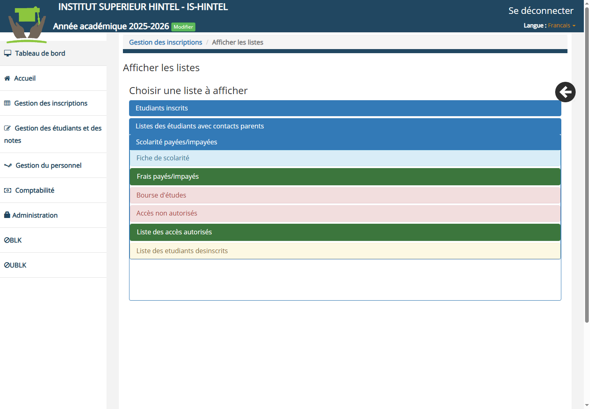

*Figure 24 — Choisir le type de liste avant le groupe.*

### P042 — Retrouver le parcours d’un étudiant et les effectifs

Responsable : Agent de scolarité

Chemin : Historique étudiant ; Effectifs par cycle

Prérequis : Identité retrouvée ; périmètre de comparaison défini.

1. Ouvrir « Historique étudiant », chercher le dossier puis consulter ses différentes années.
2. Distinguer parcours, paiements et résultats disponibles pour chaque inscription.
3. Ouvrir « Effectifs par cycle » pour une vue des groupes ; contrôler l’année et le campus.
4. Comparer ces effectifs à une liste d’inscrits utilisant les mêmes critères.

Résultat à contrôler : Les informations individuelles et les totaux sont rapprochés sur le même périmètre.

### P043 — Préparer photos, cartes, certificats et fiches d’examen

Responsable : Agent de scolarité

Chemin : Gestion des inscriptions → Photos / Cartes / Certificat de scolarité / Fiches

Prérequis : Identités vérifiées ; inscription du groupe ; photos pour les cartes.

1. Pour une photo, ouvrir « Ajouter les photos », choisir la spécialité puis le contexte, sélectionner le fichier pour le bon étudiant et vérifier le résultat.
2. Pour une carte, choisir une spécialité ou rechercher un étudiant ; contrôler photo, nom et matricule avant impression.
3. Pour un certificat, choisir cycle, filière, spécialité et niveau puis « Générer les certificats » ; vérifier l’année et les identités.
4. Pour une fiche de notes ou de présence, ouvrir « Fiches », choisir le type d’évaluation puis le groupe.
5. Vérifier l’aperçu et le nombre de pages avant de conserver ou imprimer le document.

Résultat à contrôler : Le document correspond au bon étudiant ou au bon groupe.

## 4. Versements — encaisser après l’inscription et contrôler les paiements

Dépendances : étudiant inscrit → règlement justifié → caisse ou banque autorisée → reçu → liste des versements et état financier. Le paiement d’inscription initial et les versements ultérieurs ne se saisissent pas nécessairement depuis le même formulaire.

Un montant restant dû, une bourse et un versement ne représentent pas la même information. Le mode de paiement décrit le moyen utilisé ; le type d’opération choisit la source comptable caisse ou banque.

### P044 — Lister les versements d’un étudiant

Responsable : Caissier / agent de scolarité autorisé

Chemin : Recherche étudiant → Actions → Liste des versements

Prérequis : Matricule ou nom ; année et campus du dossier.

1. Ouvrir « Inscription / Paiement / Opérations sur les étudiants » et rechercher le matricule.
2. Vérifier l’identité puis cliquer sur « Actions » sur cette ligne.
3. Choisir « Liste des versements ».
4. Contrôler le nom du dossier, l’année du bandeau, les dates, motifs, numéros et montants des règlements.
5. Ouvrir le reçu d’une ligne lorsque la commande est proposée. Pour une autre année, consulter d’abord « Historique étudiant ».

Résultat à contrôler : Les paiements existants sont consultés sans en créer un nouveau.

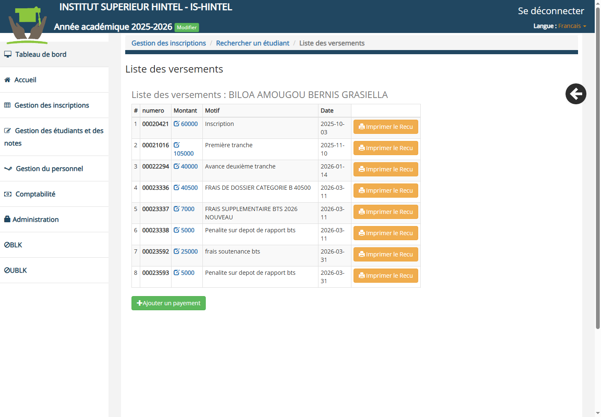

*Figure 25 — Liste des versements : vérifier l’année et le dossier.*

### P045 — Recevoir un paiement après l’inscription

Responsable : Caissier habilité

Chemin : Gestion des inscriptions → Gestion des paiements ; ou recherche étudiant → Actions → Ajouter un payement

Prérequis : Étudiant inscrit ; somme reçue et justificatif ; caisse d’entrée ou banque affectée à l’agent.

1. Rechercher l’étudiant par son matricule et contrôler ses versements déjà enregistrés.
2. Choisir « Ajouter un payement » ; vérifier nom, matricule et campus en tête du formulaire.
3. Renseigner le montant reçu, un motif précis et le montant en lettres lorsqu’il est demandé.
4. Choisir le mode de paiement : bancaire, Orange Money ou espèces, suivant le règlement réel.
5. Choisir le type d’opération : « Espèce / Caisse » ou « Banque ». Pour la caisse, choisir la caisse d’entrée ; pour la banque, choisir le compte et compléter numéro de versement et références.
6. Comparer dossier, montant, justificatif et destination des fonds ; confirmer une seule fois.
7. Revenir à « Liste des versements » pour vérifier la nouvelle ligne, puis contrôler et imprimer le reçu proposé.
8. Consulter l’état de caisse de la même période et de la même source pour rapprocher le mouvement.

Résultat à contrôler : Le paiement ultérieur est rattaché à l’étudiant et à la bonne source financière.

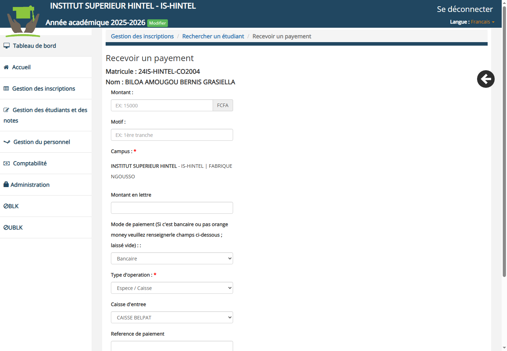

*Figure 26 — Formulaire de paiement après inscription : montant, motif et source.*

### P046 — Recevoir des frais distincts de la pension

Responsable : Caissier habilité

Chemin : Recherche étudiant → Actions → Paiement de frais

Prérequis : Catégorie de frais préparée ; étudiant identifié ; justificatif et source autorisée.

1. Ouvrir « Paiement de frais » sur le bon dossier.
2. Choisir la nature des frais dans la liste proposée et renseigner les éléments financiers demandés.
3. Vérifier le mode, le type d’opération et la caisse ou banque retenue.
4. Confirmer puis consulter les versements et le justificatif pour vérifier l’affectation.

Résultat à contrôler : Le versement est reconnu comme frais spécifiques, distinct de la pension.

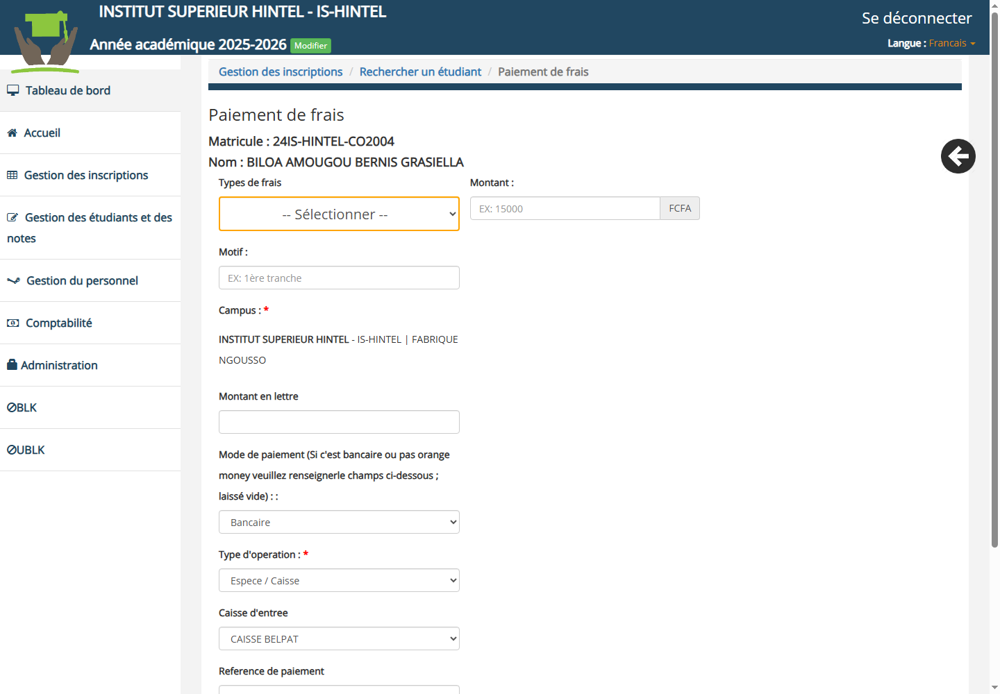

*Figure 27 — Paiement de frais : choisir la bonne nature.*

### P047 — Corriger le montant d’un versement

Responsable : Responsable habilité aux corrections financières

Chemin : Liste des versements → édition de la ligne

Prérequis : Versement identifié par sa référence ; correction justifiée et validée.

1. Retrouver la ligne exacte et comparer étudiant, numéro, date et montant au justificatif.
2. Ouvrir l’édition proposée au compte. Le contrôleur de correction met à jour le montant et le montant en lettres ; il ne constitue pas une correction complète de tous les champs financiers.
3. Renseigner les valeurs justifiées, confirmer puis vérifier la ligne.
4. Faire rapprocher le reçu, la situation de l’étudiant et le mouvement de caisse ou banque par le responsable comptable.

Point de contrôle : La mise à jour du paiement ne garantit pas, à elle seule, un rééquilibrage de tous les mouvements financiers. Le code consulté ne propose pas de suppression opérationnelle d’un versement dans ce contrôleur : ne pas inventer un effacement ou remplacer un paiement par un montant arbitraire.

Résultat à contrôler : La correction est contrôlée sur le dossier et dans les états financiers.

### P048 — Créer, modifier ou retirer une bourse

Responsable : Responsable de scolarité habilité

Chemin : Gestion des inscriptions → Bourse d’études

Prérequis : Décision de bourse ; étudiant et année identifiés.

1. Consulter les bourses existantes pour l’étudiant et l’année.
2. Pour créer, cliquer sur « Créer », choisir l’étudiant et l’année, saisir le montant puis confirmer.
3. Pour corriger, utiliser la modification de la ligne et vérifier année et montant avant validation.
4. Pour retirer, contrôler la décision de retrait puis utiliser « Supprimer » si proposé ; confirmer après vérification de la ligne.
5. Reconsulter la liste et la situation financière de l’étudiant.

Résultat à contrôler : La bourse correspond à la décision applicable à l’année ; elle n’est pas comptabilisée comme espèces reçues.

### P049 — Éditer un état de caisse et préparer un transfert

Responsable : Responsable financier

Chemin : Mon état de caisse / Administration → État caisse/banque → Transfert caisse

Prérequis : Période définie ; sources autorisées ; transfert approuvé si nécessaire.

1. Dans l’état financier, choisir dates, source, caisse ou banque puis afficher.
2. Comparer entrées, sorties, solde de période et solde actuel ; rapprocher les pièces du détail.
3. Pour transférer, ouvrir « Transfert caisse » et choisir le type : caisse vers caisse, caisse vers banque ou banque vers banque.
4. Renseigner source, destination, montant, date, référence et motif ; vérifier les deux destinations avant confirmation.
5. Contrôler les mouvements des deux sources et conserver les justificatifs du transfert.

Résultat à contrôler : Les soldes et les transferts sont expliqués par les mouvements correspondants.

## 5. Notes — préparer, créer, modifier, contrôler et délibérer

Chaîne de dépendances : matière → programme du cycle, niveau et semestre → session d’examen de l’année et de la tutelle → inscription des étudiants → autorisation de l’enseignant → évaluation non verrouillée → saisie des notes → contrôle et documents.

La grille principale sert à la création et à la modification : une valeur est créée si aucune note n’existe pour l’étudiant, la matière, l’évaluation et l’année ; une valeur existante est mise à jour lorsqu’elle change. La saisie principale se fait sur 20 et le logiciel applique la pondération de la session. Ne pas saisir une note déjà pondérée.

### P050 — Créer une note dans le circuit principal

Responsable : Enseignant affecté ou responsable pédagogique autorisé

Chemin : Étudiants et notes → Notes et PV par session → Modifier

Prérequis : Étudiants inscrits dans le groupe ; matière du programme ; session d’examen de l’année avec pondération positive ; évaluation ouverte ; enseignant affecté si le compte est enseignant.

1. Choisir le cycle, le niveau et la filière ; sélectionner la spécialité. Attendre que les listes dépendantes soient chargées.
2. Dans la liste des matières, cliquer sur la matière à évaluer.
3. Dans le choix du type de note, sélectionner CC 1 ou 2, session normale 1 ou 2, TP 1 ou 2, ou le circuit de rattrapage prévu ; confirmer ce choix pour ouvrir la grille.
4. Vérifier l’intitulé de la matière, l’année, le type d’évaluation et le pourcentage affiché.
5. Repérer chaque étudiant et saisir sa note sur 20. Contrôler la liste complète et la feuille validée de l’enseignant.
6. Lorsque la grille propose une case d’activation à côté d’une note, l’utiliser pour rendre la cellule modifiable si nécessaire.
7. Cliquer sur « Confirmer » pour enregistrer les valeurs ; attendre le retour à la liste des matières et le message de résultat.
8. Revenir dans la même évaluation ou dans « Afficher » pour contrôler les valeurs enregistrées. Le responsable vérifiera ensuite les résultats pondérés.

Point de contrôle : Les champs de rattrapage peuvent être désactivés dans la grille principale. Ne pas les contourner : utiliser le circuit de rattrapage ou la délibération prévu par le responsable.

Résultat à contrôler : Les notes du bon groupe et de la bonne évaluation sont enregistrées.

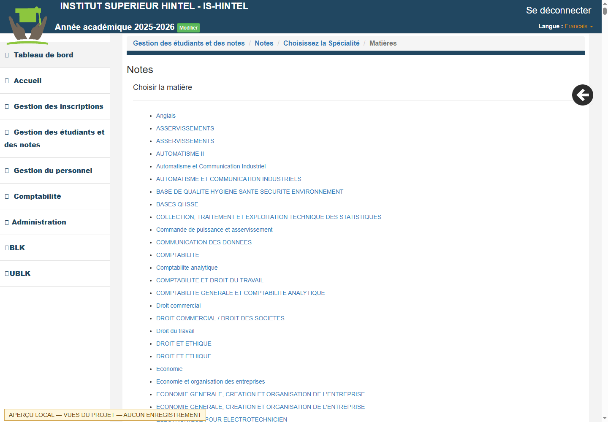

*Figure 28 — Aperçu local de la liste des matières du groupe ; aucune note enregistrée.*

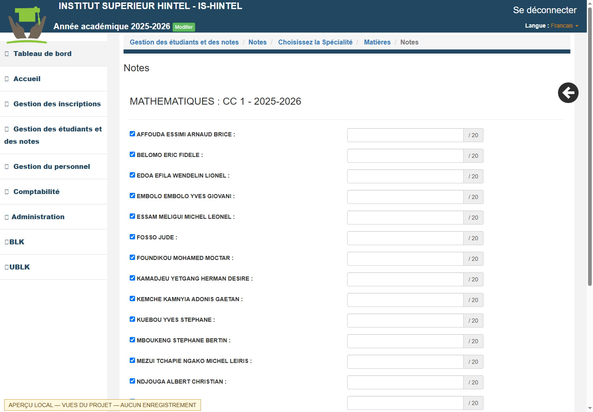

*Figure 29 — Aperçu local de la grille de saisie. Les verrous réels doivent être ouverts par le responsable avant utilisation.*

### P051 — Modifier une note déjà saisie

Responsable : Enseignant affecté ou responsable pédagogique habilité

Chemin : Notes et PV par session → Modifier → même groupe → même matière → même type de note

Prérequis : Correction de note approuvée ; contexte d’origine retrouvé ; évaluation non verrouillée.

1. Reprendre exactement campus, année, cycle, niveau, spécialité, matière et évaluation de la saisie initiale.
2. Ouvrir la grille : les notes existantes apparaissent dans les cellules. Vérifier le nom de l’étudiant à corriger.
3. Corriger la valeur sur 20 ; relire les autres valeurs avant validation de la grille.
4. Cliquer sur « Confirmer », puis rouvrir la même évaluation et vérifier la valeur.
5. Contrôler le résultat dans l’affichage des notes. Si un PV, un relevé ou une attestation a déjà été produit, examiner les documents concernés avant leur nouvelle diffusion.

Point de contrôle : Vider une cellule ne supprime pas une note : le contrôleur principal ignore les valeurs vides ou non numériques. La grille ne propose pas de suppression générale de notes visible. Ne pas remplacer une note par zéro pour simuler une suppression.

Résultat à contrôler : La note existante est corrigée ; les documents dépendants sont identifiés.

### P052 — Traiter une grille qui ne s’ouvre pas

Responsable : Responsable pédagogique

Chemin : Administration → Programme / Sessions / Verrouiller les notes

Prérequis : Contexte exact signalé par l’enseignant.

1. Vérifier que l’étudiant est inscrit dans le groupe de l’année active et que la matière figure dans le programme du cycle et du niveau.
2. Vérifier l’existence d’une session d’examen pour cette matière et cette année, et la pondération de l’évaluation choisie.
3. Vérifier le verrou de modification de cette évaluation. Ouvrir ou fermer la saisie selon la décision pédagogique.
4. Si le compte est enseignant, vérifier son affectation à la matière et au groupe.
5. Réessayer la même sélection après correction du paramètre manquant ; ne pas saisir dans une autre année ou une autre matière pour contourner le refus.

Résultat à contrôler : La cause du refus est traitée sans altérer le contexte des notes.

### P053 — Saisir dans un circuit Soa, Ngaoundéré ou Ebolowa

Responsable : Agent pédagogique habilité

Chemin : Étudiants et notes → Notes de Soa / Notes de Ngaoundéré / Notes et PV Ebolowa → Modifier

Prérequis : Tutelle et circuit confirmés ; programme et étudiants du groupe.

1. Choisir le circuit de la tutelle demandé par le responsable.
2. Cliquer sur « Modifier », sélectionner la spécialité et les paramètres de cycle et niveau.
3. Choisir la matière puis l’évaluation présentée par ce circuit.
4. Lire le barème de la grille ; reporter les notes selon ce barème, puis confirmer.
5. Reprendre « Afficher » dans ce même circuit pour vérifier les résultats.
6. Si le lien Ebolowa ouvre le circuit général, faire confirmer le circuit actif avant saisie : plusieurs routes du projet utilisent des chemins proches.

Point de contrôle : Ne pas transposer automatiquement le barème ou les choix de la grille principale dans un ancien circuit. Vérifier le libellé et le maximum affichés.

Résultat à contrôler : La note est saisie dans le circuit attendu par la tutelle.

### P054 — Importer les notes d’une spécialité

Responsable : Responsable autorisé aux imports

Chemin : Étudiants et notes → Importer les notes → Importer notes sur la spécialité

Prérequis : Mêmes prérequis que la saisie ; fichier issu du modèle de la spécialité.

1. Filtrer le contexte, puis cliquer sur « Importer notes » sur la bonne spécialité.
2. Télécharger le modèle de ce contexte ; repérer les identifiants de programmes et de sessions affichés.
3. Compléter les matricules et les valeurs attendues, sans changer les en-têtes ; vérifier année, matière et session.
4. Relire le fichier avec la feuille de référence puis lancer l’import une seule fois.
5. Lire les résultats et les lignes rejetées ; consulter ensuite plusieurs notes dans la grille ou l’affichage pour vérifier le contenu.
6. Avant de reprendre un import corrigé, vérifier ce qui a déjà été enregistré.

Résultat à contrôler : Les notes sont importées puis vérifiées dans leur contexte pédagogique.

### P055 — Afficher les notes et préparer une délibération

Responsable : Responsable pédagogique / jury

Chemin : Notes et PV par session → Afficher → groupe → Délibérations

Prérequis : Notes contrôlées ; semestre et mode normal ou rattrapage connus ; décisions du jury disponibles.

1. Ouvrir l’affichage du groupe avec le cycle et le niveau adéquats.
2. Examiner les matières et choisir l’évaluation ou les résultats du semestre.
3. Ouvrir la délibération correspondant au semestre et au mode demandé.
4. Relire les étudiants et les valeurs ; préparer uniquement les décisions approuvées.
5. Appliquer les décisions avec les droits adaptés puis contrôler l’affichage des résultats et les documents concernés.

Résultat à contrôler : La décision est rattachée au bon étudiant et au bon semestre.

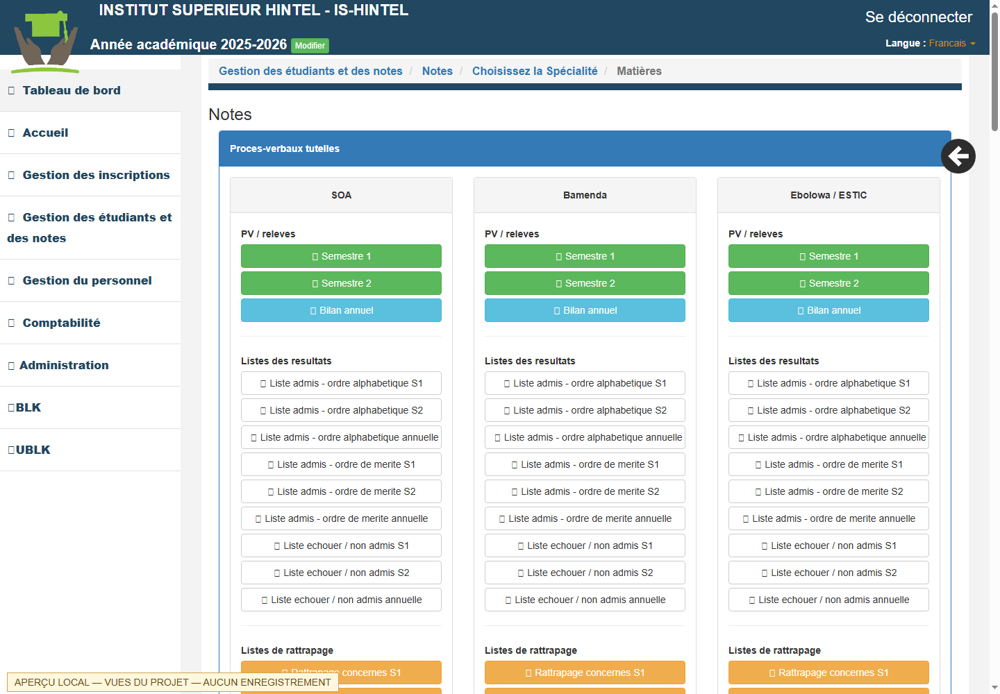

*Figure 30 — Affichage du groupe : accès aux résultats, formats de PV et délibérations.*

| Besoin | Point d’entrée | Contrôle préalable |
| --- | --- | --- |
| Saisir ou corriger | Notes et PV par session → Modifier | Programme, session, pondération, droits et verrou. |
| Afficher et produire un PV | Notes et PV par session → Afficher | Même contexte de groupe et format de tutelle. |
| Importer | Importer les notes → spécialité | Modèle, identifiants et session de la spécialité. |
| Délibérer | Affichage du groupe → Délibérations | Décision du jury et périmètre de semestre. |
| Relevé ou attestation | Circuit de document de la tutelle | Notes contrôlées et conditions d’admission. |

## 6. PV, relevés, attestations et historiques — procédure par tutelle

Les captures de modèles présentées ici proviennent des vues du projet rendues localement sans enregistrer de génération dans la base. Les exemples de PV et de relevés servent à reconnaître les formats ; leur groupe d’illustration ne certifie pas un rattachement administratif à une tutelle. Les attestations portent un étudiant fictif clairement nommé « EXEMPLE PÉDAGOGIQUE » ; elles ne constituent pas des attestations délivrées.

Les historiques ont été capturés dans la session réelle. Une liste vide signifie qu’aucune génération du format n’a été trouvée dans la base consultée ; elle n’est pas remplie artificiellement pour illustrer le guide.

Attention au circuit principal des PV : la commande « Générer le PV » et certaines ouvertures de résultats enregistrent un historique automatiquement. Le code de visualisation d’un ancien PV redirige vers le calcul à partir des notes actuelles ; il ne constitue donc pas, dans cette version, une garantie de copie figée. Pour conserver une pièce validée, sauvegarder aussi le PDF validé.

### P056 — Afficher et générer un PV — BTS

Responsable : Responsable pédagogique

Chemin : Étudiants et notes → Notes et PV par session → Afficher → groupe → Génération des procès-verbaux

Prérequis : Programme et sessions de la tutelle configurés ; groupe inscrit ; notes et décisions contrôlées ; format BTS applicable au groupe.

1. Sélectionner cycle, niveau, filière et spécialité dans « Afficher ».
2. Dans « Visualiser / générer un PV », choisir semestre 1, semestre 2 ou bilan annuel.
3. Choisir le format « BTS / Francophone ». Renseigner les dates de période si elles sont nécessaires à l’état.
4. Contrôler le périmètre puis utiliser « Générer le PV ». Cette commande peut ajouter une génération à l’historique.
5. Vérifier l’en-tête de tutelle, l’année, le groupe, les matières, crédits ou coefficients, notes, moyennes et décisions.
6. Utiliser l’impression du document, vérifier format papier et orientation, puis enregistrer le PDF validé avec un nom identifiant groupe, année, semestre et tutelle.

Résultat à contrôler : Le PV BTS est contrôlé et exploitable pour la validation pédagogique.

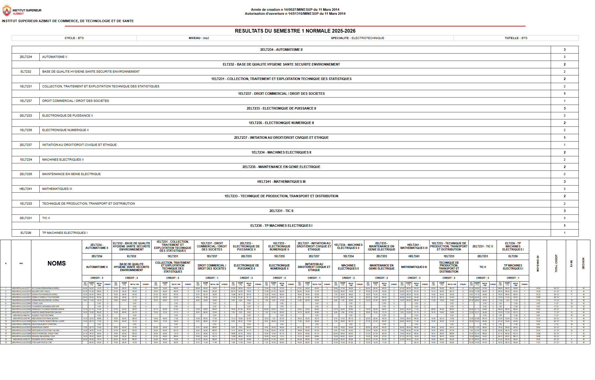

*Figure 31 — Aperçu du modèle de PV BTS — rendu local sans génération sauvegardée.*

### P057 — Afficher puis sauvegarder des relevés — BTS

Responsable : Responsable pédagogique

Chemin : Étudiants et notes → Releves de notes BTS par session

Prérequis : Tutelle et groupe configurés ; notes validées ; année et période connues.

1. Ouvrir « Releves de notes BTS par session » et vérifier le campus et l’année du bandeau.
2. Choisir le cycle et le niveau, puis la filière et la spécialité.
3. Utiliser l’action d’affichage ou de génération proposée. Dans la fenêtre de génération, contrôler le groupe, le semestre lorsqu’il est demandé et la période.
4. Pour un simple aperçu, utiliser l’affichage disponible. Pour conserver une génération, choisir explicitement « Générer et sauvegarder » ou « Generate and save » selon le circuit.
5. Vérifier les identités, notes, mentions, crédits, en-têtes et signatures attendues avant diffusion.
6. Après sauvegarde, ouvrir l’historique de ce même format pour retrouver la génération ; enregistrer le PDF validé.

Résultat à contrôler : Le relevé BTS est affiché dans son format, puis sauvegardé seulement si l’archivage est demandé.

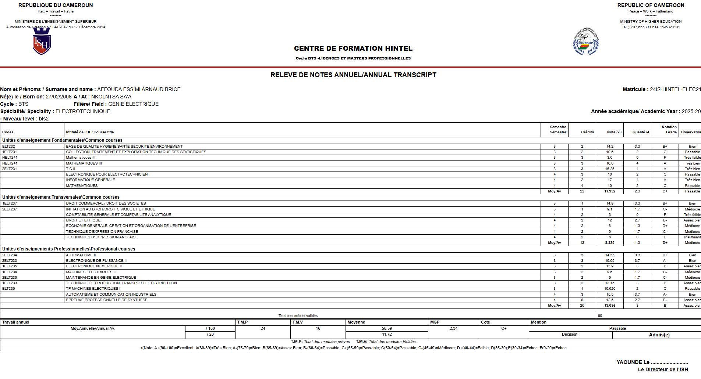

*Figure 32 — Aperçu local du relevé BTS — aucune génération sauvegardée.*

### P058 — Rechercher, ouvrir et gérer l’historique des relevés — BTS

Responsable : Agent habilité à consulter les résultats

Chemin : Releves de notes BTS par session → Historique 

Prérequis : Au moins une génération sauvegardée pour trouver un résultat ; année et groupe recherchés.

1. Ouvrir le lien d’historique depuis la page du format BTS.
2. Utiliser les filtres disponibles ou le champ de recherche ; retrouver année, spécialité, cycle, niveau et période.
3. Comparer la date de génération et le nombre de relevés. Une ligne à zéro doit être examinée avant diffusion.
4. Choisir « Ouvrir / imprimer » sur la bonne ligne ; vérifier le contenu avant réimpression.
5. Pour corriger le contenu, revenir aux données sources et produire une nouvelle génération autorisée ; ne pas tenter de modifier une cellule du tableau d’historique.
6. Si « Supprimer » est présent, vérifier la ligne et la décision de retrait avant confirmation. La suppression vise cette génération sauvegardée ; elle ne constitue pas une suppression des notes sources.

Résultat à contrôler : Le document est retrouvé dans l’historique propre à BTS.

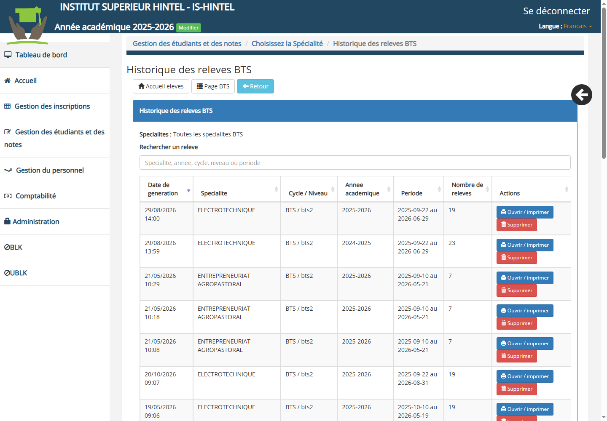

*Figure 33 — Historique réel des relevés BTS ; une liste vide est conservée telle quelle.*

### P059 — Afficher et générer un PV — HND

Responsable : Responsable pédagogique

Chemin : Étudiants et notes → Notes et PV par session → Afficher → groupe → Génération des procès-verbaux

Prérequis : Programme et sessions de la tutelle configurés ; groupe inscrit ; notes et décisions contrôlées ; format HND applicable au groupe.

1. Sélectionner cycle, niveau, filière et spécialité dans « Afficher ».
2. Dans « Visualiser / générer un PV », choisir semestre 1, semestre 2 ou bilan annuel.
3. Choisir le format « HND / Anglophone ». Renseigner les dates de période si elles sont nécessaires à l’état.
4. Contrôler le périmètre puis utiliser « Générer le PV ». Cette commande peut ajouter une génération à l’historique.
5. Vérifier l’en-tête de tutelle, l’année, le groupe, les matières, crédits ou coefficients, notes, moyennes et décisions.
6. Utiliser l’impression du document, vérifier format papier et orientation, puis enregistrer le PDF validé avec un nom identifiant groupe, année, semestre et tutelle.

Résultat à contrôler : Le PV HND est contrôlé et exploitable pour la validation pédagogique.

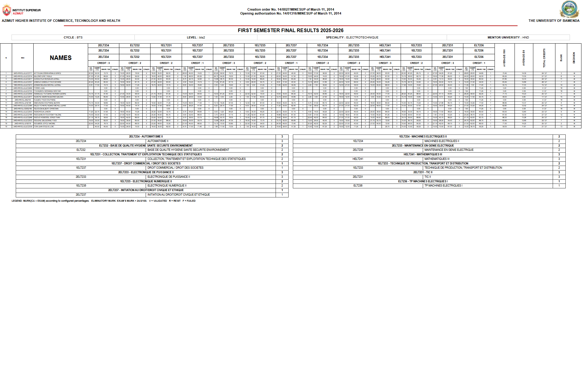

*Figure 34 — Aperçu du modèle de PV HND — rendu local sans génération sauvegardée.*

### P060 — Afficher et générer un PV — Soa

Responsable : Responsable pédagogique

Chemin : Étudiants et notes → Notes et PV par session → Afficher → groupe → Génération des procès-verbaux

Prérequis : Programme et sessions de la tutelle configurés ; groupe inscrit ; notes et décisions contrôlées ; format Soa applicable au groupe.

1. Sélectionner cycle, niveau, filière et spécialité dans « Afficher ».
2. Dans « Visualiser / générer un PV », choisir semestre 1, semestre 2 ou bilan annuel.
3. Choisir le format « Licence / Soa ». Renseigner les dates de période si elles sont nécessaires à l’état.
4. Contrôler le périmètre puis utiliser « Générer le PV ». Cette commande peut ajouter une génération à l’historique.
5. Vérifier l’en-tête de tutelle, l’année, le groupe, les matières, crédits ou coefficients, notes, moyennes et décisions.
6. Utiliser l’impression du document, vérifier format papier et orientation, puis enregistrer le PDF validé avec un nom identifiant groupe, année, semestre et tutelle.

Résultat à contrôler : Le PV Soa est contrôlé et exploitable pour la validation pédagogique.

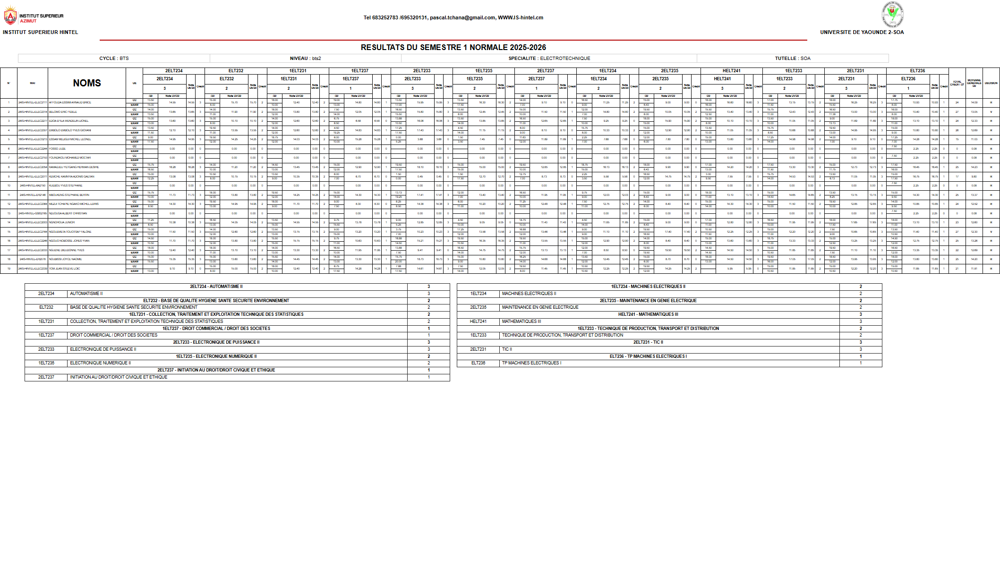

*Figure 35 — Aperçu du modèle de PV Soa — rendu local sans génération sauvegardée.*

### P061 — Afficher puis sauvegarder des relevés — Soa

Responsable : Responsable pédagogique

Chemin : Étudiants et notes → Relevé de notes Soa

Prérequis : Tutelle et groupe configurés ; notes validées ; année et période connues.

1. Ouvrir « Relevé de notes Soa » et vérifier le campus et l’année du bandeau.
2. Choisir le cycle et le niveau, puis la filière et la spécialité.
3. Utiliser l’action d’affichage ou de génération proposée. Dans la fenêtre de génération, contrôler le groupe, le semestre lorsqu’il est demandé et la période.
4. Pour un simple aperçu, utiliser l’affichage disponible. Pour conserver une génération, choisir explicitement « Générer et sauvegarder » ou « Generate and save » selon le circuit.
5. Vérifier les identités, notes, mentions, crédits, en-têtes et signatures attendues avant diffusion.
6. Après sauvegarde, ouvrir l’historique de ce même format pour retrouver la génération ; enregistrer le PDF validé.

Point de contrôle : L’écran de sélection Soa a bloqué le navigateur lors de la visite initiale. Le modèle peut être rendu localement ; le parcours de sélection interactif reste à vérifier après correction.

Résultat à contrôler : Le relevé Soa est affiché dans son format, puis sauvegardé seulement si l’archivage est demandé.

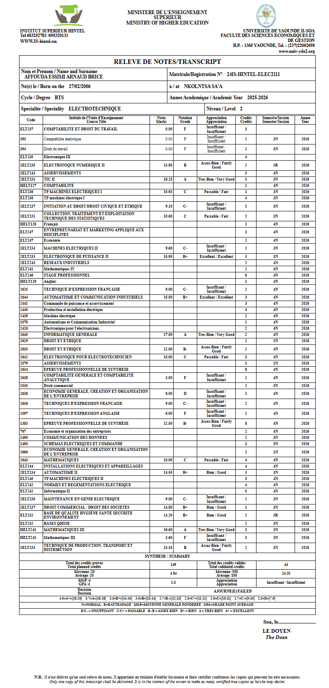

*Figure 36 — Aperçu local du relevé Soa — aucune génération sauvegardée.*

### P062 — Rechercher, ouvrir et gérer l’historique des relevés — Soa

Responsable : Agent habilité à consulter les résultats

Chemin : Relevé de notes Soa → Historique 

Prérequis : Au moins une génération sauvegardée pour trouver un résultat ; année et groupe recherchés.

1. Ouvrir le lien d’historique depuis la page du format Soa.
2. Utiliser les filtres disponibles ou le champ de recherche ; retrouver année, spécialité, cycle, niveau et période.
3. Comparer la date de génération et le nombre de relevés. Une ligne à zéro doit être examinée avant diffusion.
4. Choisir « Ouvrir / imprimer » sur la bonne ligne ; vérifier le contenu avant réimpression.
5. Pour corriger le contenu, revenir aux données sources et produire une nouvelle génération autorisée ; ne pas tenter de modifier une cellule du tableau d’historique.
6. Si « Supprimer » est présent, vérifier la ligne et la décision de retrait avant confirmation. La suppression vise cette génération sauvegardée ; elle ne constitue pas une suppression des notes sources.

Point de contrôle : Aucune route de suppression de relevé Soa n’a été identifiée dans les routes actives consultées. Si le bouton est absent ou ne fonctionne pas, demander une intervention technique ; ne pas transposer l’action d’un autre format.

Résultat à contrôler : Le document est retrouvé dans l’historique propre à Soa.

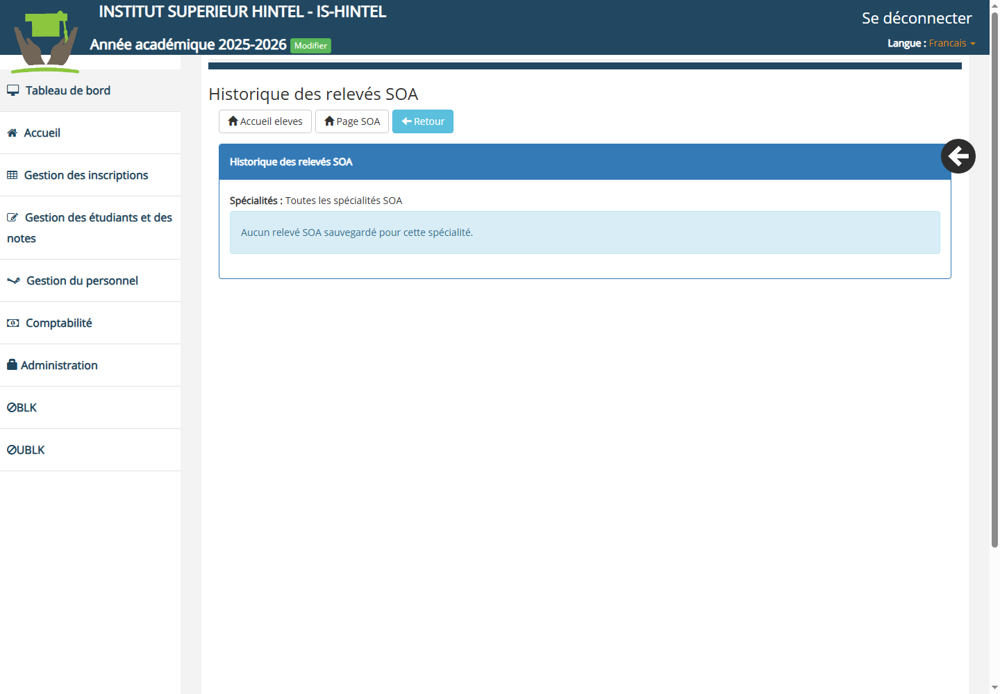

*Figure 37 — Historique réel des relevés Soa ; une liste vide est conservée telle quelle.*

### P063 — Générer et afficher une attestation de réussite — Soa

Responsable : Responsable pédagogique habilité

Chemin : Étudiants et notes → Attestations de réussite Soa

Prérequis : Étudiant admis selon les résultats et règles du programme ; données d’identité contrôlées ; notes et relevés de la tutelle vérifiés.

1. Ouvrir le circuit d’attestation Soa ; choisir cycle, niveau, filière puis spécialité.
2. Ouvrir la fenêtre « Générer les attestations » et contrôler le groupe et les dates de période.
3. Vérifier les résultats d’admission avant de confirmer la génération. Le logiciel sauvegarde une génération d’attestations.
4. Ouvrir les attestations proposées ; contrôler identité, naissance, matricule, diplôme, spécialité, année, moyenne, mention et signatures attendues.
5. Si aucune attestation n’est produite, vérifier les résultats et l’admissibilité du groupe avant toute nouvelle tentative.
6. Conserver le PDF validé ou imprimer après vérification du format A4/A3 proposé.

Résultat à contrôler : Les attestations produites correspondent aux étudiants admis du groupe et à la bonne tutelle.

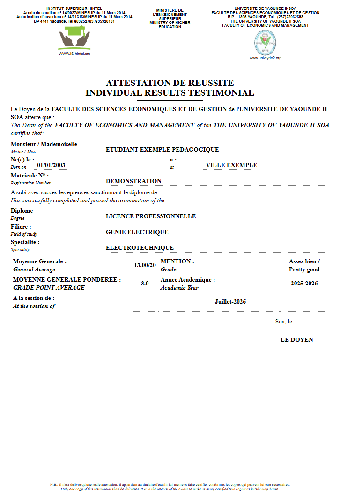

*Figure 38 — Modèle d’attestation Soa — exemple pédagogique à identité et résultats fictifs, non délivré.*

### P064 — Consulter ou supprimer un historique d’attestations — Soa

Responsable : Responsable pédagogique habilité

Chemin : Attestations de réussite Soa → Historique

Prérequis : Génération recherchée identifiée ; autorisation de retrait si suppression.

1. Ouvrir l’historique depuis le circuit d’attestation Soa.
2. Rechercher la spécialité et l’année ; comparer cycle, niveau, période, date et nombre d’attestations.
3. Choisir « Ouvrir / imprimer » pour la bonne ligne, puis vérifier les documents.
4. En cas de correction, corriger l’identité ou les résultats sources et produire une nouvelle génération approuvée.
5. Pour retirer l’historique, utiliser « Supprimer » sur la ligne exacte et lire la confirmation ; contrôler ensuite la liste.
6. Conserver la traçabilité des PDF déjà délivrés : supprimer un historique ne retire pas les copies déjà remises.

Point de contrôle : Dans cette version, l’ouverture d’une génération d’attestation vide peut tenter de la reconstruire à partir des données disponibles. Une réouverture ne doit donc pas être assimilée sans contrôle à la consultation d’un fichier PDF immuable.

Résultat à contrôler : L’historique propre aux attestations Soa est utilisé correctement.

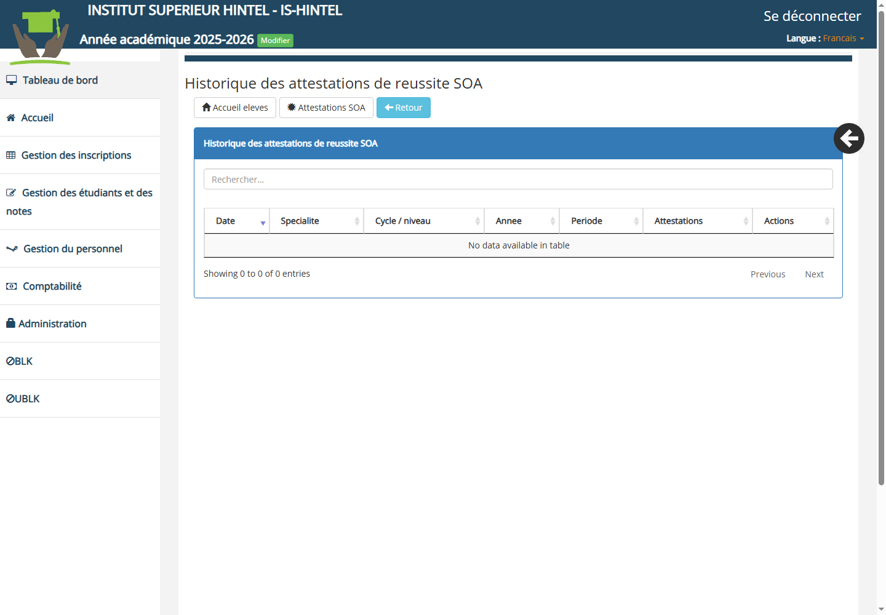

*Figure 39 — Historique réel des attestations Soa.*

### P065 — Afficher et générer un PV — Ngaoundéré

Responsable : Responsable pédagogique

Chemin : Étudiants et notes → Notes et PV par session → Afficher → groupe → Génération des procès-verbaux

Prérequis : Programme et sessions de la tutelle configurés ; groupe inscrit ; notes et décisions contrôlées ; format Ngaoundéré applicable au groupe.

1. Sélectionner cycle, niveau, filière et spécialité dans « Afficher ».
2. Dans « Visualiser / générer un PV », choisir semestre 1, semestre 2 ou bilan annuel.
3. Choisir le format « Licence / Ngaoundéré ». Renseigner les dates de période si elles sont nécessaires à l’état.
4. Contrôler le périmètre puis utiliser « Générer le PV ». Cette commande peut ajouter une génération à l’historique.
5. Vérifier l’en-tête de tutelle, l’année, le groupe, les matières, crédits ou coefficients, notes, moyennes et décisions.
6. Utiliser l’impression du document, vérifier format papier et orientation, puis enregistrer le PDF validé avec un nom identifiant groupe, année, semestre et tutelle.

Résultat à contrôler : Le PV Ngaoundéré est contrôlé et exploitable pour la validation pédagogique.

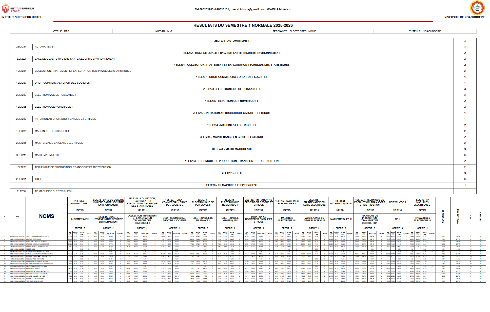

*Figure 40 — Aperçu du modèle de PV Ngaoundéré — rendu local sans génération sauvegardée.*

### P066 — Afficher puis sauvegarder des relevés — Ngaoundéré

Responsable : Responsable pédagogique

Chemin : Étudiants et notes → Releve de notes Ngaoundere

Prérequis : Tutelle et groupe configurés ; notes validées ; année et période connues.

1. Ouvrir « Releve de notes Ngaoundere » et vérifier le campus et l’année du bandeau.
2. Choisir le cycle et le niveau, puis la filière et la spécialité.
3. Utiliser l’action d’affichage ou de génération proposée. Dans la fenêtre de génération, contrôler le groupe, le semestre lorsqu’il est demandé et la période.
4. Pour un simple aperçu, utiliser l’affichage disponible. Pour conserver une génération, choisir explicitement « Générer et sauvegarder » ou « Generate and save » selon le circuit.
5. Vérifier les identités, notes, mentions, crédits, en-têtes et signatures attendues avant diffusion.
6. Après sauvegarde, ouvrir l’historique de ce même format pour retrouver la génération ; enregistrer le PDF validé.

Point de contrôle : La vue perso.header_releve_tutelle manque dans cette installation : l’affichage final des relevés Ngaoundéré doit être rétabli avant la formation pratique. Ne pas utiliser un relevé d’une autre tutelle pour remplacer ce document.

Résultat à contrôler : Le relevé Ngaoundéré est affiché dans son format, puis sauvegardé seulement si l’archivage est demandé.

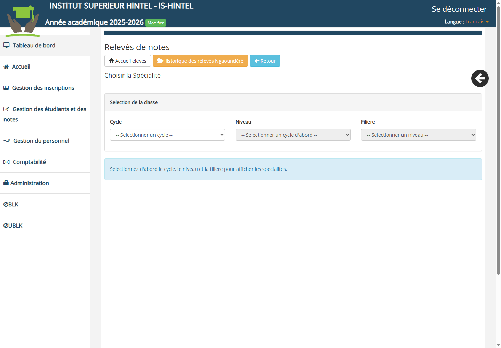

*Figure 41 — Sélection des relevés Ngaoundéré ; l’aperçu final est actuellement bloqué par une vue d’en-tête manquante.*

### P067 — Rechercher, ouvrir et gérer l’historique des relevés — Ngaoundéré

Responsable : Agent habilité à consulter les résultats

Chemin : Releve de notes Ngaoundere → Historique 

Prérequis : Au moins une génération sauvegardée pour trouver un résultat ; année et groupe recherchés.

1. Ouvrir le lien d’historique depuis la page du format Ngaoundéré.
2. Utiliser les filtres disponibles ou le champ de recherche ; retrouver année, spécialité, cycle, niveau et période.
3. Comparer la date de génération et le nombre de relevés. Une ligne à zéro doit être examinée avant diffusion.
4. Choisir « Ouvrir / imprimer » sur la bonne ligne ; vérifier le contenu avant réimpression.
5. Pour corriger le contenu, revenir aux données sources et produire une nouvelle génération autorisée ; ne pas tenter de modifier une cellule du tableau d’historique.
6. Si « Supprimer » est présent, vérifier la ligne et la décision de retrait avant confirmation. La suppression vise cette génération sauvegardée ; elle ne constitue pas une suppression des notes sources.

Résultat à contrôler : Le document est retrouvé dans l’historique propre à Ngaoundéré.

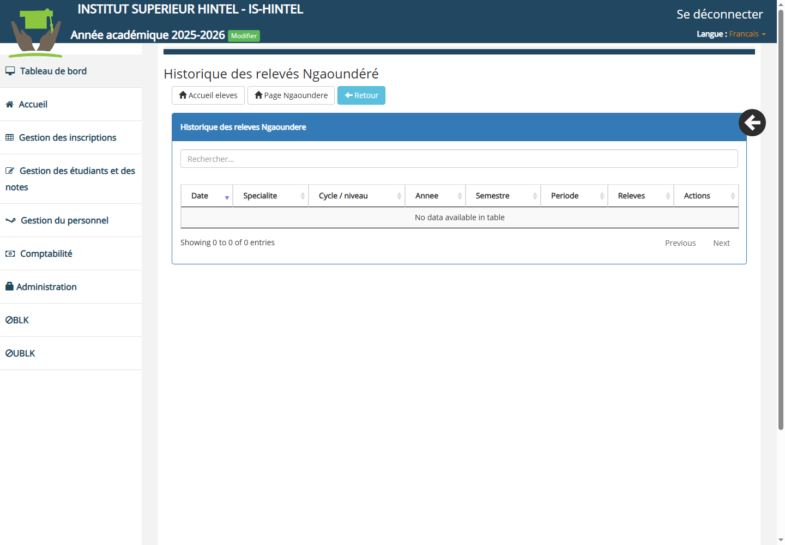

*Figure 42 — Historique réel des relevés Ngaoundéré ; une liste vide est conservée telle quelle.*

### P068 — Générer et afficher une attestation de réussite — Ngaoundéré

Responsable : Responsable pédagogique habilité

Chemin : Étudiants et notes → Attestations de réussite Ngaoundéré

Prérequis : Étudiant admis selon les résultats et règles du programme ; données d’identité contrôlées ; notes et relevés de la tutelle vérifiés.

1. Ouvrir le circuit d’attestation Ngaoundéré ; choisir cycle, niveau, filière puis spécialité.
2. Ouvrir la fenêtre « Générer les attestations » et contrôler le groupe et les dates de période.
3. Vérifier les résultats d’admission avant de confirmer la génération. Le logiciel sauvegarde une génération d’attestations.
4. Ouvrir les attestations proposées ; contrôler identité, naissance, matricule, diplôme, spécialité, année, moyenne, mention et signatures attendues.
5. Si aucune attestation n’est produite, vérifier les résultats et l’admissibilité du groupe avant toute nouvelle tentative.
6. Conserver le PDF validé ou imprimer après vérification du format A4/A3 proposé.

Résultat à contrôler : Les attestations produites correspondent aux étudiants admis du groupe et à la bonne tutelle.

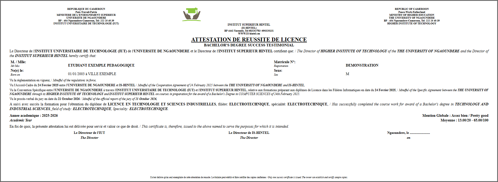

*Figure 43 — Modèle d’attestation Ngaoundéré — exemple pédagogique à identité et résultats fictifs, non délivré.*

### P069 — Consulter ou supprimer un historique d’attestations — Ngaoundéré

Responsable : Responsable pédagogique habilité

Chemin : Attestations de réussite Ngaoundéré → Historique

Prérequis : Génération recherchée identifiée ; autorisation de retrait si suppression.

1. Ouvrir l’historique depuis le circuit d’attestation Ngaoundéré.
2. Rechercher la spécialité et l’année ; comparer cycle, niveau, période, date et nombre d’attestations.
3. Choisir « Ouvrir / imprimer » pour la bonne ligne, puis vérifier les documents.
4. En cas de correction, corriger l’identité ou les résultats sources et produire une nouvelle génération approuvée.
5. Pour retirer l’historique, utiliser « Supprimer » sur la ligne exacte et lire la confirmation ; contrôler ensuite la liste.
6. Conserver la traçabilité des PDF déjà délivrés : supprimer un historique ne retire pas les copies déjà remises.

Point de contrôle : Dans cette version, l’ouverture d’une génération d’attestation vide peut tenter de la reconstruire à partir des données disponibles. Une réouverture ne doit donc pas être assimilée sans contrôle à la consultation d’un fichier PDF immuable.

Résultat à contrôler : L’historique propre aux attestations Ngaoundéré est utilisé correctement.

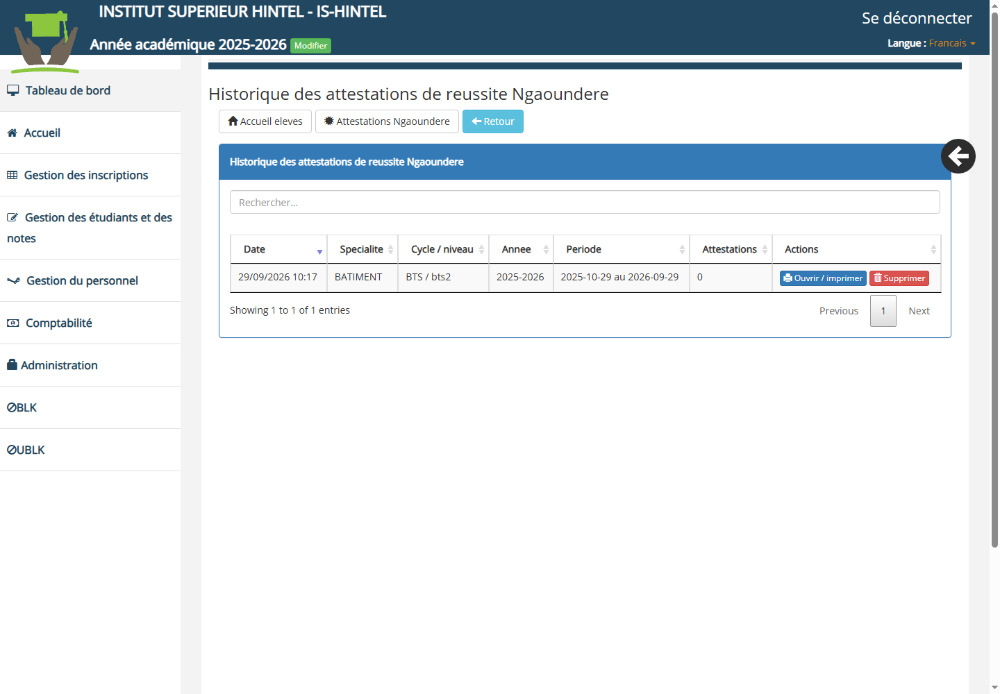

*Figure 44 — Historique réel des attestations Ngaoundéré.*

### P070 — Afficher et générer un PV — Ebolowa

Responsable : Responsable pédagogique

Chemin : Étudiants et notes → Notes et PV par session → Afficher → groupe → Génération des procès-verbaux

Prérequis : Programme et sessions de la tutelle configurés ; groupe inscrit ; notes et décisions contrôlées ; format Ebolowa applicable au groupe.

1. Sélectionner cycle, niveau, filière et spécialité dans « Afficher ».
2. Dans « Visualiser / générer un PV », choisir semestre 1, semestre 2 ou bilan annuel.
3. Choisir le format « Licence / Ebolowa ». Renseigner les dates de période si elles sont nécessaires à l’état.
4. Contrôler le périmètre puis utiliser « Générer le PV ». Cette commande peut ajouter une génération à l’historique.
5. Vérifier l’en-tête de tutelle, l’année, le groupe, les matières, crédits ou coefficients, notes, moyennes et décisions.
6. Utiliser l’impression du document, vérifier format papier et orientation, puis enregistrer le PDF validé avec un nom identifiant groupe, année, semestre et tutelle.

Résultat à contrôler : Le PV Ebolowa est contrôlé et exploitable pour la validation pédagogique.

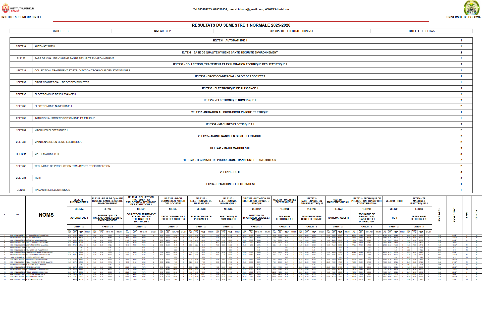

*Figure 45 — Aperçu du modèle de PV Ebolowa — rendu local sans génération sauvegardée.*

### P071 — Afficher puis sauvegarder des relevés — Ebolowa

Responsable : Responsable pédagogique

Chemin : Étudiants et notes → Releve de notes Ebolowa

Prérequis : Tutelle et groupe configurés ; notes validées ; année et période connues.

1. Ouvrir « Releve de notes Ebolowa » et vérifier le campus et l’année du bandeau.
2. Choisir le cycle et le niveau, puis la filière et la spécialité.
3. Utiliser l’action d’affichage ou de génération proposée. Dans la fenêtre de génération, contrôler le groupe, le semestre lorsqu’il est demandé et la période.
4. Pour un simple aperçu, utiliser l’affichage disponible. Pour conserver une génération, choisir explicitement « Générer et sauvegarder » ou « Generate and save » selon le circuit.
5. Vérifier les identités, notes, mentions, crédits, en-têtes et signatures attendues avant diffusion.
6. Après sauvegarde, ouvrir l’historique de ce même format pour retrouver la génération ; enregistrer le PDF validé.

Résultat à contrôler : Le relevé Ebolowa est affiché dans son format, puis sauvegardé seulement si l’archivage est demandé.

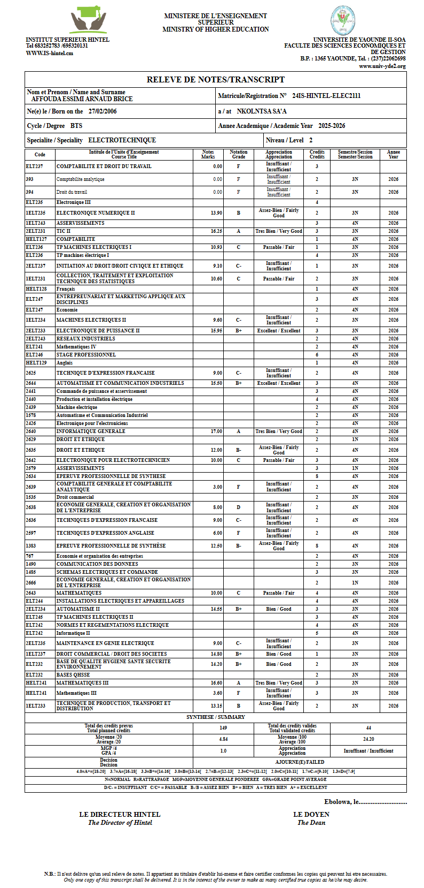

*Figure 46 — Aperçu local du relevé Ebolowa — aucune génération sauvegardée.*

### P072 — Rechercher, ouvrir et gérer l’historique des relevés — Ebolowa

Responsable : Agent habilité à consulter les résultats

Chemin : Releve de notes Ebolowa → Historique 

Prérequis : Au moins une génération sauvegardée pour trouver un résultat ; année et groupe recherchés.

1. Ouvrir le lien d’historique depuis la page du format Ebolowa.
2. Utiliser les filtres disponibles ou le champ de recherche ; retrouver année, spécialité, cycle, niveau et période.
3. Comparer la date de génération et le nombre de relevés. Une ligne à zéro doit être examinée avant diffusion.
4. Choisir « Ouvrir / imprimer » sur la bonne ligne ; vérifier le contenu avant réimpression.
5. Pour corriger le contenu, revenir aux données sources et produire une nouvelle génération autorisée ; ne pas tenter de modifier une cellule du tableau d’historique.
6. Si « Supprimer » est présent, vérifier la ligne et la décision de retrait avant confirmation. La suppression vise cette génération sauvegardée ; elle ne constitue pas une suppression des notes sources.

Résultat à contrôler : Le document est retrouvé dans l’historique propre à Ebolowa.

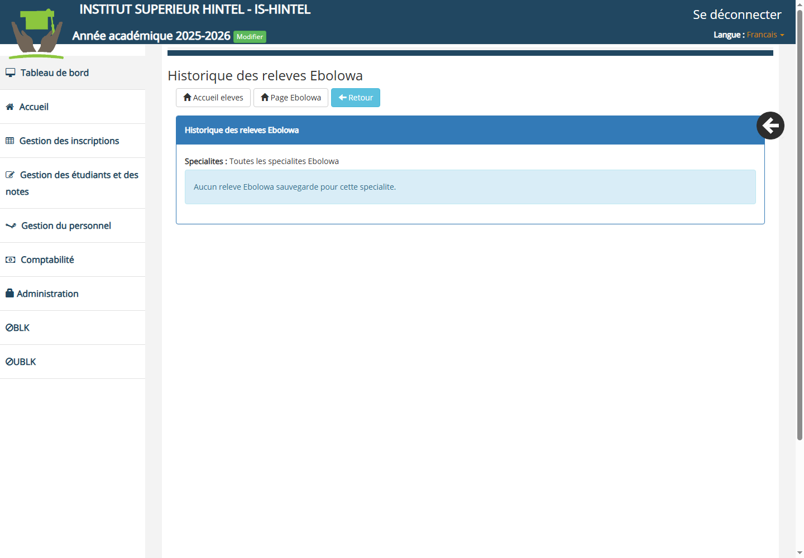

*Figure 47 — Historique réel des relevés Ebolowa ; une liste vide est conservée telle quelle.*

### P073 — Générer et afficher une attestation de réussite — Ebolowa

Responsable : Responsable pédagogique habilité

Chemin : Étudiants et notes → Attestations de réussite Ebolowa

Prérequis : Étudiant admis selon les résultats et règles du programme ; données d’identité contrôlées ; notes et relevés de la tutelle vérifiés.

1. Ouvrir le circuit d’attestation Ebolowa ; choisir cycle, niveau, filière puis spécialité.
2. Ouvrir la fenêtre « Générer les attestations » et contrôler le groupe et les dates de période.
3. Vérifier les résultats d’admission avant de confirmer la génération. Le logiciel sauvegarde une génération d’attestations.
4. Ouvrir les attestations proposées ; contrôler identité, naissance, matricule, diplôme, spécialité, année, moyenne, mention et signatures attendues.
5. Si aucune attestation n’est produite, vérifier les résultats et l’admissibilité du groupe avant toute nouvelle tentative.
6. Conserver le PDF validé ou imprimer après vérification du format A4/A3 proposé.

Résultat à contrôler : Les attestations produites correspondent aux étudiants admis du groupe et à la bonne tutelle.

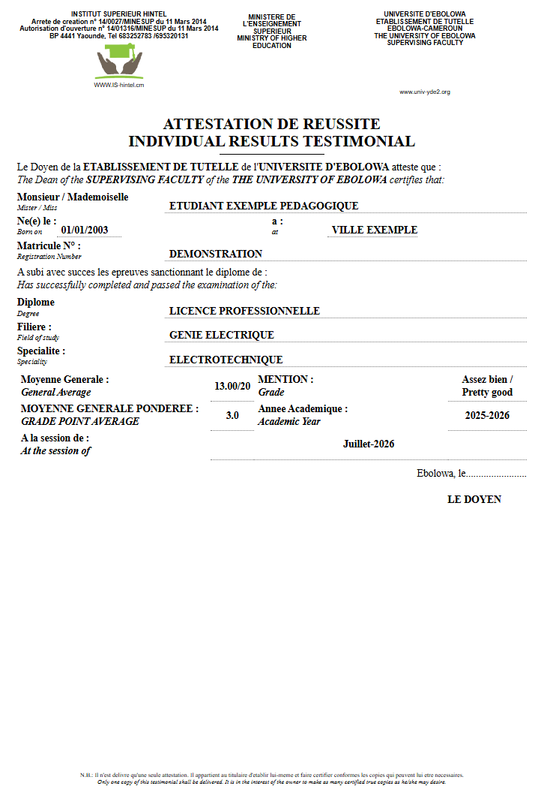

*Figure 48 — Modèle d’attestation Ebolowa — exemple pédagogique à identité et résultats fictifs, non délivré.*

### P074 — Consulter ou supprimer un historique d’attestations — Ebolowa

Responsable : Responsable pédagogique habilité

Chemin : Attestations de réussite Ebolowa → Historique

Prérequis : Génération recherchée identifiée ; autorisation de retrait si suppression.

1. Ouvrir l’historique depuis le circuit d’attestation Ebolowa.
2. Rechercher la spécialité et l’année ; comparer cycle, niveau, période, date et nombre d’attestations.
3. Choisir « Ouvrir / imprimer » pour la bonne ligne, puis vérifier les documents.
4. En cas de correction, corriger l’identité ou les résultats sources et produire une nouvelle génération approuvée.
5. Pour retirer l’historique, utiliser « Supprimer » sur la ligne exacte et lire la confirmation ; contrôler ensuite la liste.
6. Conserver la traçabilité des PDF déjà délivrés : supprimer un historique ne retire pas les copies déjà remises.

Point de contrôle : Dans cette version, l’ouverture d’une génération d’attestation vide peut tenter de la reconstruire à partir des données disponibles. Une réouverture ne doit donc pas être assimilée sans contrôle à la consultation d’un fichier PDF immuable.

Résultat à contrôler : L’historique propre aux attestations Ebolowa est utilisé correctement.

*Figure 49 — Historique réel des attestations Ebolowa.*

### P075 — Afficher et générer un PV — Bamenda

Responsable : Responsable pédagogique

Chemin : Étudiants et notes → Notes et PV par session → Afficher → groupe → Génération des procès-verbaux

Prérequis : Programme et sessions de la tutelle configurés ; groupe inscrit ; notes et décisions contrôlées ; format Bamenda applicable au groupe.

1. Sélectionner cycle, niveau, filière et spécialité dans « Afficher ».
2. Dans « Visualiser / générer un PV », choisir semestre 1, semestre 2 ou bilan annuel.
3. Choisir le format « Licence / Bamenda ». Renseigner les dates de période si elles sont nécessaires à l’état.
4. Contrôler le périmètre puis utiliser « Générer le PV ». Cette commande peut ajouter une génération à l’historique.
5. Vérifier l’en-tête de tutelle, l’année, le groupe, les matières, crédits ou coefficients, notes, moyennes et décisions.
6. Utiliser l’impression du document, vérifier format papier et orientation, puis enregistrer le PDF validé avec un nom identifiant groupe, année, semestre et tutelle.

Résultat à contrôler : Le PV Bamenda est contrôlé et exploitable pour la validation pédagogique.

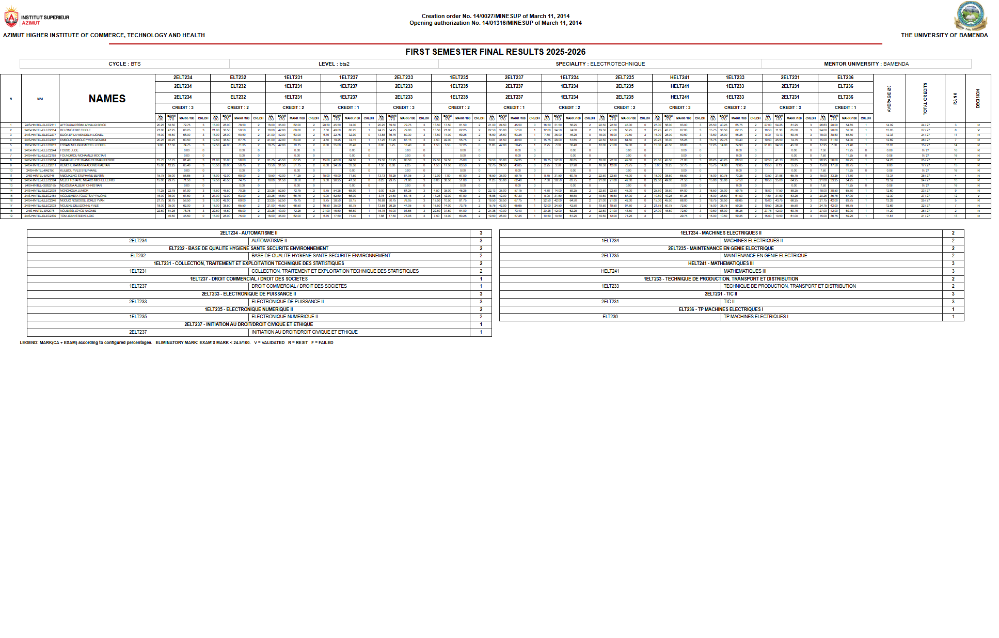

*Figure 50 — Aperçu du modèle de PV Bamenda — rendu local sans génération sauvegardée.*

### P076 — Afficher puis sauvegarder des relevés — Bamenda

Responsable : Responsable pédagogique

Chemin : Étudiants et notes → Bamenda transcripts

Prérequis : Tutelle et groupe configurés ; notes validées ; année et période connues.

1. Ouvrir « Bamenda transcripts » et vérifier le campus et l’année du bandeau.
2. Choisir le cycle et le niveau, puis la filière et la spécialité.
3. Utiliser l’action d’affichage ou de génération proposée. Dans la fenêtre de génération, contrôler le groupe, le semestre lorsqu’il est demandé et la période.
4. Pour un simple aperçu, utiliser l’affichage disponible. Pour conserver une génération, choisir explicitement « Générer et sauvegarder » ou « Generate and save » selon le circuit.
5. Vérifier les identités, notes, mentions, crédits, en-têtes et signatures attendues avant diffusion.
6. Après sauvegarde, ouvrir l’historique de ce même format pour retrouver la génération ; enregistrer le PDF validé.

Résultat à contrôler : Le relevé Bamenda est affiché dans son format, puis sauvegardé seulement si l’archivage est demandé.

*Figure 51 — Aperçu local du relevé Bamenda — aucune génération sauvegardée.*

### P077 — Rechercher, ouvrir et gérer l’historique des relevés — Bamenda

Responsable : Agent habilité à consulter les résultats

Chemin : Bamenda transcripts → Historique  / Bamenda transcripts history

Prérequis : Au moins une génération sauvegardée pour trouver un résultat ; année et groupe recherchés.

1. Ouvrir le lien d’historique depuis la page du format Bamenda.
2. Utiliser les filtres disponibles ou le champ de recherche ; retrouver année, spécialité, cycle, niveau et période.
3. Comparer la date de génération et le nombre de relevés. Une ligne à zéro doit être examinée avant diffusion.
4. Choisir « Ouvrir / imprimer » sur la bonne ligne ; vérifier le contenu avant réimpression.
5. Pour corriger le contenu, revenir aux données sources et produire une nouvelle génération autorisée ; ne pas tenter de modifier une cellule du tableau d’historique.
6. Si « Supprimer » est présent, vérifier la ligne et la décision de retrait avant confirmation. La suppression vise cette génération sauvegardée ; elle ne constitue pas une suppression des notes sources.

Résultat à contrôler : Le document est retrouvé dans l’historique propre à Bamenda.

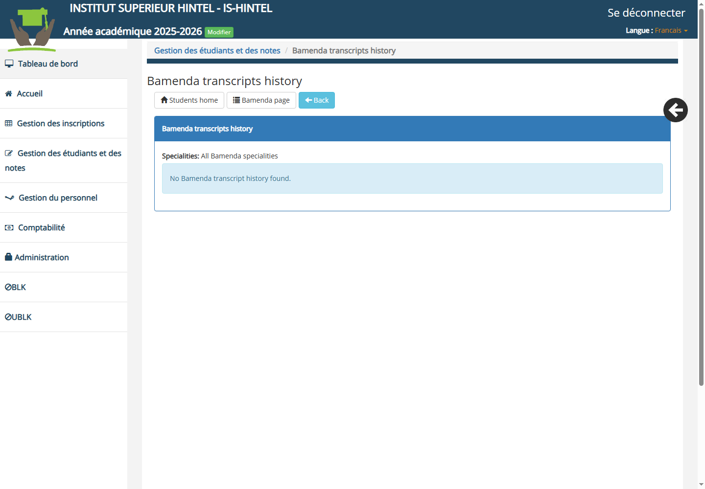

*Figure 52 — Historique réel des relevés Bamenda ; une liste vide est conservée telle quelle.*

### P078 — Consulter l’historique des PV par format de tutelle

Responsable : Responsable pédagogique

Chemin : Affichage du groupe → Historique des PV

Prérequis : Spécialité, cycle, niveau et format du PV recherchés.

1. Ouvrir le groupe dans « Afficher », puis « Historique des PV ».
2. Choisir année, semestre ou bilan et format : BTS, HND, Soa, Ngaoundéré, Ebolowa ou Bamenda selon les filtres affichés.
3. Renseigner les autres filtres de période si nécessaires puis lancer la recherche.
4. Lire les dates, types et états des générations retournées. La base consultée ne contenait pas de PV sauvegardé à la date des captures.
5. Lorsqu’une ligne existe, utiliser la visualisation proposée puis contrôler le résultat avec le PDF validé conservé par le service.

Résultat à contrôler : La recherche utilise le format de tutelle du PV concerné.

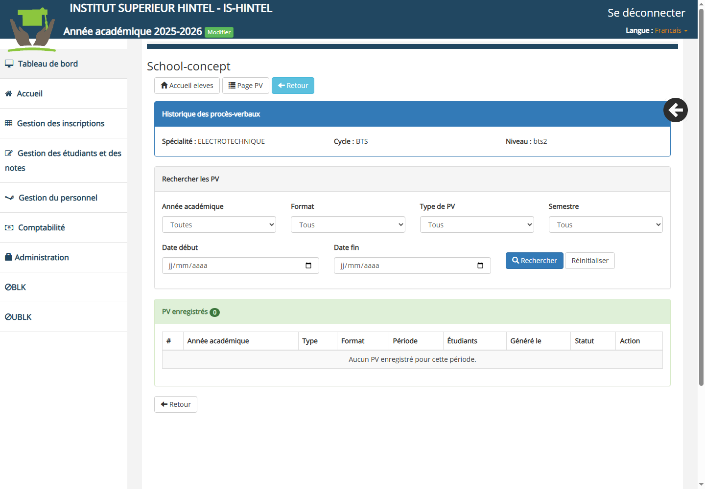

*Figure 53 — Historique réel des PV du groupe ; les filtres permettent de distinguer les formats.*

### P079 — Produire une liste de rattrapage et un bilan annuel

Responsable : Responsable pédagogique

Chemin : Affichage du groupe → PV rattrapages / Bilan annuel

Prérequis : Résultats des semestres et décisions du jury contrôlés.

1. Pour le rattrapage, choisir le semestre et le format de tutelle dans le bloc prévu ; vérifier la période et le format papier A4 ou A3.
2. Lancer la liste ou le PV de rattrapage, puis vérifier les étudiants et matières concernés.
3. Pour le bilan annuel, choisir « Bilan annuel » dans le circuit de PV avec le même format de tutelle.
4. Contrôler les résultats des deux semestres, les crédits et décisions affichés.
5. Enregistrer les PDF validés en distinguant clairement rattrapage et bilan annuel.

Résultat à contrôler : Les états servent à préparer la session ou la validation annuelle du bon groupe.

| Format | PV | Relevés | Attestations | Historique |
| --- | --- | --- | --- | --- |
| BTS francophone | Format BTS / Francophone dans Afficher | Relevés de notes BTS par session | Pas d’entrée distincte observée | Historique des relevés BTS ; historique des PV du groupe. |
| HND anglophone | Format HND / Anglophone dans Afficher | Circuit dédié de transcript HND non observé dans le menu | Pas d’entrée distincte observée | Historique des PV du groupe, filtre HND. |
| Soa | Format Licence / SOA | Relevé de notes Soa | Attestations de réussite SOA | Historiques distincts relevés / attestations ; PV filtrables. |
| Ngaoundéré | Format Licence / Ngaoundéré | Relevé de notes Ngaoundéré | Attestations de réussite Ngaoundéré | Historiques distincts relevés / attestations ; PV filtrables. |
| Ebolowa | Format Licence / Ebolowa | Relevé de notes Ebolowa | Attestations de réussite Ebolowa | Historiques distincts relevés / attestations ; PV filtrables. |
| Bamenda | Format Licence / Bamenda | Bamenda transcripts | Pas d’entrée distincte observée | Bamenda transcripts history ; PV filtrables. |

## 7. Personnel et emplois du temps — préparer, programmer, modifier et contrôler

Dépendances : dossier personnel et affectations → programme de spécialité → matière du bon semestre → plages horaires → cours et séances → emplois du temps par groupe ou enseignant → progression et heures réalisées → contrôle avant rémunération.

Les pages de planning de l’installation consultée déclenchent une initialisation de plages horaires qui échoue en base. Les images de formulaires de ce chapitre sont des aperçus locaux des vues du projet, sans initialisation ni enregistrement. Elles montrent le parcours prévu ; son usage interactif doit être vérifié après remise en service.

### P080 — Créer puis modifier un personnel

Responsable : Gestionnaire RH

Chemin : Gestion du personnel → 1. Personnel

Prérequis : Identité, contacts et situation professionnelle connus ; campus actif.

1. Rechercher la personne avant de cliquer sur « Ajouter un nouveau personnel ».
2. Renseigner identité, naissance, nationalité, diplôme, adresse et téléphone ; compléter les informations professionnelles disponibles.
3. Choisir les types et paramètres d’horaires proposés ; compléter catégorie, échelon, recrutement et taux selon la situation approuvée.
4. Valider puis retrouver la personne dans la liste.
5. Pour corriger, ouvrir le nom ou le lien d’édition de cette même personne, modifier les renseignements justifiés puis vérifier la liste.

Résultat à contrôler : Le dossier du personnel est unique et ses paramètres sont contrôlés.

*Figure 54 — Liste du personnel : recherche, ajout, import et exports.*

*Figure 55 — Formulaire d’ajout du personnel.*

### P081 — Affecter une fonction et gérer l’activité du personnel

Responsable : Gestionnaire RH

Chemin : Gestion du personnel → Affectation entités ; liste du personnel → Activer/Désactiver

Prérequis : Dossier existant ; fonction et entité préparées.

1. Rechercher la personne dans « Affectation entités ».
2. Choisir la fonction et l’entité correspondant au poste, puis enregistrer et vérifier les affectations.
3. Pour un départ ou une suspension du travail, utiliser « Désactiver » sur la bonne ligne de personnel selon la décision RH.
4. Pour un retour autorisé, utiliser « Activer » puis contrôler son retour dans la liste adéquate.
5. Avant une suppression définitive proposée ailleurs, examiner cours, présences et paiements ; privilégier le statut adapté lorsque les données doivent être conservées.

Résultat à contrôler : Le statut de travail et les affectations reflètent la décision RH.

### P082 — Créer ou modifier une plage horaire

Responsable : Gestionnaire des emplois du temps

Chemin : Gestion du personnel → Plages horaires

Prérequis : Jours de travail et organisation approuvés ; page remise en service pour l’utilisation réelle.

1. Ouvrir la liste des plages, vérifier qu’une plage identique n’existe pas.
2. Renseigner libellé, heures de début et de fin, type de plage, type de personnel, période de journée, format, ordre et durée payable selon le formulaire.
3. Vérifier la distinction entre cours, pause et plage de travail permanent ; enregistrer.
4. Pour corriger, ouvrir l’édition de la plage existante, modifier les valeurs puis contrôler la liste.
5. Avant de supprimer une plage, vérifier toutes les séances et emplois permanents qui l’utilisent.

Résultat à contrôler : La plage peut être utilisée dans une séance et sa durée est compréhensible.

*Figure 56 — Aperçu local des plages horaires ; l’initialisation automatique de la page réelle n’a pas été exécutée.*

### P083 — Créer un emploi du temps en programmant les cours

Responsable : Gestionnaire des emplois du temps

Chemin : Gestion du personnel → Cours enseignants → création du cours

Prérequis : Enseignant actif ; matière présente au programme du cycle, niveau et semestre ; plages disponibles ; période connue.

1. Ouvrir la création du cours et choisir l’enseignant.
2. Sélectionner cycle, niveau académique, filière et spécialité, puis semestre.
3. Choisir « UE / Matière » dans la liste filtrée par le programme. Si elle est vide, vérifier programme et semestre avant de continuer.
4. Renseigner dates de début et de fin, volume prévu et statut.
5. Dans « Séances hebdomadaires », choisir un jour et une plage ; cliquer sur « Ajouter une séance » pour chaque occurrence hebdomadaire supplémentaire.
6. Utiliser « Retirer » pour enlever une ligne de séance non souhaitée avant validation.
7. Relire les jours, périodes et plages puis cliquer sur « Enregistrer ». Le contrôleur vérifie notamment les conflits de l’enseignant.
8. Ouvrir « Emplois spécialités » et « Emplois enseignants » pour vérifier le planning obtenu dans les deux vues.

Résultat à contrôler : Le cours et ses séances composent un emploi du temps cohérent.

*Figure 57 — Aperçu local du formulaire : contexte du cours et séances hebdomadaires.*

### P084 — Modifier ou supprimer un cours programmé

Responsable : Gestionnaire des emplois du temps

Chemin : Cours enseignants → cours concerné → Modifier / Supprimer

Prérequis : Cours identifié ; changement de période ou de séance approuvé ; heures déjà réalisées examinées.

1. Filtrer la liste par enseignant, spécialité et période pour retrouver le cours exact.
2. Pour modifier, ouvrir son édition ; corriger matière ou contexte si autorisé, dates, volume, statut ou séances.
3. Vérifier les occurrences hebdomadaires puis enregistrer. La mise à jour remplace les séances du cours dans le code consulté.
4. Contrôler les emplois par enseignant et par spécialité après modification.
5. Pour supprimer, vérifier les dépendances puis utiliser l’action de suppression de ce cours et la confirmation proposée.
6. Vérifier que le cours et ses séances ont disparu du planning ; rapprocher les heures ou pièces déjà produites avant leur traitement ultérieur.

Résultat à contrôler : Le planning reflète la décision et les états dépendants sont examinés.

### P085 — Afficher et imprimer un emploi du temps

Responsable : Enseignant / gestionnaire habilité

Chemin : Gestion du personnel → Emplois spécialités ou Emplois enseignants

Prérequis : Cours enregistrés ; groupe ou enseignant identifié.

1. Choisir la vue du groupe ou celle de l’enseignant selon le destinataire.
2. Renseigner les filtres de cycle, niveau, spécialité, enseignant ou période présents.
3. Vérifier cours, jours et plages sur l’état affiché.
4. Utiliser la commande d’impression disponible et vérifier l’aperçu avant diffusion.
5. Conserver un fichier dont le nom indique le groupe ou l’enseignant et la période.

Résultat à contrôler : Le destinataire peut reconnaître son planning et sa période.

*Figure 58 — Aperçu local de consultation par spécialité.*

*Figure 59 — Aperçu local de consultation par enseignant.*

### P086 — Préparer l’emploi d’un permanent et son salaire

Responsable : Gestionnaire RH / financier

Chemin : Emplois permanents ; Salaires permanents ; Taux horaires

Prérequis : Personnel actif ; jours et plages permanents ; base de rémunération approuvée.

1. Dans les emplois permanents, choisir la personne, les jours, la plage et les dates de validité puis enregistrer.
2. Vérifier la présence du planning ; utiliser la modification ou le retrait de l’affectation lorsque la situation change.
3. Pour un salaire permanent, sélectionner la personne, le type de salaire et le montant de référence, puis contrôler la liste.
4. Pour un taux horaire, rechercher la personne et renseigner le taux approuvé dans son circuit dédié.
5. Vérifier séparément les paiements : préparer un salaire ou un taux ne signifie pas que la personne a été payée.

Résultat à contrôler : Planning de travail et base de rémunération sont prêts pour les contrôles de présence.

### P087 — Suivre les progressions, heures et pointages

Responsable : Gestionnaire RH / pédagogique

Chemin : Fiches de progression ; Volumes horaires ; Décompte heures

Prérequis : Cours et période connus ; justificatifs de progression ou de présence.

1. Dans les fiches de progression, choisir l’enseignant puis consulter ses cours et les fiches disponibles ou manquantes.
2. Comparer le volume prévu du cours et le volume affiché par spécialité.
3. Dans le décompte, choisir enseignant et dates ; lire les heures réalisées avant toute utilisation en rémunération.
4. Pour importer des pointages, renseigner libellé, dates et fichier puis vérifier le résultat de l’import. Pour une correction justifiée, utiliser le circuit de saisie manuelle et contrôler le résultat.
5. Utiliser les exports CSV ou « Imprimer / PDF » proposés pour constituer l’état de contrôle.
6. Les actions de consolidation, nettoyage ou suppression d’import doivent viser le bon lot et être rapprochées des états déjà utilisés.

Résultat à contrôler : Les heures exploitables sont rapprochées des cours et des présences.

### P088 — Importer le personnel et exporter une liste de travail

Responsable : Gestionnaire RH habilité

Chemin : Gestion du personnel → Personnel → Télécharger le template / Importer le personnel

Prérequis : Fichier de personnel contrôlé ; recherche préalable des personnes déjà présentes.

1. Télécharger le modèle depuis la liste du personnel ; conserver ses en-têtes et une ligne par personne.
2. Compléter les champs requis et les paramètres professionnels correspondant aux colonnes du modèle.
3. Cliquer sur « Importer le personnel », sélectionner le fichier Excel ou CSV attendu puis valider l’import une seule fois.
4. Lire le résultat et rechercher plusieurs personnes pour contrôler leurs dossiers et leurs statuts.
5. Pour transmettre un état, filtrer la liste puis utiliser « Excel », « PDF » ou « Imprimer » ; vérifier que le document correspond au personnel actif ou au filtre retenu.

Résultat à contrôler : Les personnes importées sont contrôlées et la liste transmise identifie son périmètre.

*Figure 60 — Fenêtre réelle d’import du personnel.*

## 8. Comptabilité — dépenses, paiements du personnel, budgets et états

Dépendances : source financière et utilisateurs autorisés → catégorie budgétaire → ligne budgétaire → dépense ou paiement → bilan et justificatifs. Les états exploitables doivent préciser période, campus et source ; les totaux de pages différentes ne se comparent pas sans vérifier ces périmètres.

### P089 — Créer, modifier et consulter une catégorie et une ligne budgétaire

Responsable : Responsable comptable

Chemin : Comptabilité → Catégorie de budget / Ligne budgétaire

Prérequis : Budget et catégories approuvés ; dates et montants de référence.

1. Consulter les catégories existantes ; créer la catégorie manquante dans le formulaire prévu puis vérifier son libellé.
2. Ouvrir « Ligne budgétaire » puis « Nouvelle ligne ». Renseigner le rattachement, le nom, les dates et le montant proposés par le formulaire.
3. Enregistrer puis ouvrir le rapport de la ligne ou de la catégorie.
4. Pour corriger, utiliser l’édition de la ligne ou de la catégorie ; vérifier l’impact des changements sur les mouvements déjà rattachés.
5. Pour supprimer une ligne ou une catégorie, contrôler d’abord les dépenses qui l’utilisent, puis utiliser l’action proposée uniquement si le retrait est approuvé.
6. Imprimer le rapport disponible pour constituer un état de suivi.

Résultat à contrôler : Les opérations peuvent être suivies selon un budget identifié.

*Figure 61 — Lignes budgétaires : création et accès au suivi.*

### P090 — Créer une sortie de caisse pour une facture

Responsable : Agent comptable habilité

Chemin : Comptabilité → Payer une facture → Nouvelle facture

Prérequis : Facture approuvée ; bénéficiaire, ligne budgétaire et caisse de sortie identifiés.

1. Rechercher les sorties existantes pour vérifier que la facture n’a pas déjà été réglée.
2. Ouvrir « Nouvelle facture », renseigner bénéficiaire, motif, montant, source et affectation budgétaire selon le formulaire.
3. Comparer les données avec la pièce approuvée puis confirmer une seule fois.
4. Vérifier la ligne de sortie, son justificatif et son apparition dans le bilan des sorties.
5. Si une correction est nécessaire, utiliser uniquement l’action autorisée du dossier ; vérifier ensuite source et budget avec le responsable. Ne pas créer un second règlement pour corriger le premier.

Résultat à contrôler : La dépense est identifiable, justifiée et rapprochée de son budget.

*Figure 62 — Sorties de caisse : recherche et Nouvelle facture.*

### P091 — Payer un membre du personnel et retrouver ses paiements

Responsable : Agent comptable habilité

Chemin : Comptabilité → Payer un personnel → recherche

Prérequis : Personnel identifié ; heures ou salaire contrôlés ; période et montant approuvés.

1. Rechercher la personne et comparer son identité avec la pièce à payer.
2. Afficher ses paiements existants et vérifier la période pour éviter un double règlement.
3. Ouvrir la création du paiement proposée sur la personne ; renseigner les montants et éléments du règlement demandés.
4. Relire période, bénéficiaire, motif et source financière puis confirmer une fois.
5. Consulter la liste de paiements et le bulletin ou reçu proposé, puis rapprocher la sortie dans le bilan.

Résultat à contrôler : Le règlement est rattaché à la bonne personne et à la bonne période.

### P092 — Afficher les bilans des entrées, sorties et budgets

Responsable : Responsable comptable

Chemin : Comptabilité → Bilan des entrées / Bilan des sorties ; rapports de budget

Prérequis : Période, campus et source de comparaison définis.

1. Ouvrir le bilan souhaité et choisir les critères proposés.
2. Contrôler les totaux puis examiner les lignes et références qui les composent.
3. Comparer les encaissements aux reçus et les sorties aux pièces approuvées.
4. Ouvrir le rapport d’une ligne ou catégorie pour vérifier son affectation et sa consommation.
5. Utiliser la commande d’export ou d’impression disponible, puis vérifier titre, période, totaux et pages de l’aperçu.
6. Conserver le fichier validé avec sa période et son périmètre ; noter les écarts et les références à examiner.

Résultat à contrôler : Les états sont exploitables et leur périmètre est explicite.

## 9. Contrôles d’accès, discipline, publication et corrections

Les autorisations conditionnent les boutons et les listes disponibles. Le guide montre un compte étendu : une personne disposant seulement d’un rôle de scolarité ou d’enseignant n’a pas nécessairement les mêmes actions. Les pages de rôles et de journal de l’installation locale présentent des vues manquantes ; les opérations correspondantes restent à vérifier après correction.

### P093 — Activer un utilisateur et lui donner le bon périmètre

Responsable : Administrateur

Chemin : Administration → Utilisateurs ; Campus ; Rôles et permissions

Prérequis : Compte identifié ; poste et responsabilités connus.

1. Rechercher le nom d’utilisateur et comparer nom complet et personnel associé.
2. Vérifier l’état actif ; activer ou désactiver selon la décision du responsable.
3. Contrôler les campus affectés et les sources financières autorisées le cas échéant.
4. Lorsque la page de rôles fonctionne, associer le rôle et les permissions de lecture, création, modification ou suppression nécessaires au poste.
5. Faire contrôler l’accès avec ce profil : menus, groupes, caisses et actions doivent correspondre au périmètre attribué.

Résultat à contrôler : Le titulaire retrouve uniquement les fonctions et données de son poste.

### P094 — Gérer le verrou des notes et la visibilité du portail étudiant

Responsable : Responsable pédagogique

Chemin : Administration → Verrouiller la modification des notes

Prérequis : Calendrier de saisie et décision de publication.

1. Identifier l’évaluation et le semestre dans la partie verrouillage des notes.
2. Utiliser l’activation ou la désactivation selon la décision d’ouverture de saisie puis contrôler l’état affiché.
3. Pour l’accès étudiant aux notes, choisir campus, dates, objectif et message de blocage dans la partie portail.
4. Confirmer la décision puis contrôler le statut affiché ; une ouverture du portail ne doit pas être confondue avec une réouverture de la grille de saisie.
5. Vérifier ensuite le parcours avec le profil concerné sans saisir de données d’essai dans un dossier réel.

Résultat à contrôler : Saisie et publication suivent deux décisions clairement identifiées.

### P095 — Effectuer l’appel et consulter un état disciplinaire

Responsable : Agent de discipline / enseignant habilité

Chemin : Étudiants et notes → Effectuer l’appel en salle par spécialité / Discipline

Prérequis : Étudiants inscrits ; groupe et séance identifiés.

1. Choisir le groupe et les paramètres de cycle, niveau, date ou séance proposés.
2. Vérifier la liste avant de renseigner présences et absences selon les choix de l’écran.
3. Relire les lignes puis enregistrer.
4. Pour consulter ou traiter une justification, rechercher l’étudiant ou l’état de sa spécialité ; vérifier la période et les pièces disponibles.
5. Afficher l’état disciplinaire puis utiliser l’impression proposée après contrôle des identités et dates.

Résultat à contrôler : Les éléments de discipline concernent le bon étudiant et la bonne séance.

### P096 — Rechercher l’origine d’une correction et retirer un état obsolète

Responsable : Responsable du module

Chemin : Dossier concerné ; Journal des opérations ; historique du document

Prérequis : Référence du dossier, période et action à expliquer.

1. Retrouver l’opération dans son module avec sa référence et son contexte.
2. Lorsque le journal est disponible, filtrer l’utilisateur, les dates et l’action pour consulter les événements utiles.
3. Contrôler la différence entre correction des données sources et retrait d’un document sauvegardé.
4. Remplacer un PDF obsolète dans le circuit de diffusion après validation du document corrigé ; ne pas supposer qu’une suppression d’historique retire les copies déjà diffusées.
5. Signaler les incohérences avec module, écran, campus, année, référence et message exact.

Résultat à contrôler : La correction est expliquée et les documents diffusés restent identifiables.

## 10. Trouver une information — quel module et quel état utiliser ?

Cette table relie une question de travail à sa source. Pour une même personne, l’identité, le parcours annuel, les versements et les résultats peuvent relever de rubriques différentes.

| Information recherchée | Par où passer | Ce dont on a besoin |
| --- | --- | --- |
| Identité, contacts, parents | Recherche étudiant → Voir/Modifier | Nom ou matricule ; vérifier la personne. |
| Parcours et inscriptions antérieures | Historique étudiant | Dossier étudiant ; année recherchée. |
| Inscription du groupe actuel | Afficher les listes → inscrits | Campus, année, cycle, niveau et spécialité. |
| Versements d’un étudiant | Recherche → Actions → Liste des versements | Matricule, campus et année des règlements. |
| Paiement ultérieur à l’inscription | Gestion des paiements / Ajouter un payement | Étudiant inscrit, justificatif et caisse ou banque. |
| Bourse accordée | Bourse d’études | Étudiant et année de décision. |
| Effectif | Effectifs par cycle puis liste correspondante | Même périmètre de comparaison. |
| Matières du parcours | Administration → Programme de Spécialité | Spécialité, cycle, niveau, semestre. |
| Pondération d’une évaluation | Sessions de la matière / Sessions examens globales | Programme, année et tutelle. |
| Note à corriger | Notes → Modifier → matière → évaluation | Contexte d’origine et droits de saisie. |
| PV du groupe | Notes → Afficher → Génération des procès-verbaux | Groupe, semestre, format de tutelle et période. |
| Relevé déjà sauvegardé | Historique des relevés du format concerné | Tutelle, année, groupe et date de génération. |
| Attestation déjà sauvegardée | Historique des attestations de la tutelle | Tutelle, année, groupe et génération. |
| Cours d’un enseignant | Cours enseignants / Emplois enseignants | Personnel, période et année. |
| Planning d’un groupe | Emplois spécialités | Cycle, niveau, spécialité et période. |
| Heures réalisées | Décompte heures | Enseignant, dates et pointages contrôlés. |
| Règlement d’un personnel | Comptabilité → Payer un personnel → liste | Personne et période. |
| Dépense et justificatif | Payer une facture / Bilan des sorties | Référence, bénéficiaire, période et budget. |
| Solde et mouvements d’une source | État caisse/banque | Dates, source et utilisateurs concernés. |
| Consommation du budget | Rapport de ligne ou de catégorie | Catégorie, ligne et période. |
| Qui peut agir ? | Utilisateurs, campus, affectations financières et rôles | Compte exact, rôle et périmètre. |

## 11. Résoudre les difficultés courantes

Pour signaler un incident, indiquer le module, l’action effectuée, le campus, l’année, le message exact et la référence du dossier. Joindre une capture utile en évitant d’exposer un mot de passe. Les erreurs réellement rencontrées pendant la visite sont recensées à la fin du guide.

| Situation | Contrôles et action |
| --- | --- |
| La connexion échoue | Vérifier le nom d’utilisateur, la casse du mot de passe et l’état du compte auprès de l’administrateur. Ne pas créer un second compte pour contourner un accès refusé. |
| L’adresse ish.informatique-ht.cm ne répond pas | Vérifier la connexion Internet et l’orthographe de l’adresse https://ish.informatique-ht.cm, puis réessayer. Si le problème persiste, contacter le responsable informatique pour vérifier la disponibilité de l’application hébergée dans le cloud. |
| Un menu ou une action manque | Faire vérifier les rôles, permissions et campus autorisés du compte. |
| La liste d’un niveau ou d’une spécialité est vide | Contrôler le campus, l’année, le cycle et les dépendances entre filière, spécialité et niveau. Attendre le chargement des listes. |
| Un étudiant est introuvable | Rechercher par matricule puis par une partie du nom, vérifier le campus et consulter son historique avant d’enregistrer une nouvelle fiche. |
| Un tarif n’apparaît pas | Faire contrôler le profil de scolarité et le barème du cycle, du niveau et de la spécialité choisis. |
| Un import est rejeté | Télécharger le modèle de cette version, conserver les colonnes et vérifier les identifiants, formats de dates et valeurs attendues. Lire le compte rendu avant reprise. |
| La validation semble ne pas avoir répondu | Rechercher d’abord le dossier, le paiement ou l’import avant de cliquer à nouveau. Une seconde validation peut créer un doublon. |
| La note ne peut pas être modifiée | Vérifier la session, les droits et les verrous avec le responsable pédagogique. |
| Le document imprimé est tronqué | Ouvrir l’aperçu du navigateur, vérifier l’orientation, le format de papier, les marges et l’échelle ; préférer la commande d’impression du document si elle existe. |
| Une page affiche une erreur serveur | Conserver le message, l’adresse et le contexte, puis transmettre au responsable technique. Ne pas relancer une opération de paiement ou de génération sans vérification préalable. |

## 12. Organiser la formation des utilisateurs

Prévoir les exercices sur une base de formation ou avec des dossiers explicitement réservés aux essais. Les montants et identités d’exercice doivent être fictifs. L’animateur montre d’abord la procédure, le participant la reproduit, puis explique les contrôles effectués.

### P097 — Vérifier l’autonomie à la fin de la formation

1. Demander au participant de retrouver un étudiant par son matricule et d’expliquer la différence entre fiche et inscription.
2. Lui faire identifier le campus, l’année, le cycle et le niveau d’un dossier avant toute préparation d’opération.
3. Lui faire expliquer les contrôles précédant un paiement ou une saisie de notes.
4. Lui demander de retrouver une opération existante et un document sans les recréer.
5. Présenter un cas de liste vide ou de permission manquante et vérifier qu’il sait qui contacter.
6. Clore la session et noter les points à reprendre dans le prochain accompagnement.

Résultat à contrôler : Le participant peut effectuer les tâches de son poste et identifier les situations nécessitant un responsable.

| Séance | Exercice | Critère de réussite |
| --- | --- | --- |
| 1 — Prise en main, 30 min | Se connecter, choisir le campus, retrouver l’année et ouvrir les modules. | Le participant sait expliquer son contexte de travail et se déconnecter. |
| 2 — Scolarité, 60 min | Rechercher un étudiant, remplir une fiche de formation, préparer une inscription et consulter une liste. | Aucun doublon ; identité, parcours et année correctement identifiés. |
| 3 — Encaissement, 45 min | Préparer un règlement fictif, distinguer mode et source, consulter le reçu et l’état de caisse. | Montant, motif, étudiant et destination financière cohérents. |
| 4 — Pédagogie, 60 min | Retrouver une grille, préparer un import de notes et choisir le bon format de relevé. | Groupe, matière, session et format maîtrisés avant validation. |
| 5 — Ressources humaines, 45 min | Retrouver un enseignant, son cours, son emploi du temps et ses heures. | Le participant rapproche planning, progression et décompte. |
| 6 — Responsables, 60 min | Consulter un bilan, une ligne budgétaire, les droits et le journal. | Le participant interprète le périmètre des états et sait faire remonter un incident. |

## Interfaces illustrées et champs des formulaires

Chaque fiche présente une interface consultée, les étapes de son utilisation et les champs repérés dans les formulaires, y compris les fenêtres d’ajout ou de modification. Les captures principales montrent la première zone visible : faire défiler la page dans le logiciel pour atteindre les sections suivantes. Les images s’ouvrent en grand par un clic dans la version HTML.

## Scolarité

### Fiche 1 — Gestion des inscriptions

Choisir une opération de scolarité : fiche, inscription, paiement, liste ou document.

*Figure 63 — Gestion des inscriptions.*

1. Rechercher un dossier existant avant un enregistrement.
2. Choisir la tuile correspondant à l’opération ; faire défiler pour voir les dernières tuiles.
3. Lire l’effectif affiché dans le contexte de l’année active.

Résultat à contrôler : L’agent ouvre le circuit adapté à son besoin.

### Fiche 2 — Enregistrer un étudiant

Créer la fiche d’identité, les coordonnées et les renseignements familiaux.

*Figure 64 — Enregistrer un étudiant.*

1. Renseigner les champs d’identité marqués d’un astérisque à partir des pièces.
2. Compléter les coordonnées, études antérieures, financement et renseignements complémentaires.
3. Faire défiler jusqu’aux sections père, mère et tuteur ; relire puis confirmer.

Résultat à contrôler : Un message de succès et une possibilité de poursuivre l’inscription sont prévus par le formulaire.

#### Champs et contrôles

| Champ | Comment le renseigner ou le contrôler |
| --- | --- |
| Nom | Renseigner la valeur correspondant au dossier ou au paramétrage approuvé. Champ signalé obligatoire dans le libellé de l’interface. |
| Photo | Sélectionner le fichier attendu par ce formulaire ; pour un import, utiliser son modèle. |
| Date de naissance | Choisir la date avec le sélecteur ; vérifier sa cohérence avec la période. Champ signalé obligatoire dans le libellé de l’interface. |
| Lieu de naissance | Renseigner la valeur correspondant au dossier ou au paramétrage approuvé. Champ signalé obligatoire dans le libellé de l’interface. |
| Naissance approximative | Renseigner la valeur correspondant au dossier ou au paramétrage approuvé. |
| Sexe | Choisir une valeur dans la liste proposée pour le contexte actif. Choix affichés : Homme ; Femme. |
| Nationalité | Renseigner la valeur correspondant au dossier ou au paramétrage approuvé. Champ signalé obligatoire dans le libellé de l’interface. |
| Lieu de résidence | Renseigner la valeur correspondant au dossier ou au paramétrage approuvé. Champ signalé obligatoire dans le libellé de l’interface. |
| Adresse email | Saisir une adresse électronique complète, si connue et demandée. |
| Téléphone WhatsApp de l’étudiant | Recopier le numéro de contact et vérifier le titulaire concerné. |
| Numéros de téléphones | Recopier le numéro de contact et vérifier le titulaire concerné. |
| Statut matrimonial | Renseigner la valeur correspondant au dossier ou au paramétrage approuvé. |
| Region d'origine | Renseigner la valeur correspondant au dossier ou au paramétrage approuvé. |
| Département d'origine | Renseigner la valeur correspondant au dossier ou au paramétrage approuvé. |
| Diplome présenté à la préinscription | Renseigner la valeur correspondant au dossier ou au paramétrage approuvé. |
| Spécialité | Renseigner la valeur correspondant au dossier ou au paramétrage approuvé. |
| Moyenne générale | Renseigner la valeur correspondant au dossier ou au paramétrage approuvé. |
| Localisation du précédent établissement | Renseigner la valeur correspondant au dossier ou au paramétrage approuvé. |
| Année de l'obtention | Renseigner la valeur correspondant au dossier ou au paramétrage approuvé. |
| Pays de l'obtention | Renseigner la valeur correspondant au dossier ou au paramétrage approuvé. |
| Dernier établissement fréquenté | Renseigner la valeur correspondant au dossier ou au paramétrage approuvé. |
| Année de sortie | Renseigner la valeur correspondant au dossier ou au paramétrage approuvé. |
| Diplome obtenu | Renseigner la valeur correspondant au dossier ou au paramétrage approuvé. |
| Première langue | Renseigner la valeur correspondant au dossier ou au paramétrage approuvé. |
| Deuxieme langue | Renseigner la valeur correspondant au dossier ou au paramétrage approuvé. |
| Autre langue(s) | Renseigner la valeur correspondant au dossier ou au paramétrage approuvé. |
| Activité professionnelle | Renseigner la valeur correspondant au dossier ou au paramétrage approuvé. |
| Sources potentielles de financement pour les études | Choisir une valeur dans la liste proposée pour le contexte actif. Choix affichés : Bourses ; Prêt ; Soutient familliale ; Autres. |
| Par quel canal avez-vous connu le Centre de Formation Hintel | Choisir une valeur dans la liste proposée pour le contexte actif. |
| Entrez le numéro de téléphone du conseillé d'orientation qui vous a suivie | Renseigner la valeur correspondant au dossier ou au paramétrage approuvé. |
| Chaine | Renseigner la valeur correspondant au dossier ou au paramétrage approuvé. |
| Avez-vous déjà visité le site de le Centre de Formation Hintel ? | Choisir une valeur dans la liste proposée pour le contexte actif. Choix affichés : OUI ; NON. |
| Etes-vous abonnés à la page facebook ou autre canal de communication ? | Choisir une valeur dans la liste proposée pour le contexte actif. Choix affichés : OUI ; NON. |
| Si oui laquelle ? | Renseigner la valeur correspondant au dossier ou au paramétrage approuvé. |
| Liens avec son tuteur (Optionnel) | Renseigner la valeur correspondant au dossier ou au paramétrage approuvé. |
| Nom — père | Renseigner la valeur correspondant au dossier ou au paramétrage approuvé. |
| Profession — père | Renseigner la valeur correspondant au dossier ou au paramétrage approuvé. |
| Ville — père | Renseigner la valeur correspondant au dossier ou au paramétrage approuvé. |
| Adresse — père | Renseigner la valeur correspondant au dossier ou au paramétrage approuvé. |
| Téléphone WhatsApp — père | Recopier le numéro de contact et vérifier le titulaire concerné. |
| Autre téléphone — père | Recopier le numéro de contact et vérifier le titulaire concerné. |
| Nom — mère | Renseigner la valeur correspondant au dossier ou au paramétrage approuvé. |
| Profession — mère | Renseigner la valeur correspondant au dossier ou au paramétrage approuvé. |
| Ville — mère | Renseigner la valeur correspondant au dossier ou au paramétrage approuvé. |
| Adresse — mère | Renseigner la valeur correspondant au dossier ou au paramétrage approuvé. |
| Téléphone WhatsApp — mère | Recopier le numéro de contact et vérifier le titulaire concerné. |
| Autre téléphone — mère | Recopier le numéro de contact et vérifier le titulaire concerné. |
| Nom — tuteur | Renseigner la valeur correspondant au dossier ou au paramétrage approuvé. |
| Profession — tuteur | Renseigner la valeur correspondant au dossier ou au paramétrage approuvé. |
| Ville — tuteur | Renseigner la valeur correspondant au dossier ou au paramétrage approuvé. |
| Adresse — tuteur | Renseigner la valeur correspondant au dossier ou au paramétrage approuvé. |
| Téléphone WhatsApp — tuteur | Recopier le numéro de contact et vérifier le titulaire concerné. |
| Autre téléphone — tuteur | Recopier le numéro de contact et vérifier le titulaire concerné. |

*Figure 65 — Suite du formulaire — zone 2*

### Fiche 3 — Importer les étudiants

Importer les identités et les parents depuis le modèle de cette installation.

*Figure 66 — Importer les étudiants.*

1. Télécharger le modèle Excel/CSV.
2. Conserver ses colonnes et contrôler les champs obligatoires indiqués dans l’aide de l’écran.
3. Choisir le fichier, importer une fois puis vérifier les résultats dans la recherche.

Résultat à contrôler : Les dossiers importés sont retrouvés dans les recherches ; les erreurs sont traitées avant une nouvelle tentative.

#### Champs et contrôles

| Champ | Comment le renseigner ou le contrôler |
| --- | --- |
| Fichier des étudiants | Sélectionner le fichier attendu par ce formulaire ; pour un import, utiliser son modèle. |

### Fiche 4 — Importer les inscriptions

Importer les rattachements annuels des étudiants déjà identifiés.

*Figure 67 — Importer les inscriptions.*

1. Télécharger le modèle spécifique aux inscriptions.
2. Reprendre les identifiants affichés des cycles, filières, spécialités et niveaux.
3. Vérifier les parcours et les montants éventuels, importer puis consulter les listes.

Résultat à contrôler : Les inscriptions sont rattachées à la bonne année et au bon parcours.

#### Champs et contrôles

| Champ | Comment le renseigner ou le contrôler |
| --- | --- |
| Fichier des inscriptions | Sélectionner le fichier attendu par ce formulaire ; pour un import, utiliser son modèle. |

### Fiche 5 — Rechercher un étudiant et ses opérations — inscrire un étudiant enregistré

Retrouver un dossier et choisir l’action associée à cet étudiant.

*Figure 68 — Rechercher un étudiant et ses opérations — inscrire un étudiant enregistré.*

1. Saisir un nom ou un matricule et cliquer sur « Chercher ».
2. Comparer matricule, nom, date et lieu de naissance.
3. Ouvrir « Actions » sur la bonne ligne : inscription, paiement, versements, statut ou fiche selon les droits.

Résultat à contrôler : Le formulaire ouvert concerne la personne recherchée.

#### Champs et contrôles

| Champ | Comment le renseigner ou le contrôler |
| --- | --- |
| Recherche | Saisir le nom, une partie du nom ou le matricule, selon la recherche proposée. |

### Fiche 6 — Gestion des paiements — recherche

Retrouver un étudiant inscrit ou un paiement existant.

*Figure 69 — Gestion des paiements — recherche.*

1. Rechercher le matricule ou le nom ; le code permet également la recherche d’un numéro de paiement.
2. Contrôler les résultats et les versements existants.
3. Ouvrir l’action de paiement ou le justificatif recherché.

Résultat à contrôler : Le dossier financier est identifié avant toute nouvelle saisie.

#### Champs et contrôles

| Champ | Comment le renseigner ou le contrôler |
| --- | --- |
| Recherche | Saisir le nom, une partie du nom ou le matricule, selon la recherche proposée. |

### Fiche 7 — Rechercher un étudiant et ses opérations — toutes les opérations

Retrouver un dossier et choisir l’action associée à cet étudiant.

*Figure 70 — Rechercher un étudiant et ses opérations — toutes les opérations.*

1. Saisir un nom ou un matricule et cliquer sur « Chercher ».
2. Comparer matricule, nom, date et lieu de naissance.
3. Ouvrir « Actions » sur la bonne ligne : inscription, paiement, versements, statut ou fiche selon les droits.

Résultat à contrôler : Le formulaire ouvert concerne la personne recherchée.

#### Champs et contrôles

| Champ | Comment le renseigner ou le contrôler |
| --- | --- |
| Recherche | Saisir le nom, une partie du nom ou le matricule, selon la recherche proposée. |

### Fiche 8 — Historique étudiant

Rechercher le parcours d’un étudiant sur les années disponibles.

*Figure 71 — Historique étudiant.*

1. Saisir le nom ou le matricule.
2. Ouvrir le dossier correspondant.
3. Comparer les années, inscriptions, situations financières et informations pédagogiques disponibles.

Résultat à contrôler : Les années précédentes sont consultées sans changer l’année de travail de l’établissement.

#### Champs et contrôles

| Champ | Comment le renseigner ou le contrôler |
| --- | --- |
| Recherche | Saisir le nom, une partie du nom ou le matricule, selon la recherche proposée. |

### Fiche 9 — Choisir une liste

Accéder aux listes de scolarité par type et par groupe.

*Figure 72 — Choisir une liste.*

1. Choisir la catégorie de liste souhaitée.
2. Sélectionner la spécialité, puis le cycle et le niveau lorsque demandés.
3. Contrôler le titre et le périmètre de la liste avant l’impression.

Résultat à contrôler : La liste correspond au groupe et au type demandés.

#### Champs et contrôles

| Champ | Comment le renseigner ou le contrôler |
| --- | --- |
| Option | Choisir une valeur dans la liste proposée pour le contexte actif. Choix affichés : Première tranche ; Deuxième tranche ; Troisième tranche ; Quatrième tranche ; Cinquième tranche ; Scolarité. |
| Type | Choisir une valeur dans la liste proposée pour le contexte actif. Choix affichés : impayé ; payé. |
| Profil / style de scolarité | Choisir une valeur dans la liste proposée pour le contexte actif. Choix affichés : Tous les profils ; Ancien profil ; Nouveau profil. |
| Id | Choisir une valeur dans la liste proposée pour le contexte actif. |
| Niveau académique | Choisir le parcours ; les listes suivantes peuvent dépendre de cette sélection. |
| Frais | Choisir une valeur dans la liste proposée pour le contexte actif. |
| Spécialité | Choisir le parcours ; les listes suivantes peuvent dépendre de cette sélection. |

### Fiche 10 — Effectifs par cycle

Examiner les effectifs par cycle et niveau.

*Figure 73 — Effectifs par cycle.*

1. Contrôler le campus et l’année.
2. Lire les effectifs détaillés et les totaux.
3. Rapprocher avec une liste d’inscrits utilisant les mêmes critères.

Résultat à contrôler : Les effectifs sont comparés sur un périmètre identique.

#### Champs et contrôles

| Champ | Comment le renseigner ou le contrôler |
| --- | --- |
| Année académique | Renseigner la valeur correspondant au dossier ou au paramétrage approuvé. |

### Fiche 11 — Sélection de spécialité — photos

Choisir la spécialité avant de traiter les photos ou les cartes.

*Figure 74 — Sélection de spécialité — photos.*

1. Repérer la filière puis la spécialité.
2. Choisir ensuite le cycle et le niveau dans la sélection proposée.
3. Vérifier le groupe avant de modifier une photo ou préparer les cartes.

Résultat à contrôler : Le traitement concerne le groupe attendu.

### Fiche 12 — Scan de cartes

Utiliser l’interface de lecture d’une carte d’étudiant.

*Figure 75 — Scan de cartes.*

1. Ouvrir l’écran prévu pour le scan.
2. Présenter la carte au lecteur configuré pour le poste.
3. Contrôler l’identité et le résultat affichés avant toute action complémentaire.

Résultat à contrôler : La lecture permet d’identifier le dossier ; le fonctionnement matériel du lecteur n’a pas été testé pendant la visite.

### Fiche 13 — Sélection de spécialité — cartes

Choisir la spécialité avant de traiter les photos ou les cartes.

*Figure 76 — Sélection de spécialité — cartes.*

1. Repérer la filière puis la spécialité.
2. Choisir ensuite le cycle et le niveau dans la sélection proposée.
3. Vérifier le groupe avant de modifier une photo ou préparer les cartes.

Résultat à contrôler : Le traitement concerne le groupe attendu.

### Fiche 14 — Carte d’un étudiant — recherche

Préparer l’édition d’une carte individuelle.

*Figure 77 — Carte d’un étudiant — recherche.*

1. Rechercher l’étudiant.
2. Vérifier son matricule, son identité et sa photo.
3. Utiliser la commande d’affichage ou d’impression de carte proposée.

Résultat à contrôler : La carte est contrôlée avant impression.

#### Champs et contrôles

| Champ | Comment le renseigner ou le contrôler |
| --- | --- |
| Recherche | Saisir le nom, une partie du nom ou le matricule, selon la recherche proposée. |

### Fiche 15 — Bourses d’études

Consulter, créer ou modifier une bourse pour un étudiant et une année.

*Figure 78 — Bourses d’études.*

1. Cliquer sur « Créer ».
2. Choisir l’étudiant et l’année puis renseigner le montant accordé.
3. Vérifier la décision et confirmer ; contrôler la ligne de la liste.

Résultat à contrôler : La bourse correspond à la décision et à l’année concernées.

#### Champs et contrôles

| Champ | Comment le renseigner ou le contrôler |
| --- | --- |
| Étudiant | Choisir une valeur dans la liste proposée pour le contexte actif. Champ signalé obligatoire dans le libellé de l’interface. |
| Année académique | Choisir une valeur dans la liste proposée pour le contexte actif. Champ signalé obligatoire dans le libellé de l’interface. |
| Montant | Saisir le montant prévu par la pièce ou la décision ; les écrans financiers utilisent le FCFA. |

### Fiche 16 — Fiches pédagogiques vierges

Choisir des supports de report de notes ou de présence aux examens.

*Figure 79 — Fiches pédagogiques vierges.*

1. Choisir contrôle continu, examen, examen blanc, rattrapage ou présence.
2. Sélectionner le groupe demandé.
3. Vérifier le document et l’imprimer pour la session organisée.

Résultat à contrôler : Le personnel dispose du support correspondant à l’évaluation.

### Fiche 17 — État financier — caisse et banque

Lire les mouvements et les soldes pour une période et une source.

*Figure 80 — État financier — caisse et banque.*

1. Saisir les dates et les filtres de source ; les administrateurs disposent de filtres supplémentaires.
2. Cliquer sur « Afficher ».
3. Comparer entrées, sorties, solde de période et solde actuel, puis examiner les mouvements détaillés.

Résultat à contrôler : Les totaux peuvent être rapprochés des justificatifs pour la période choisie.

#### Champs et contrôles

| Champ | Comment le renseigner ou le contrôler |
| --- | --- |
| Date de début | Choisir la date avec le sélecteur ; vérifier sa cohérence avec la période. |
| Date de fin | Choisir la date avec le sélecteur ; vérifier sa cohérence avec la période. |
| Source financière | Choisir une valeur dans la liste proposée pour le contexte actif. Choix affichés : Toutes ; Caisse ; Banque. |
| Caisse | Sélectionner la source autorisée correspondant au mouvement réel. |
| Banque | Sélectionner la source autorisée correspondant au mouvement réel. |

### Fiche 18 — Certificats de scolarité — sélection

Préparer les certificats d’un groupe.

*Figure 81 — Certificats de scolarité — sélection.*

1. Choisir le cycle et la filière.
2. Sélectionner la spécialité et le niveau associés.
3. Contrôler le contexte puis utiliser « Générer les certificats » ; relire les documents avant remise.

Résultat à contrôler : Les certificats concernent les étudiants et le parcours retenus.

#### Champs et contrôles

| Champ | Comment le renseigner ou le contrôler |
| --- | --- |
| Cycle | Choisir le parcours ; les listes suivantes peuvent dépendre de cette sélection. |
| Filière | Choisir une valeur dans la liste proposée pour le contexte actif. |
| Spécialité | Choisir le parcours ; les listes suivantes peuvent dépendre de cette sélection. |
| Niveau académique | Choisir le parcours ; les listes suivantes peuvent dépendre de cette sélection. |

### Fiche 19 — Inscrire un étudiant — formulaire

Rattacher un dossier à un parcours et préparer son premier règlement si demandé.

*Figure 82 — Inscrire un étudiant — formulaire.*

1. Vérifier l’identité en tête de page.
2. Choisir profil de scolarité, cycle, filière, spécialité, niveau et type ancien/nouveau.
3. Vérifier le barème et les informations financières ; contrôler l’année, puis confirmer une seule fois.

Résultat à contrôler : L’inscription annuelle et les montants saisis doivent être retrouvés après validation.

#### Champs et contrôles

| Champ | Comment le renseigner ou le contrôler |
| --- | --- |
| Profil / style de scolarité | Choisir une valeur dans la liste proposée pour le contexte actif. Choix affichés : Ancien profil / ancien style de scolarite ; Nouveau profil / nouveau style de scolarite. |
| Cycle | Choisir le parcours ; les listes suivantes peuvent dépendre de cette sélection. |
| Filière | Choisir le parcours ; les listes suivantes peuvent dépendre de cette sélection. |
| Spécialité | Choisir le parcours ; les listes suivantes peuvent dépendre de cette sélection. |
| Type de scolarité | Choisir une valeur dans la liste proposée pour le contexte actif. Choix affichés : Ancien ; Nouveau. |
| Niveau académique | Choisir le parcours ; les listes suivantes peuvent dépendre de cette sélection. |
| Montant | Saisir le montant prévu par la pièce ou la décision ; les écrans financiers utilisent le FCFA. |
| Montant en lettres | Écrire le montant en toutes lettres et le comparer au montant numérique. |
| Mode de paiement | Choisir le moyen de règlement ; vérifier aussi le type d’opération et la caisse ou banque. Choix affichés : Bancaire ; Orange Money ; Espece. |
| Type d’opération | Choisir caisse ou banque, puis renseigner la destination correspondante. Choix affichés : Espece / Caisse ; Banque. |
| Caisse | Sélectionner la source autorisée correspondant au mouvement réel. |
| Banque | Sélectionner la source autorisée correspondant au mouvement réel. |
| Numéro de versement | Reprendre la référence exacte figurant sur le justificatif correspondant. |
| Référence bancaire | Reprendre la référence exacte figurant sur le justificatif correspondant. |
| Demande | Renseigner la valeur correspondant au dossier ou au paramétrage approuvé. |
| Référence du versement | Reprendre la référence exacte figurant sur le justificatif correspondant. |

*Figure 83 — Suite du formulaire — zone 2*

### Fiche 20 — Recevoir un paiement — formulaire

Enregistrer une somme effectivement reçue pour la scolarité.

*Figure 84 — Recevoir un paiement — formulaire.*

1. Vérifier le nom et le matricule affichés.
2. Saisir montant, motif, montant en lettres et mode ; choisir caisse ou banque.
3. Compléter les références et la destination, relire puis confirmer une fois.

Résultat à contrôler : La liste des versements et le reçu permettent de contrôler le paiement.

#### Champs et contrôles

| Champ | Comment le renseigner ou le contrôler |
| --- | --- |
| Montant | Saisir le montant prévu par la pièce ou la décision ; les écrans financiers utilisent le FCFA. |
| Motif | Décrire précisément l’objet du versement, de la dépense ou du transfert. |
| Montant en lettres | Écrire le montant en toutes lettres et le comparer au montant numérique. |
| Mode de paiement | Choisir le moyen de règlement ; vérifier aussi le type d’opération et la caisse ou banque. Choix affichés : Bancaire ; Orange Money ; Espece. |
| Type d’opération | Choisir caisse ou banque, puis renseigner la destination correspondante. Choix affichés : Espece / Caisse ; Banque. |
| Caisse | Sélectionner la source autorisée correspondant au mouvement réel. |
| Banque | Sélectionner la source autorisée correspondant au mouvement réel. |
| Numéro de versement | Reprendre la référence exacte figurant sur le justificatif correspondant. |
| Référence bancaire | Reprendre la référence exacte figurant sur le justificatif correspondant. |
| Demande | Renseigner la valeur correspondant au dossier ou au paramétrage approuvé. |
| Référence du versement | Reprendre la référence exacte figurant sur le justificatif correspondant. |

*Figure 85 — Suite du formulaire — zone 2*

### Fiche 21 — Paiement de frais — formulaire

Enregistrer un règlement pour une catégorie de frais.

*Figure 86 — Paiement de frais — formulaire.*

1. Vérifier l’étudiant et choisir le type de frais proposé.
2. Renseigner le montant, le motif et les informations de paiement.
3. Contrôler la source caisse/banque puis confirmer et vérifier le reçu.

Résultat à contrôler : Le règlement est distingué de la pension et associé aux bons frais.

#### Champs et contrôles

| Champ | Comment le renseigner ou le contrôler |
| --- | --- |
| Type | Choisir une valeur dans la liste proposée pour le contexte actif. |
| Motif | Décrire précisément l’objet du versement, de la dépense ou du transfert. |
| Montant en lettres | Écrire le montant en toutes lettres et le comparer au montant numérique. |
| Mode de paiement | Choisir le moyen de règlement ; vérifier aussi le type d’opération et la caisse ou banque. Choix affichés : Bancaire ; Orange Money ; Espece. |
| Type d’opération | Choisir caisse ou banque, puis renseigner la destination correspondante. Choix affichés : Espece / Caisse ; Banque. |
| Caisse | Sélectionner la source autorisée correspondant au mouvement réel. |
| Banque | Sélectionner la source autorisée correspondant au mouvement réel. |
| Numéro de versement | Reprendre la référence exacte figurant sur le justificatif correspondant. |
| Référence bancaire | Reprendre la référence exacte figurant sur le justificatif correspondant. |
| Demande | Renseigner la valeur correspondant au dossier ou au paramétrage approuvé. |
| Référence du versement | Reprendre la référence exacte figurant sur le justificatif correspondant. |

### Fiche 22 — Liste des versements d’un étudiant

Consulter les paiements déjà enregistrés.

*Figure 87 — Liste des versements d’un étudiant.*

1. Vérifier le nom en tête d’écran et l’année du bandeau.
2. Examiner dates, montants, motifs et références des lignes.
3. Ouvrir le justificatif de la ligne utile plutôt que créer un nouveau versement.

Résultat à contrôler : Les paiements existants peuvent être rapprochés des reçus.

#### Champs et contrôles

| Champ | Comment le renseigner ou le contrôler |
| --- | --- |
| Montant | Saisir le montant prévu par la pièce ou la décision ; les écrans financiers utilisent le FCFA. |

### Fiche 23 — Voir ou modifier la fiche étudiant

Consulter ou corriger l’identité et les coordonnées d’un dossier existant.

*Figure 88 — Voir ou modifier la fiche étudiant.*

1. Vérifier qu’il s’agit du bon étudiant.
2. Modifier uniquement les renseignements justifiés ; parcourir les sections familiales et scolaires.
3. Relire, confirmer puis vérifier les informations affichées dans la recherche.

Résultat à contrôler : La fiche existante est mise à jour sans création d’un second dossier.

#### Champs et contrôles

| Champ | Comment le renseigner ou le contrôler |
| --- | --- |
| Photo | Sélectionner le fichier attendu par ce formulaire ; pour un import, utiliser son modèle. |
| Nom | Renseigner la valeur correspondant au dossier ou au paramétrage approuvé. Champ signalé obligatoire dans le libellé de l’interface. |
| Date de naissance | Choisir la date avec le sélecteur ; vérifier sa cohérence avec la période. Champ signalé obligatoire dans le libellé de l’interface. |
| Lieu de naissance | Renseigner la valeur correspondant au dossier ou au paramétrage approuvé. Champ signalé obligatoire dans le libellé de l’interface. |
| Naissance approximative | Renseigner la valeur correspondant au dossier ou au paramétrage approuvé. |
| Sexe | Choisir une valeur dans la liste proposée pour le contexte actif. Choix affichés : Homme ; Femme. |
| Nationalité | Renseigner la valeur correspondant au dossier ou au paramétrage approuvé. Champ signalé obligatoire dans le libellé de l’interface. |
| Lieu de résidence | Renseigner la valeur correspondant au dossier ou au paramétrage approuvé. Champ signalé obligatoire dans le libellé de l’interface. |
| Adresse email | Saisir une adresse électronique complète, si connue et demandée. |
| Téléphone WhatsApp de l’étudiant | Recopier le numéro de contact et vérifier le titulaire concerné. |
| Numéros de téléphones | Recopier le numéro de contact et vérifier le titulaire concerné. |
| Statut matrimonial | Renseigner la valeur correspondant au dossier ou au paramétrage approuvé. |
| Region d'origine | Renseigner la valeur correspondant au dossier ou au paramétrage approuvé. |
| Département d'origine | Renseigner la valeur correspondant au dossier ou au paramétrage approuvé. |
| Diplome présenté à la préinscription | Renseigner la valeur correspondant au dossier ou au paramétrage approuvé. |
| Spécialité | Renseigner la valeur correspondant au dossier ou au paramétrage approuvé. |
| Moyenne générale | Renseigner la valeur correspondant au dossier ou au paramétrage approuvé. |
| Année de l'obtention | Renseigner la valeur correspondant au dossier ou au paramétrage approuvé. |
| Pays de l'obtention | Renseigner la valeur correspondant au dossier ou au paramétrage approuvé. |
| Localisation du précédent établissement | Renseigner la valeur correspondant au dossier ou au paramétrage approuvé. |
| Dernier établissement fréquenté | Renseigner la valeur correspondant au dossier ou au paramétrage approuvé. |
| Année de sortie | Renseigner la valeur correspondant au dossier ou au paramétrage approuvé. |
| Diplome obtenu | Renseigner la valeur correspondant au dossier ou au paramétrage approuvé. |
| Première langue | Renseigner la valeur correspondant au dossier ou au paramétrage approuvé. |
| Deuxieme langue | Renseigner la valeur correspondant au dossier ou au paramétrage approuvé. |
| Autre langue(s) | Renseigner la valeur correspondant au dossier ou au paramétrage approuvé. |
| Téléphone wathsapp du père | Recopier le numéro de contact et vérifier le titulaire concerné. |
| Téléphone wathsapp de la mère | Recopier le numéro de contact et vérifier le titulaire concerné. |
| Téléphone wathsapp du tuteur | Recopier le numéro de contact et vérifier le titulaire concerné. |
| Activité professionnelle | Renseigner la valeur correspondant au dossier ou au paramétrage approuvé. |
| Sources potentielles de financement pour les études | Choisir une valeur dans la liste proposée pour le contexte actif. Choix affichés : Bourses ; Prêt ; Soutient familliale ; Autres. |
| Par quel canal avez-vous connu le Centre de Formation Hintel | Choisir une valeur dans la liste proposée pour le contexte actif. |
| Entrez le numéro de téléphone du conseillé d'orientation qui vous a suivie | Renseigner la valeur correspondant au dossier ou au paramétrage approuvé. |
| Chaine | Renseigner la valeur correspondant au dossier ou au paramétrage approuvé. |
| Avez-vous déjà visité le site de le Centre de Formation Hintel ? | Choisir une valeur dans la liste proposée pour le contexte actif. Choix affichés : OUI ; NON. |
| Etes-vous abonnés à la page facebook ou autre canal de communication ? | Choisir une valeur dans la liste proposée pour le contexte actif. Choix affichés : OUI ; NON. |
| Si oui laquelle ? | Renseigner la valeur correspondant au dossier ou au paramétrage approuvé. |
| Liens avec son tuteur (Optionnel) | Renseigner la valeur correspondant au dossier ou au paramétrage approuvé. |

*Figure 89 — Suite du formulaire — zone 2*

*Figure 90 — Suite du formulaire — zone 3*

## Pédagogie et résultats

### Fiche 24 — Étudiants et notes — menu

Choisir discipline, appel, notes, import ou documents de résultats.

*Figure 91 — Étudiants et notes — menu.*

1. Déterminer le circuit pédagogique applicable à la spécialité.
2. Ouvrir la tuile correspondante.
3. Vérifier l’année et le groupe avant toute saisie ou génération.

Résultat à contrôler : Le circuit est choisi selon la procédure pédagogique attendue.

### Fiche 25 — Discipline — recherche et états

Retrouver un étudiant ou un état disciplinaire par groupe.

*Figure 92 — Discipline — recherche et états.*

1. Rechercher l’étudiant ou choisir la liste de groupe.
2. Contrôler la période et le dossier.
3. Consulter les faits, absences et justifications accessibles selon les droits.

Résultat à contrôler : Le suivi disciplinaire est rattaché à la bonne personne et au bon contexte.

#### Champs et contrôles

| Champ | Comment le renseigner ou le contrôler |
| --- | --- |
| Recherche | Saisir le nom, une partie du nom ou le matricule, selon la recherche proposée. |

### Fiche 26 — Appel en salle — menu

Choisir entre appel par spécialité et état de discipline.

*Figure 93 — Appel en salle — menu.*

1. Ouvrir l’action d’appel ou l’état de discipline.
2. Choisir la spécialité et le contexte demandés.
3. Vérifier la séance et les étudiants avant de préparer une saisie.

Résultat à contrôler : L’agent accède au groupe qui fait l’objet du suivi.

### Fiche 27 — Relevés de notes — BTS

Préparer les documents au format BTS.

*Figure 94 — Relevés de notes — BTS.*

1. Choisir cycle, niveau et filière, puis la spécialité.
2. Vérifier semestre et période lorsque ces critères sont proposés.
3. Contrôler les résultats avant toute génération sauvegardée, puis vérifier le document.

Résultat à contrôler : Le document respecte le format institutionnel et le parcours demandés.

#### Champs et contrôles

| Champ | Comment le renseigner ou le contrôler |
| --- | --- |
| Cycle | Choisir le parcours ; les listes suivantes peuvent dépendre de cette sélection. |
| Niveau académique | Choisir le parcours ; les listes suivantes peuvent dépendre de cette sélection. |
| Début de période | Choisir la date avec le sélecteur ; vérifier sa cohérence avec la période. |
| Fin de période | Choisir la date avec le sélecteur ; vérifier sa cohérence avec la période. |

### Fiche 28 — Notes — choix de l’opération — BTS / par session

Accéder à la saisie ou à la consultation du circuit sélectionné.

*Figure 95 — Notes — choix de l’opération — BTS / par session.*

1. Cliquer sur « Modifier » pour préparer une saisie ou « Afficher » pour lire les notes.
2. Choisir le groupe, le cycle et le niveau demandés.
3. Pour le circuit principal, utiliser « Fiches individualisées » si le document demandé est individuel.

Résultat à contrôler : La sélection prépare la grille ou le document du circuit concerné.

### Fiche 29 — Importation des notes — sélection

Choisir une spécialité avant de préparer le fichier des notes.

*Figure 96 — Importation des notes — sélection.*

1. Filtrer par cycle et niveau lorsque nécessaire.
2. Cliquer sur « Importer notes » pour la spécialité concernée.
3. Télécharger le modèle du contexte choisi et suivre les consignes des colonnes.

Résultat à contrôler : Le modèle et les identifiants correspondent au programme de la spécialité.

#### Champs et contrôles

| Champ | Comment le renseigner ou le contrôler |
| --- | --- |
| Fichier des notes | Sélectionner le fichier attendu par ce formulaire ; pour un import, utiliser son modèle. |
| Cycle | Choisir le parcours ; les listes suivantes peuvent dépendre de cette sélection. |
| Niveau académique | Choisir le parcours ; les listes suivantes peuvent dépendre de cette sélection. |

### Fiche 30 — Notes — choix de l’opération — Soa

Accéder à la saisie ou à la consultation du circuit sélectionné.

*Figure 97 — Notes — choix de l’opération — Soa.*

1. Cliquer sur « Modifier » pour préparer une saisie ou « Afficher » pour lire les notes.
2. Choisir le groupe, le cycle et le niveau demandés.
3. Pour le circuit principal, utiliser « Fiches individualisées » si le document demandé est individuel.

Résultat à contrôler : La sélection prépare la grille ou le document du circuit concerné.

### Fiche 31 — Notes — choix de l’opération — Ngaoundéré

Accéder à la saisie ou à la consultation du circuit sélectionné.

*Figure 98 — Notes — choix de l’opération — Ngaoundéré.*

1. Cliquer sur « Modifier » pour préparer une saisie ou « Afficher » pour lire les notes.
2. Choisir le groupe, le cycle et le niveau demandés.
3. Pour le circuit principal, utiliser « Fiches individualisées » si le document demandé est individuel.

Résultat à contrôler : La sélection prépare la grille ou le document du circuit concerné.

### Fiche 32 — Relevés de notes — Ngaoundéré

Préparer les documents au format Ngaoundéré.

*Figure 99 — Relevés de notes — Ngaoundéré.*

1. Choisir cycle, niveau et filière, puis la spécialité.
2. Vérifier semestre et période lorsque ces critères sont proposés.
3. Contrôler les résultats avant toute génération sauvegardée, puis vérifier le document.

Résultat à contrôler : Le document respecte le format institutionnel et le parcours demandés.

#### Champs et contrôles

| Champ | Comment le renseigner ou le contrôler |
| --- | --- |
| Cycle | Choisir le parcours ; les listes suivantes peuvent dépendre de cette sélection. |
| Niveau académique | Choisir le parcours ; les listes suivantes peuvent dépendre de cette sélection. |
| Semestre | Choisir une valeur dans la liste proposée pour le contexte actif. |
| Début de période | Choisir la date avec le sélecteur ; vérifier sa cohérence avec la période. |
| Fin de période | Choisir la date avec le sélecteur ; vérifier sa cohérence avec la période. |

### Fiche 33 — Attestations de réussite — Ngaoundéré

Préparer les documents au format Ngaoundéré.

*Figure 100 — Attestations de réussite — Ngaoundéré.*

1. Choisir cycle, niveau et filière, puis la spécialité.
2. Vérifier semestre et période lorsque ces critères sont proposés.
3. Contrôler les résultats avant toute génération sauvegardée, puis vérifier le document.

Résultat à contrôler : Le document respecte le format institutionnel et le parcours demandés.

#### Champs et contrôles

| Champ | Comment le renseigner ou le contrôler |
| --- | --- |
| Cycle | Choisir le parcours ; les listes suivantes peuvent dépendre de cette sélection. |
| Niveau académique | Choisir le parcours ; les listes suivantes peuvent dépendre de cette sélection. |
| Début de période | Choisir la date avec le sélecteur ; vérifier sa cohérence avec la période. |
| Fin de période | Choisir la date avec le sélecteur ; vérifier sa cohérence avec la période. |

### Fiche 34 — Attestations de réussite — Soa

Préparer les documents au format Soa.

*Figure 101 — Attestations de réussite — Soa.*

1. Choisir cycle, niveau et filière, puis la spécialité.
2. Vérifier semestre et période lorsque ces critères sont proposés.
3. Contrôler les résultats avant toute génération sauvegardée, puis vérifier le document.

Résultat à contrôler : Le document respecte le format institutionnel et le parcours demandés.

#### Champs et contrôles

| Champ | Comment le renseigner ou le contrôler |
| --- | --- |
| Cycle | Choisir le parcours ; les listes suivantes peuvent dépendre de cette sélection. |
| Niveau académique | Choisir le parcours ; les listes suivantes peuvent dépendre de cette sélection. |
| Début de période | Choisir la date avec le sélecteur ; vérifier sa cohérence avec la période. |
| Fin de période | Choisir la date avec le sélecteur ; vérifier sa cohérence avec la période. |

### Fiche 35 — Relevés de notes — Ebolowa

Préparer les documents au format Ebolowa.

*Figure 102 — Relevés de notes — Ebolowa.*

1. Choisir cycle, niveau et filière, puis la spécialité.
2. Vérifier semestre et période lorsque ces critères sont proposés.
3. Contrôler les résultats avant toute génération sauvegardée, puis vérifier le document.

Résultat à contrôler : Le document respecte le format institutionnel et le parcours demandés.

#### Champs et contrôles

| Champ | Comment le renseigner ou le contrôler |
| --- | --- |
| Cycle | Choisir le parcours ; les listes suivantes peuvent dépendre de cette sélection. |
| Niveau académique | Choisir le parcours ; les listes suivantes peuvent dépendre de cette sélection. |
| Début de période | Choisir la date avec le sélecteur ; vérifier sa cohérence avec la période. |
| Fin de période | Choisir la date avec le sélecteur ; vérifier sa cohérence avec la période. |

### Fiche 36 — Attestations de réussite — Ebolowa

Préparer les documents au format Ebolowa.

*Figure 103 — Attestations de réussite — Ebolowa.*

1. Choisir cycle, niveau et filière, puis la spécialité.
2. Vérifier semestre et période lorsque ces critères sont proposés.
3. Contrôler les résultats avant toute génération sauvegardée, puis vérifier le document.

Résultat à contrôler : Le document respecte le format institutionnel et le parcours demandés.

#### Champs et contrôles

| Champ | Comment le renseigner ou le contrôler |
| --- | --- |
| Cycle | Choisir le parcours ; les listes suivantes peuvent dépendre de cette sélection. |
| Niveau académique | Choisir le parcours ; les listes suivantes peuvent dépendre de cette sélection. |
| Début de période | Choisir la date avec le sélecteur ; vérifier sa cohérence avec la période. |
| Fin de période | Choisir la date avec le sélecteur ; vérifier sa cohérence avec la période. |

### Fiche 37 — Relevés de notes — Bamenda

Préparer les documents au format Bamenda.

*Figure 104 — Relevés de notes — Bamenda.*

1. Choisir cycle, niveau et filière, puis la spécialité.
2. Vérifier semestre et période lorsque ces critères sont proposés.
3. Contrôler les résultats avant toute génération sauvegardée, puis vérifier le document.

Résultat à contrôler : Le document respecte le format institutionnel et le parcours demandés.

#### Champs et contrôles

| Champ | Comment le renseigner ou le contrôler |
| --- | --- |
| Cycle | Choisir le parcours ; les listes suivantes peuvent dépendre de cette sélection. |
| Niveau académique | Choisir le parcours ; les listes suivantes peuvent dépendre de cette sélection. |
| Début de période | Choisir la date avec le sélecteur ; vérifier sa cohérence avec la période. |
| Fin de période | Choisir la date avec le sélecteur ; vérifier sa cohérence avec la période. |

### Fiche 38 — Notes — choix de l’opération — Ebolowa

Accéder à la saisie ou à la consultation du circuit sélectionné.

*Figure 105 — Notes — choix de l’opération — Ebolowa.*

1. Cliquer sur « Modifier » pour préparer une saisie ou « Afficher » pour lire les notes.
2. Choisir le groupe, le cycle et le niveau demandés.
3. Pour le circuit principal, utiliser « Fiches individualisées » si le document demandé est individuel.

Résultat à contrôler : La sélection prépare la grille ou le document du circuit concerné.

### Fiche 39 — Notes et PV — choix de la spécialité — préparer la saisie

Choisir le groupe avant la grille de notes, son affichage ou une fiche.

*Figure 106 — Notes et PV — choix de la spécialité — préparer la saisie.*

1. Choisir la spécialité parmi les filières affichées.
2. Sélectionner le cycle, le niveau et les paramètres de l’évaluation proposés.
3. Contrôler le titre du groupe avant d’accéder aux notes ou au document.

Résultat à contrôler : La grille ou la fiche est ouverte pour le parcours attendu.

### Fiche 40 — Notes et PV — choix de la spécialité — consulter

Choisir le groupe avant la grille de notes, son affichage ou une fiche.

*Figure 107 — Notes et PV — choix de la spécialité — consulter.*

1. Choisir la spécialité parmi les filières affichées.
2. Sélectionner le cycle, le niveau et les paramètres de l’évaluation proposés.
3. Contrôler le titre du groupe avant d’accéder aux notes ou au document.

Résultat à contrôler : La grille ou la fiche est ouverte pour le parcours attendu.

### Fiche 41 — Notes et PV — choix de la spécialité — fiches individualisées

Choisir le groupe avant la grille de notes, son affichage ou une fiche.

*Figure 108 — Notes et PV — choix de la spécialité — fiches individualisées.*

1. Choisir la spécialité parmi les filières affichées.
2. Sélectionner le cycle, le niveau et les paramètres de l’évaluation proposés.
3. Contrôler le titre du groupe avant d’accéder aux notes ou au document.

Résultat à contrôler : La grille ou la fiche est ouverte pour le parcours attendu.

### Fiche 42 — Historique des relevés — Soa

Retrouver une génération précédemment enregistrée.

*Figure 109 — Historique des relevés — Soa.*

1. Vérifier les critères et les générations disponibles.
2. Sélectionner la génération correspondant à l’année et au groupe recherchés.
3. Consulter le document sauvegardé plutôt que lancer une nouvelle génération.

Résultat à contrôler : Le document correspond à une génération identifiée.

### Fiche 43 — Historique des relevés — BTS

Retrouver une génération précédemment enregistrée.

*Figure 110 — Historique des relevés — BTS.*

1. Vérifier les critères et les générations disponibles.
2. Sélectionner la génération correspondant à l’année et au groupe recherchés.
3. Consulter le document sauvegardé plutôt que lancer une nouvelle génération.

Résultat à contrôler : Le document correspond à une génération identifiée.

### Fiche 44 — Historique des relevés — Ngaoundéré

Retrouver une génération précédemment enregistrée.

*Figure 111 — Historique des relevés — Ngaoundéré.*

1. Vérifier les critères et les générations disponibles.
2. Sélectionner la génération correspondant à l’année et au groupe recherchés.
3. Consulter le document sauvegardé plutôt que lancer une nouvelle génération.

Résultat à contrôler : Le document correspond à une génération identifiée.

### Fiche 45 — Historique des relevés — Ebolowa

Retrouver une génération précédemment enregistrée.

*Figure 112 — Historique des relevés — Ebolowa.*

1. Vérifier les critères et les générations disponibles.
2. Sélectionner la génération correspondant à l’année et au groupe recherchés.
3. Consulter le document sauvegardé plutôt que lancer une nouvelle génération.

Résultat à contrôler : Le document correspond à une génération identifiée.

### Fiche 46 — Historique des relevés — Bamenda

Retrouver une génération précédemment enregistrée.

*Figure 113 — Historique des relevés — Bamenda.*

1. Vérifier les critères et les générations disponibles.
2. Sélectionner la génération correspondant à l’année et au groupe recherchés.
3. Consulter le document sauvegardé plutôt que lancer une nouvelle génération.

Résultat à contrôler : Le document correspond à une génération identifiée.

### Fiche 47 — Historique des attestations — Ngaoundéré

Retrouver une génération précédemment enregistrée.

*Figure 114 — Historique des attestations — Ngaoundéré.*

1. Vérifier les critères et les générations disponibles.
2. Sélectionner la génération correspondant à l’année et au groupe recherchés.
3. Consulter le document sauvegardé plutôt que lancer une nouvelle génération.

Résultat à contrôler : Le document correspond à une génération identifiée.

### Fiche 48 — Historique des attestations — Soa

Retrouver une génération précédemment enregistrée.

*Figure 115 — Historique des attestations — Soa.*

1. Vérifier les critères et les générations disponibles.
2. Sélectionner la génération correspondant à l’année et au groupe recherchés.
3. Consulter le document sauvegardé plutôt que lancer une nouvelle génération.

Résultat à contrôler : Le document correspond à une génération identifiée.

### Fiche 49 — Historique des attestations — Ebolowa

Retrouver une génération précédemment enregistrée.

*Figure 116 — Historique des attestations — Ebolowa.*

1. Vérifier les critères et les générations disponibles.
2. Sélectionner la génération correspondant à l’année et au groupe recherchés.
3. Consulter le document sauvegardé plutôt que lancer une nouvelle génération.

Résultat à contrôler : Le document correspond à une génération identifiée.

### Fiche 50 — Historique des PV — filtres par format de tutelle

Retrouver les procès-verbaux d’un groupe selon le format, l’année et la période.

*Figure 117 — Historique des PV — filtres par format de tutelle.*

1. Vérifier la spécialité, le cycle et le niveau.
2. Choisir le format de PV et les critères de période, puis rechercher.
3. Contrôler la date et le type avant de visualiser une génération disponible.

Résultat à contrôler : La liste correspond aux critères retenus ; une liste vide n’est pas une génération de document.

#### Champs et contrôles

| Champ | Comment le renseigner ou le contrôler |
| --- | --- |
| Année académique | Choisir une valeur dans la liste proposée pour le contexte actif. |
| Type pv | Choisir une valeur dans la liste proposée pour le contexte actif. Choix affichés : Tous ; BTS ; HND ; Licence SOA ; Licence Bamenda ; Licence Ebolowa ; Licence Ngaoundere. |
| Categorie | Choisir une valeur dans la liste proposée pour le contexte actif. Choix affichés : Tous ; Semestriel ; Bilan annuel. |
| Semestre | Choisir une valeur dans la liste proposée pour le contexte actif. Choix affichés : Tous ; Semestre 1 ; Semestre 2. |
| Date de début | Choisir la date avec le sélecteur ; vérifier sa cohérence avec la période. |
| Date de fin | Choisir la date avec le sélecteur ; vérifier sa cohérence avec la période. |

### Fiche 51 — Notes

Consulter la fonction indiquée par le menu.

*Figure 118 — Notes.*

1. Contrôler le contexte et les filtres.
2. Lire les informations affichées et utiliser l’action correspondant à la tâche.
3. Vérifier le résultat avant une validation.

Résultat à contrôler : Le contexte et les informations sont contrôlés.

#### Champs et contrôles

| Champ | Comment le renseigner ou le contrôler |
| --- | --- |
| Sequence | Choisir une valeur dans la liste proposée pour le contexte actif. Choix affichés : Semestre 1 ; Semestre 2 ; Bilan annuel. |
| Pv type | Choisir une valeur dans la liste proposée pour le contexte actif. Choix affichés : BTS / Francophone ; HND / Anglophone ; Licence / SOA ; Licence / Bamenda ; Licence / Ebolowa ; Licence / Ngaoundere. |
| Date de début | Choisir la date avec le sélecteur ; vérifier sa cohérence avec la période. |
| Date de fin | Choisir la date avec le sélecteur ; vérifier sa cohérence avec la période. |
| Semestre | Choisir une valeur dans la liste proposée pour le contexte actif. Choix affichés : Semestre 1 ; Semestre 2. |
| Page size | Choisir une valeur dans la liste proposée pour le contexte actif. Choix affichés : A4 portrait - un etudiant par page ; A3 paysage - un etudiant par page. |
| Mode | Choisir une valeur dans la liste proposée pour le contexte actif. Choix affichés : Semestriel ; Rattrapage. |
| Target note | Saisir une valeur numérique et vérifier l’unité et le montant attendu. |

### Fiche 52 — Notes

Consulter la fonction indiquée par le menu.

*Figure 119 — Notes.*

1. Contrôler le contexte et les filtres.
2. Lire les informations affichées et utiliser l’action correspondant à la tâche.
3. Vérifier le résultat avant une validation.

Résultat à contrôler : Le contexte et les informations sont contrôlés.

### Fiche 53 — Notes

Consulter la fonction indiquée par le menu.

*Figure 120 — Notes.*

1. Contrôler le contexte et les filtres.
2. Lire les informations affichées et utiliser l’action correspondant à la tâche.
3. Vérifier le résultat avant une validation.

Résultat à contrôler : Le contexte et les informations sont contrôlés.

### Fiche 54 — Notes

Consulter la fonction indiquée par le menu.

*Figure 121 — Notes.*

1. Contrôler le contexte et les filtres.
2. Lire les informations affichées et utiliser l’action correspondant à la tâche.
3. Vérifier le résultat avant une validation.

Résultat à contrôler : Le contexte et les informations sont contrôlés.

### Fiche 55 — Relevés de notes — Ngaoundéré

Préparer les documents au format Ngaoundéré.

Écran indisponible lors de la visite. Vue perso.header_releve_tutelle introuvable.

*Figure 122 — Erreur réellement observée à l’ouverture de cette rubrique.*

Faire intervenir le responsable technique avant la formation pratique sur cette rubrique. Les procédures générales du chapitre correspondant restent à valider après remise en service.

## Personnel et organisation

### Fiche 56 — Ressources humaines — tableau de bord

Accéder aux dossiers du personnel, aux cours, aux horaires et aux heures.

*Figure 123 — Ressources humaines — tableau de bord.*

1. Lire les indicateurs dans le contexte de l’année.
2. Choisir l’entrée personnel, affectations, planning, progression ou décompte.
3. Les entrées de paie numérotées conduisent dans cette installation à une recherche de personnel ; vérifier le parcours disponible avant de préparer la paie.

Résultat à contrôler : L’agent rejoint la rubrique correspondant à son rôle.

### Fiche 57 — Liste et création du personnel

Rechercher, ajouter, importer ou modifier un personnel.

*Figure 124 — Liste et création du personnel.*

1. Rechercher la personne avant de cliquer sur « Ajouter un nouveau personnel ».
2. Compléter identité, coordonnées, catégorie, type, horaires et renseignements professionnels du formulaire.
3. Pour un import, télécharger le modèle et contrôler le fichier avant validation ; les boutons Excel, PDF et Imprimer servent aux sorties de liste.

Résultat à contrôler : La personne apparaît dans la liste avec les données et le statut attendus.

#### Champs et contrôles

| Champ | Comment le renseigner ou le contrôler |
| --- | --- |
| Fichier du personnel | Sélectionner le fichier attendu par ce formulaire ; pour un import, utiliser son modèle. Champ signalé obligatoire dans le libellé de l’interface. |
| Nom | Renseigner la valeur correspondant au dossier ou au paramétrage approuvé. Champ signalé obligatoire dans le libellé de l’interface. |
| Date de naissance | Choisir la date avec le sélecteur ; vérifier sa cohérence avec la période. |
| Lieu de naissance | Renseigner la valeur correspondant au dossier ou au paramétrage approuvé. |
| Nationalité | Renseigner la valeur correspondant au dossier ou au paramétrage approuvé. Champ signalé obligatoire dans le libellé de l’interface. |
| Sexe | Choisir une valeur dans la liste proposée pour le contexte actif. Choix affichés : Homme ; Femme. |
| Diplome/Formation | Renseigner la valeur correspondant au dossier ou au paramétrage approuvé. Champ signalé obligatoire dans le libellé de l’interface. |
| N° contribuale | Renseigner la valeur correspondant au dossier ou au paramétrage approuvé. |
| N° securité sociale | Renseigner la valeur correspondant au dossier ou au paramétrage approuvé. |
| Categorie | Renseigner la valeur correspondant au dossier ou au paramétrage approuvé. |
| Echelon | Renseigner la valeur correspondant au dossier ou au paramétrage approuvé. |
| Date du recrutement | Choisir la date avec le sélecteur ; vérifier sa cohérence avec la période. |
| Type | Choisir une valeur dans la liste proposée pour le contexte actif. Choix affichés : Enseignant ; Autres. |
| Type personnel | Choisir une valeur dans la liste proposée pour le contexte actif. |
| Mode horaire | Choisir une valeur dans la liste proposée pour le contexte actif. Choix affichés : Strict ; Souple. |
| Categorie horaire | Choisir une valeur dans la liste proposée pour le contexte actif. Choix affichés : Standard ; Conseil administration ; Chef service ; Coordination. |
| Horaire travail | Choisir une valeur dans la liste proposée pour le contexte actif. Choix affichés : -- ; Permanent jour ; Permanent soir ; Enseignant jour ; Vacataire soir. |
| Adresse | Renseigner la valeur correspondant au dossier ou au paramétrage approuvé. Champ signalé obligatoire dans le libellé de l’interface. |
| Adresse email | Saisir une adresse électronique complète, si connue et demandée. |
| Téléphone principal | Recopier le numéro de contact et vérifier le titulaire concerné. Champ signalé obligatoire dans le libellé de l’interface. |
| Autre téléphone | Recopier le numéro de contact et vérifier le titulaire concerné. |
| Matières | Renseigner la valeur correspondant au dossier ou au paramétrage approuvé. |
| Autres informations | Renseigner la valeur correspondant au dossier ou au paramétrage approuvé. |
| Taux horaire | Saisir une valeur numérique et vérifier l’unité et le montant attendu. |

#### Ajouter un nouveau personnel

*Figure 125 — Ajouter un nouveau personnel. Fenêtre ouverte sans validation.*

#### Importer le personnel

*Figure 126 — Importer le personnel. Fenêtre ouverte sans validation.*

### Fiche 58 — Affectation aux entités — recherche

Retrouver le personnel à affecter à une fonction ou entité.

*Figure 127 — Affectation aux entités — recherche.*

1. Rechercher la personne.
2. Vérifier son identité puis ouvrir ses affectations.
3. Choisir la fonction et l’entité cohérentes avec le poste.

Résultat à contrôler : L’affectation peut être vérifiée sur la personne concernée.

#### Champs et contrôles

| Champ | Comment le renseigner ou le contrôler |
| --- | --- |
| Recherche | Saisir le nom, une partie du nom ou le matricule, selon la recherche proposée. |

### Fiche 59 — Plages horaires

Consulter la fonction indiquée par le menu.

Écran indisponible lors de la visite. Échec d’initialisation des plages horaires : identifiant obligatoire absent.

*Figure 128 — Erreur réellement observée à l’ouverture de cette rubrique.*

Faire intervenir le responsable technique avant la formation pratique sur cette rubrique. Les procédures générales du chapitre correspondant restent à valider après remise en service.

### Fiche 60 — Emplois permanents

Consulter la fonction indiquée par le menu.

Écran indisponible lors de la visite. Échec d’initialisation des plages horaires : identifiant obligatoire absent.

*Figure 129 — Erreur réellement observée à l’ouverture de cette rubrique.*

Faire intervenir le responsable technique avant la formation pratique sur cette rubrique. Les procédures générales du chapitre correspondant restent à valider après remise en service.

### Fiche 61 — Salaires de référence

Préparer ou consulter les montants de salaire associés au personnel.

*Figure 130 — Salaires de référence.*

1. Choisir « Ajouter un salaire » pour une nouvelle référence.
2. Sélectionner la personne, le type et le montant.
3. Comparer au montant approuvé puis confirmer ; contrôler la liste.

Résultat à contrôler : Le salaire de référence est distingué du paiement effectif.

#### Champs et contrôles

| Champ | Comment le renseigner ou le contrôler |
| --- | --- |
| Personnel | Choisir une valeur dans la liste proposée pour le contexte actif. |
| Type | Choisir une valeur dans la liste proposée pour le contexte actif. |
| Montant | Saisir le montant prévu par la pièce ou la décision ; les écrans financiers utilisent le FCFA. |

### Fiche 62 — Paiement du personnel — recherche

Retrouver une personne avant un paiement de personnel.

Écran indisponible lors de la visite. L’adresse avec barre finale renvoie une page introuvable (404). La variante sans barre finale ouvrait la recherche de personnel.

*Figure 131 — Erreur réellement observée à l’ouverture de cette rubrique.*

Faire intervenir le responsable technique avant la formation pratique sur cette rubrique. Les procédures générales du chapitre correspondant restent à valider après remise en service.

### Fiche 63 — Décompte des heures réalisées

Importer des pointages ou consulter les heures réalisées.

*Figure 132 — Décompte des heures réalisées.*

1. Pour une consultation, choisir l’enseignant, les dates et les filtres proposés.
2. Vérifier le détail et les volumes ; exporter en CSV ou utiliser « Imprimer / PDF » selon le besoin.
3. Pour un import, renseigner le libellé, les dates et le fichier seulement après contrôle ; une saisie manuelle dispose d’un lien spécifique.

Résultat à contrôler : Les heures sont rapprochées des présences et des séances avant utilisation pour la rémunération.

#### Champs et contrôles

| Champ | Comment le renseigner ou le contrôler |
| --- | --- |
| Libellé | Renseigner la valeur correspondant au dossier ou au paramétrage approuvé. |
| Date de début | Choisir la date avec le sélecteur ; vérifier sa cohérence avec la période. |
| Date de fin | Choisir la date avec le sélecteur ; vérifier sa cohérence avec la période. |
| Fichier | Sélectionner le fichier attendu par ce formulaire ; pour un import, utiliser son modèle. |
| Personnel | Choisir une valeur dans la liste proposée pour le contexte actif. |
| Id biometrie import | Choisir une valeur dans la liste proposée pour le contexte actif. |
| Cycle | Choisir le parcours ; les listes suivantes peuvent dépendre de cette sélection. |
| Niveau académique | Choisir le parcours ; les listes suivantes peuvent dépendre de cette sélection. |
| Filière | Choisir le parcours ; les listes suivantes peuvent dépendre de cette sélection. |
| Spécialité | Choisir le parcours ; les listes suivantes peuvent dépendre de cette sélection. |
| Semestre | Choisir une valeur dans la liste proposée pour le contexte actif. Choix affichés : Tous ; Semestre 1 ; Semestre 2. |
| Nom biometrie | Choisir une valeur dans la liste proposée pour le contexte actif. |

### Fiche 64 — Paiement du personnel — recherche

Retrouver une personne avant un paiement de personnel.

*Figure 133 — Paiement du personnel — recherche.*

1. Saisir le nom du personnel et cliquer sur « Chercher ».
2. Sélectionner la bonne personne.
3. Consulter les paiements existants et ouvrir le formulaire prévu pour le règlement.

Résultat à contrôler : La recherche identifie le bénéficiaire ; les écrans de rubriques et génération de paie annoncés dans le menu RH n’ont pas été obtenus via ces liens.

#### Champs et contrôles

| Champ | Comment le renseigner ou le contrôler |
| --- | --- |
| Recherche | Saisir le nom, une partie du nom ou le matricule, selon la recherche proposée. |

### Fiche 65 — Discipline du personnel

Retrouver un dossier et les éléments de discipline du personnel.

*Figure 134 — Discipline du personnel.*

1. Rechercher la personne.
2. Contrôler l’identité et la période.
3. Consulter les états ou préparer le suivi proposé par l’interface.

Résultat à contrôler : Les éléments du suivi concernent le bon personnel.

#### Champs et contrôles

| Champ | Comment le renseigner ou le contrôler |
| --- | --- |
| Recherche | Saisir le nom, une partie du nom ou le matricule, selon la recherche proposée. |

### Fiche 66 — Matières

Consulter et préparer les intitulés de matières.

*Figure 135 — Matières.*

1. Rechercher l’intitulé avant tout ajout.
2. Saisir le nom et, si utilisé, le nom dans la deuxième langue.
3. Vérifier le rattachement au programme de spécialité.

Résultat à contrôler : Les programmes s’appuient sur les bonnes matières.

#### Champs et contrôles

| Champ | Comment le renseigner ou le contrôler |
| --- | --- |
| Recherche | Saisir le nom, une partie du nom ou le matricule, selon la recherche proposée. |
| Nom | Renseigner la valeur correspondant au dossier ou au paramétrage approuvé. Champ signalé obligatoire dans le libellé de l’interface. |
| Nom deuxième langue | Renseigner la valeur correspondant au dossier ou au paramétrage approuvé. |

### Fiche 67 — Programmes de spécialité

Choisir une spécialité avant de paramétrer ses enseignements.

*Figure 136 — Programmes de spécialité.*

1. Choisir la spécialité dans sa filière.
2. Renseigner le cycle et le niveau demandés.
3. Consulter ou préparer les matières du programme ; accéder aux sessions d’examen globales si nécessaire.

Résultat à contrôler : Le programme correspond au parcours de formation retenu.

### Fiche 68 — Cours enseignants

Consulter la fonction indiquée par le menu.

Écran indisponible lors de la visite. Échec d’initialisation des plages horaires : identifiant obligatoire absent.

*Figure 137 — Erreur réellement observée à l’ouverture de cette rubrique.*

Faire intervenir le responsable technique avant la formation pratique sur cette rubrique. Les procédures générales du chapitre correspondant restent à valider après remise en service.

### Fiche 69 — Fiches de progression — enseignants

Retrouver les cours et fiches d’un enseignant.

*Figure 138 — Fiches de progression — enseignants.*

1. Choisir l’enseignant dans la liste.
2. Ouvrir ses cours ou ses fiches de progression.
3. Contrôler le groupe, la période et les pièces présentes ou manquantes.

Résultat à contrôler : Le suivi d’exécution pédagogique peut être rapproché du planning.

#### Champs et contrôles

| Champ | Comment le renseigner ou le contrôler |
| --- | --- |
| Année académique | Choisir une valeur dans la liste proposée pour le contexte actif. |
| Q | Renseigner la valeur correspondant au dossier ou au paramétrage approuvé. |

### Fiche 70 — Emplois par spécialité

Consulter la fonction indiquée par le menu.

Écran indisponible lors de la visite. Échec d’initialisation des plages horaires : identifiant obligatoire absent.

*Figure 139 — Erreur réellement observée à l’ouverture de cette rubrique.*

Faire intervenir le responsable technique avant la formation pratique sur cette rubrique. Les procédures générales du chapitre correspondant restent à valider après remise en service.

### Fiche 71 — Emplois par enseignant

Consulter la fonction indiquée par le menu.

Écran indisponible lors de la visite. Échec d’initialisation des plages horaires : identifiant obligatoire absent.

*Figure 140 — Erreur réellement observée à l’ouverture de cette rubrique.*

Faire intervenir le responsable technique avant la formation pratique sur cette rubrique. Les procédures générales du chapitre correspondant restent à valider après remise en service.

### Fiche 72 — Volumes horaires par spécialité

Consulter les volumes d’enseignement prévus.

*Figure 141 — Volumes horaires par spécialité.*

1. Choisir les filtres de parcours disponibles.
2. Examiner les volumes par spécialité et matière.
3. Comparer aux cours planifiés pour le même contexte.

Résultat à contrôler : Le responsable dispose d’une vue de la charge horaire.

#### Champs et contrôles

| Champ | Comment le renseigner ou le contrôler |
| --- | --- |
| Cycle | Choisir le parcours ; les listes suivantes peuvent dépendre de cette sélection. |
| Niveau académique | Choisir le parcours ; les listes suivantes peuvent dépendre de cette sélection. |
| Filière | Choisir le parcours ; les listes suivantes peuvent dépendre de cette sélection. |
| Spécialité | Choisir le parcours ; les listes suivantes peuvent dépendre de cette sélection. |
| Semestre | Choisir une valeur dans la liste proposée pour le contexte actif. Choix affichés : Tous ; Semestre 1 ; Semestre 2. |

### Fiche 73 — Salles

Préparer les salles utilisées dans l’organisation des cours.

*Figure 142 — Salles.*

1. Rechercher la salle dans la liste.
2. Renseigner les champs du formulaire d’ajout ou de modification.
3. Vérifier que le libellé permet d’identifier clairement le local.

Résultat à contrôler : La salle peut être sélectionnée dans les circuits de planning disponibles.

#### Champs et contrôles

| Champ | Comment le renseigner ou le contrôler |
| --- | --- |
| Nom | Renseigner la valeur correspondant au dossier ou au paramétrage approuvé. Champ signalé obligatoire dans le libellé de l’interface. |

### Fiche 74 — Taux horaires — recherche

Retrouver le personnel pour consulter ou préparer ses taux.

*Figure 143 — Taux horaires — recherche.*

1. Rechercher l’enseignant ou le personnel.
2. Vérifier son identité puis ouvrir le réglage proposé.
3. Comparer le taux au montant approuvé avant validation.

Résultat à contrôler : Le taux est rattaché à la bonne personne et au bon usage.

#### Champs et contrôles

| Champ | Comment le renseigner ou le contrôler |
| --- | --- |
| Recherche | Saisir le nom, une partie du nom ou le matricule, selon la recherche proposée. |

### Fiche 75 — Ancien emploi du temps

Accéder à l’ancien circuit de cours et dispenses.

*Figure 144 — Ancien emploi du temps.*

1. Rechercher le personnel ou le groupe demandé.
2. Contrôler les cours et horaires affichés.
3. Utiliser ce circuit uniquement lorsque la procédure de l’établissement le prévoit.

Résultat à contrôler : Le suivi est réalisé dans le circuit retenu par le responsable.

#### Champs et contrôles

| Champ | Comment le renseigner ou le contrôler |
| --- | --- |
| Recherche | Saisir le nom, une partie du nom ou le matricule, selon la recherche proposée. |

## Comptabilité

### Fiche 76 — Comptabilité — tableau de bord

Lire les totaux et accéder aux dépenses, paiements, bilans et budgets.

*Figure 145 — Comptabilité — tableau de bord.*

1. Contrôler les totaux d’entrées, sorties et solde.
2. Choisir facture, personnel, bilan, catégorie ou ligne budgétaire.
3. Rapprocher les totaux avec les états filtrés avant de conclure sur une différence.

Résultat à contrôler : L’agent utilise l’état ou l’opération correspondant au besoin.

### Fiche 77 — Payer une facture — décaissement

Préparer une sortie de fonds sur justificatif.

*Figure 146 — Payer une facture — décaissement.*

1. Identifier le bénéficiaire et la pièce à régler.
2. Compléter le montant, le motif, le budget et la source proposés.
3. Vérifier l’absence de paiement antérieur puis confirmer selon les droits.

Résultat à contrôler : La dépense doit pouvoir être retrouvée dans les sorties et son justificatif.

#### Champs et contrôles

| Champ | Comment le renseigner ou le contrôler |
| --- | --- |
| Recherche | Saisir le nom, une partie du nom ou le matricule, selon la recherche proposée. |
| Personnel associé | Choisir une valeur dans la liste proposée pour le contexte actif. |
| Nom beneficiaire | Renseigner la valeur correspondant au dossier ou au paramétrage approuvé. |
| Caisse | Choisir une valeur dans la liste proposée pour le contexte actif. |
| Ligne budgetaire | Choisir une valeur dans la liste proposée pour le contexte actif. |
| Categorie budgetaire | Choisir une valeur dans la liste proposée pour le contexte actif. |
| Montant | Saisir le montant prévu par la pièce ou la décision ; les écrans financiers utilisent le FCFA. |
| Motif | Décrire précisément l’objet du versement, de la dépense ou du transfert. |

### Fiche 78 — Bilan des mouvements

Examiner les entrées ou sorties selon le bilan ouvert.

*Figure 147 — Bilan des mouvements.*

1. Renseigner les dates et les filtres proposés.
2. Afficher les lignes et lire les totaux.
3. Rapprocher les montants avec les justificatifs du même périmètre.

Résultat à contrôler : Le bilan est interprété avec sa période et son contexte.

#### Champs et contrôles

| Champ | Comment le renseigner ou le contrôler |
| --- | --- |
| Date de début | Renseigner la valeur correspondant au dossier ou au paramétrage approuvé. |
| Date de fin | Renseigner la valeur correspondant au dossier ou au paramétrage approuvé. |

### Fiche 79 — Bilan des mouvements

Examiner les entrées ou sorties selon le bilan ouvert.

*Figure 148 — Bilan des mouvements.*

1. Renseigner les dates et les filtres proposés.
2. Afficher les lignes et lire les totaux.
3. Rapprocher les montants avec les justificatifs du même périmètre.

Résultat à contrôler : Le bilan est interprété avec sa période et son contexte.

#### Champs et contrôles

| Champ | Comment le renseigner ou le contrôler |
| --- | --- |
| Date de début | Renseigner la valeur correspondant au dossier ou au paramétrage approuvé. |
| Date de fin | Renseigner la valeur correspondant au dossier ou au paramétrage approuvé. |

### Fiche 80 — Catégories de budget

Organiser les regroupements du budget.

*Figure 149 — Catégories de budget.*

1. Consulter les catégories existantes.
2. Ouvrir le formulaire de création si une nouvelle catégorie est approuvée.
3. Saisir le libellé demandé et contrôler la liste après validation.

Résultat à contrôler : Les catégories servent au classement cohérent des lignes budgétaires.

#### Champs et contrôles

| Champ | Comment le renseigner ou le contrôler |
| --- | --- |
| Numero compte | Renseigner la valeur correspondant au dossier ou au paramétrage approuvé. |
| Libellé | Renseigner la valeur correspondant au dossier ou au paramétrage approuvé. Champ signalé obligatoire dans le libellé de l’interface. |
| Description informations | Renseigner la valeur correspondant au dossier ou au paramétrage approuvé. |

### Fiche 81 — Lignes budgétaires

Préparer et suivre les lignes rattachées aux catégories de budget.

*Figure 150 — Lignes budgétaires.*

1. Choisir la catégorie et les renseignements de la ligne.
2. Vérifier les montants et la période avant validation.
3. Consulter le rapport de la ligne ou de sa catégorie, puis l’imprimer si nécessaire.

Résultat à contrôler : Les opérations peuvent être rapprochées de leur ligne de budget.

#### Champs et contrôles

| Champ | Comment le renseigner ou le contrôler |
| --- | --- |
| Libelle ligne | Renseigner la valeur correspondant au dossier ou au paramétrage approuvé. |
| Date de début | Renseigner la valeur correspondant au dossier ou au paramétrage approuvé. |
| Date de fin | Renseigner la valeur correspondant au dossier ou au paramétrage approuvé. |
| Montant | Renseigner la valeur correspondant au dossier ou au paramétrage approuvé. |

## Administration

### Fiche 82 — Accueil

Accéder aux cinq modules du logiciel et aux réglages personnels.

*Figure 151 — Accueil.*

1. Vérifier le campus et l’année dans le bandeau.
2. Choisir la tuile du module correspondant à la tâche.
3. Utiliser « Modifier le mot de passe » pour les réglages de son compte.

Résultat à contrôler : Le module choisi est ouvert ; le menu de gauche permet de revenir à l’accueil.

#### Modifier le mot de passe

*Figure 152 — Modifier le mot de passe. Fenêtre ouverte sans validation.*

### Fiche 83 — Administration — tableau de bord

Accéder aux référentiels, utilisateurs et contrôles de gestion.

*Figure 153 — Administration — tableau de bord.*

1. Choisir la famille : inscriptions, étudiants et notes, personnel ou autres.
2. Ouvrir la rubrique de paramétrage souhaitée.
3. Contrôler les dépendances avant une création ou une modification.

Résultat à contrôler : Le paramétrage prépare les choix disponibles dans les autres modules.

### Fiche 84 — Cycles

Définir les cycles de formation.

*Figure 154 — Cycles.*

1. Consulter les cycles existants.
2. Ajouter ou modifier un libellé approuvé.
3. Contrôler ensuite les niveaux associés et les listes d’inscription.

Résultat à contrôler : Le cycle est identifiable dans les parcours proposés aux agents.

#### Champs et contrôles

| Champ | Comment le renseigner ou le contrôler |
| --- | --- |
| Nom | Renseigner la valeur correspondant au dossier ou au paramétrage approuvé. Champ signalé obligatoire dans le libellé de l’interface. |
| Numéro d’ordre | Saisir une valeur numérique et vérifier l’unité et le montant attendu. Champ signalé obligatoire dans le libellé de l’interface. |

#### Ajouter un cycle

*Figure 155 — Ajouter un cycle. Fenêtre ouverte sans validation.*

### Fiche 85 — Filières

Organiser les filières de formation.

*Figure 156 — Filières.*

1. Contrôler les libellés et les rattachements présents.
2. Créer ou modifier la filière approuvée.
3. Vérifier ses spécialités et les choix de parcours proposés.

Résultat à contrôler : La filière regroupe les spécialités attendues.

#### Champs et contrôles

| Champ | Comment le renseigner ou le contrôler |
| --- | --- |
| Nom | Renseigner la valeur correspondant au dossier ou au paramétrage approuvé. Champ signalé obligatoire dans le libellé de l’interface. |
| Nom anglais | Renseigner la valeur correspondant au dossier ou au paramétrage approuvé. |
| Domaines | Renseigner la valeur correspondant au dossier ou au paramétrage approuvé. |

### Fiche 86 — Spécialités

Préparer les spécialités et leur rattachement à une filière.

*Figure 157 — Spécialités.*

1. Identifier la filière de rattachement.
2. Renseigner la spécialité et ses autres paramètres.
3. Contrôler les affectations de campus et le programme associé.

Résultat à contrôler : La spécialité apparaît dans le périmètre des campus et parcours prévus.

#### Champs et contrôles

| Champ | Comment le renseigner ou le contrôler |
| --- | --- |
| Choisissez la filière de la spécialité | Choisir une valeur dans la liste proposée pour le contexte actif. Champ signalé obligatoire dans le libellé de l’interface. |
| Code | Renseigner la valeur correspondant au dossier ou au paramétrage approuvé. |
| Nom | Renseigner la valeur correspondant au dossier ou au paramétrage approuvé. Champ signalé obligatoire dans le libellé de l’interface. |
| Nom anglais | Renseigner la valeur correspondant au dossier ou au paramétrage approuvé. |
| Capacité | Saisir une valeur numérique et vérifier l’unité et le montant attendu. Champ signalé obligatoire dans le libellé de l’interface. |

### Fiche 87 — Campus

Définir les établissements ou sites et leurs affectations.

*Figure 158 — Campus.*

1. Vérifier le nom, le sigle et la localisation.
2. Utiliser « Utilisateurs » et « Spécialités » sur la ligne du campus pour consulter ses rattachements.
3. Éviter les libellés ambigus lors du paramétrage du choix de campus.

Résultat à contrôler : Les utilisateurs peuvent choisir et reconnaître leur contexte de travail.

#### Champs et contrôles

| Champ | Comment le renseigner ou le contrôler |
| --- | --- |
| Nom | Renseigner la valeur correspondant au dossier ou au paramétrage approuvé. |
| Sigle | Renseigner la valeur correspondant au dossier ou au paramétrage approuvé. |
| Ville | Renseigner la valeur correspondant au dossier ou au paramétrage approuvé. |
| Localisation | Renseigner la valeur correspondant au dossier ou au paramétrage approuvé. |
| Date creation | Choisir la date avec le sélecteur ; vérifier sa cohérence avec la période. |
| Numero agrement | Renseigner la valeur correspondant au dossier ou au paramétrage approuvé. |
| Référence | Reprendre la référence exacte figurant sur le justificatif correspondant. |
| Telephone | Recopier le numéro de contact et vérifier le titulaire concerné. |
| Email | Saisir une adresse électronique complète, si connue et demandée. |
| Site web | Renseigner la valeur correspondant au dossier ou au paramétrage approuvé. |
| Boite postale | Renseigner la valeur correspondant au dossier ou au paramétrage approuvé. |
| Logo file | Sélectionner le fichier attendu par ce formulaire ; pour un import, utiliser son modèle. |
| Logo | Renseigner la valeur correspondant au dossier ou au paramétrage approuvé. |
| Autorisation ouverture | Renseigner la valeur correspondant au dossier ou au paramétrage approuvé. |
| Arrete creation | Renseigner la valeur correspondant au dossier ou au paramétrage approuvé. |

### Fiche 88 — Niveaux académiques

Définir les niveaux d’étude associés aux cycles.

*Figure 159 — Niveaux académiques.*

1. Vérifier le cycle concerné.
2. Renseigner le nom du niveau et son rattachement.
3. Contrôler l’apparition de ce niveau dans les sélections du cycle.

Résultat à contrôler : Les niveaux sont distincts des filières et compatibles avec leur cycle.

#### Champs et contrôles

| Champ | Comment le renseigner ou le contrôler |
| --- | --- |
| Nom | Renseigner la valeur correspondant au dossier ou au paramétrage approuvé. Champ signalé obligatoire dans le libellé de l’interface. |
| Cycle | Choisir le parcours ; les listes suivantes peuvent dépendre de cette sélection. |
| Numéro d’ordre | Saisir une valeur numérique et vérifier l’unité et le montant attendu. Champ signalé obligatoire dans le libellé de l’interface. |

### Fiche 89 — Profils et barèmes de scolarité

Choisir le style de scolarité et préparer les tarifs.

*Figure 160 — Profils et barèmes de scolarité.*

1. Choisir « Ancien style de scolarité » ou « Nouveau style de scolarité ».
2. Consulter les profils et ouvrir le formulaire correspondant au style.
3. Contrôler parcours, année, type d’étudiant et montants avant validation.

Résultat à contrôler : Le tarif adéquat peut être récupéré dans le formulaire d’inscription.

#### Champs et contrôles

| Champ | Comment le renseigner ou le contrôler |
| --- | --- |
| Cycle | Choisir le parcours ; les listes suivantes peuvent dépendre de cette sélection. |
| Filières | Choisir une valeur dans la liste proposée pour le contexte actif. Champ signalé obligatoire dans le libellé de l’interface. |
| Inscriptions | Renseigner la valeur correspondant au dossier ou au paramétrage approuvé. |
| Première tranche | Renseigner la valeur correspondant au dossier ou au paramétrage approuvé. Champ signalé obligatoire dans le libellé de l’interface. |
| Deuxième tranche | Renseigner la valeur correspondant au dossier ou au paramétrage approuvé. Champ signalé obligatoire dans le libellé de l’interface. |
| Troisième tranche | Renseigner la valeur correspondant au dossier ou au paramétrage approuvé. Champ signalé obligatoire dans le libellé de l’interface. |
| Quatrième tranche | Renseigner la valeur correspondant au dossier ou au paramétrage approuvé. |
| Cinquième tranche | Renseigner la valeur correspondant au dossier ou au paramétrage approuvé. |
| Type de scolarité | Choisir une valeur dans la liste proposée pour le contexte actif. Choix affichés : Ancien ; Nouveau. |

### Fiche 90 — Banques

Préparer les comptes bancaires et leur identification.

*Figure 161 — Banques.*

1. Vérifier les banques et comptes déjà présents.
2. Renseigner les informations demandées et contrôler les affectations d’utilisateurs.
3. Vérifier la disponibilité du compte dans le paiement bancaire.

Résultat à contrôler : Les versements peuvent être dirigés vers le compte autorisé.

#### Champs et contrôles

| Champ | Comment le renseigner ou le contrôler |
| --- | --- |
| Nom | Renseigner la valeur correspondant au dossier ou au paramétrage approuvé. |
| Numero compte | Renseigner la valeur correspondant au dossier ou au paramétrage approuvé. |
| Ville | Renseigner la valeur correspondant au dossier ou au paramétrage approuvé. |
| Localisation | Renseigner la valeur correspondant au dossier ou au paramétrage approuvé. |
| Solde | Saisir une valeur numérique et vérifier l’unité et le montant attendu. |
| Description | Renseigner la valeur correspondant au dossier ou au paramétrage approuvé. |

### Fiche 91 — Caisses

Définir les caisses, leur nature et leurs utilisateurs.

*Figure 162 — Caisses.*

1. Distinguer caisse d’entrée et caisse de sortie.
2. Renseigner le nom, les montants de référence et autres paramètres présentés.
3. Contrôler les affectations et consulter l’état financier pour le rapprochement.

Résultat à contrôler : Chaque mouvement peut être rattaché à la caisse autorisée adaptée.

#### Champs et contrôles

| Champ | Comment le renseigner ou le contrôler |
| --- | --- |
| Nom | Renseigner la valeur correspondant au dossier ou au paramétrage approuvé. |
| Type caisse | Choisir une valeur dans la liste proposée pour le contexte actif. |
| Solde | Saisir une valeur numérique et vérifier l’unité et le montant attendu. |
| Description | Renseigner la valeur correspondant au dossier ou au paramétrage approuvé. |

### Fiche 92 — Frais

Préparer les catégories de frais distinctes de la pension.

*Figure 163 — Frais.*

1. Consulter les catégories existantes.
2. Renseigner la nature et les paramètres approuvés dans le formulaire.
3. Vérifier leur disponibilité dans « Paiement de frais ».

Résultat à contrôler : Le caissier peut identifier correctement la nature du versement.

#### Champs et contrôles

| Champ | Comment le renseigner ou le contrôler |
| --- | --- |
| Code | Renseigner la valeur correspondant au dossier ou au paramétrage approuvé. Champ signalé obligatoire dans le libellé de l’interface. |
| Nom | Renseigner la valeur correspondant au dossier ou au paramétrage approuvé. Champ signalé obligatoire dans le libellé de l’interface. |
| Type frais | Renseigner la valeur correspondant au dossier ou au paramétrage approuvé. |
| Montant | Saisir le montant prévu par la pièce ou la décision ; les écrans financiers utilisent le FCFA. |
| Show on report | Choisir une valeur dans la liste proposée pour le contexte actif. Choix affichés : Non ; Oui. |
| Numéro d’ordre | Saisir une valeur numérique et vérifier l’unité et le montant attendu. |

### Fiche 93 — Tutelles académiques

Préparer les informations et en-têtes des tutelles institutionnelles.

*Figure 164 — Tutelles académiques.*

1. Renseigner le nom, la faculté, la ville et les contacts.
2. Ajouter les logos et libellés francophones/anglophones utilisés dans les documents.
3. Contrôler les spécialités associées et les détails de la tutelle.

Résultat à contrôler : Les documents utilisent les informations de la tutelle attendue.

#### Champs et contrôles

| Champ | Comment le renseigner ou le contrôler |
| --- | --- |
| Nom | Renseigner la valeur correspondant au dossier ou au paramétrage approuvé. |
| Ville | Renseigner la valeur correspondant au dossier ou au paramétrage approuvé. |
| Ministere tutelle | Recopier le numéro de contact et vérifier le titulaire concerné. |
| Faculte | Renseigner la valeur correspondant au dossier ou au paramétrage approuvé. |
| Telephone | Recopier le numéro de contact et vérifier le titulaire concerné. |
| Email | Saisir une adresse électronique complète, si connue et demandée. |
| Localisation | Renseigner la valeur correspondant au dossier ou au paramétrage approuvé. |
| Logo file | Sélectionner le fichier attendu par ce formulaire ; pour un import, utiliser son modèle. |
| Description1 | Renseigner la valeur correspondant au dossier ou au paramétrage approuvé. |
| Description2 | Renseigner la valeur correspondant au dossier ou au paramétrage approuvé. |
| Logo faculte file | Sélectionner le fichier attendu par ce formulaire ; pour un import, utiliser son modèle. |
| Republique francophone | Renseigner la valeur correspondant au dossier ou au paramétrage approuvé. |
| Republique anglophone | Renseigner la valeur correspondant au dossier ou au paramétrage approuvé. |
| Patrie francophone | Renseigner la valeur correspondant au dossier ou au paramétrage approuvé. |
| Patrie anglophone | Renseigner la valeur correspondant au dossier ou au paramétrage approuvé. |
| Ministere tutelle anglophone | Recopier le numéro de contact et vérifier le titulaire concerné. |
| Faculte anglophone | Renseigner la valeur correspondant au dossier ou au paramétrage approuvé. |
| Tutelle anglophone | Recopier le numéro de contact et vérifier le titulaire concerné. |

### Fiche 94 — Verrouillage des notes et accès étudiant

Contrôler les verrous d’évaluation et les fermetures d’accès aux notes.

*Figure 165 — Verrouillage des notes et accès étudiant.*

1. Identifier semestre et type d’évaluation pour les verrous de modification.
2. Pour le portail étudiant, choisir campus, dates, objectif et message.
3. Exécuter uniquement la décision validée et vérifier l’état affiché.

Résultat à contrôler : Le verrou et l’accès étudiant correspondent à la décision pédagogique.

#### Champs et contrôles

| Champ | Comment le renseigner ou le contrôler |
| --- | --- |
| Campus | Choisir une valeur dans la liste proposée pour le contexte actif. |
| Date et heure de fermeture | Choisir la date et l’heure avec le sélecteur ; vérifier sa cohérence avec la période. |
| Date et heure de réouverture | Choisir la date et l’heure avec le sélecteur ; vérifier sa cohérence avec la période. |
| Objectif | Renseigner la valeur correspondant au dossier ou au paramétrage approuvé. |
| Message affiché | Renseigner la valeur correspondant au dossier ou au paramétrage approuvé. |

### Fiche 95 — Jours

Préparer les jours et observations utilisés dans l’organisation.

*Figure 166 — Jours.*

1. Ouvrir « Ajouter jour ».
2. Saisir le nom et l’observation utile.
3. Vérifier les lignes après validation.

Résultat à contrôler : Les jours de référence sont disponibles.

#### Champs et contrôles

| Champ | Comment le renseigner ou le contrôler |
| --- | --- |
| Nom | Renseigner la valeur correspondant au dossier ou au paramétrage approuvé. |
| Observation | Renseigner la valeur correspondant au dossier ou au paramétrage approuvé. |

### Fiche 96 — Fonctions du personnel

Préparer les fonctions utilisées dans les affectations.

*Figure 167 — Fonctions du personnel.*

1. Consulter les fonctions existantes.
2. Ouvrir « Ajouter une fonction » et saisir le libellé approuvé.
3. Vérifier la liste puis l’affectation à la personne concernée.

Résultat à contrôler : Le personnel peut être rattaché à une fonction identifiée.

#### Champs et contrôles

| Champ | Comment le renseigner ou le contrôler |
| --- | --- |
| Nom | Renseigner la valeur correspondant au dossier ou au paramétrage approuvé. Champ signalé obligatoire dans le libellé de l’interface. |

### Fiche 97 — Horaires — ancien référentiel

Définir les intervalles, leur type et leur ordre d’affichage.

*Figure 168 — Horaires — ancien référentiel.*

1. Vérifier les horaires existants.
2. Saisir intervalle, type cours/pause, nombre d’heures et numéro d’ordre.
3. Contrôler l’enchaînement et les durées.

Résultat à contrôler : Les intervalles sont ordonnés et utilisables dans l’ancien circuit.

#### Champs et contrôles

| Champ | Comment le renseigner ou le contrôler |
| --- | --- |
| Horaires | Renseigner la valeur correspondant au dossier ou au paramétrage approuvé. Champ signalé obligatoire dans le libellé de l’interface. |
| Type | Choisir une valeur dans la liste proposée pour le contexte actif. Choix affichés : Cours ; Pause. |
| Nombre d'heures | Renseigner la valeur correspondant au dossier ou au paramétrage approuvé. |
| Numéro d’ordre | Renseigner la valeur correspondant au dossier ou au paramétrage approuvé. |

### Fiche 98 — Utilisateurs

Consulter les comptes, leur état et les actions d’administration.

*Figure 169 — Utilisateurs.*

1. Rechercher le compte et vérifier le nom complet.
2. Contrôler ses rôles, son personnel associé et ses campus.
3. Activer, désactiver ou réinitialiser le mot de passe uniquement sur instruction du responsable habilité.

Résultat à contrôler : L’état du compte correspond au besoin du titulaire.

#### Champs et contrôles

| Champ | Comment le renseigner ou le contrôler |
| --- | --- |
| Recherche | Saisir le nom, une partie du nom ou le matricule, selon la recherche proposée. |
| Personnel associé | Choisir une valeur dans la liste proposée pour le contexte actif. |
| INSTITUT SUPERIEUR HINTEL | Renseigner la valeur correspondant au dossier ou au paramétrage approuvé. |

### Fiche 99 — Rôles et permissions

Consulter la fonction indiquée par le menu.

Écran indisponible lors de la visite. Vue admin.access.index introuvable.

*Figure 170 — Erreur réellement observée à l’ouverture de cette rubrique.*

Faire intervenir le responsable technique avant la formation pratique sur cette rubrique. Les procédures générales du chapitre correspondant restent à valider après remise en service.

### Fiche 100 — État financier — caisse et banque

Lire les mouvements et les soldes pour une période et une source.

*Figure 171 — État financier — caisse et banque.*

1. Saisir les dates et les filtres de source ; les administrateurs disposent de filtres supplémentaires.
2. Cliquer sur « Afficher ».
3. Comparer entrées, sorties, solde de période et solde actuel, puis examiner les mouvements détaillés.

Résultat à contrôler : Les totaux peuvent être rapprochés des justificatifs pour la période choisie.

#### Champs et contrôles

| Champ | Comment le renseigner ou le contrôler |
| --- | --- |
| Date de début | Choisir la date avec le sélecteur ; vérifier sa cohérence avec la période. |
| Date de fin | Choisir la date avec le sélecteur ; vérifier sa cohérence avec la période. |
| Campus | Choisir une valeur dans la liste proposée pour le contexte actif. |
| Utilisateur | Choisir une valeur dans la liste proposée pour le contexte actif. |
| Source financière | Choisir une valeur dans la liste proposée pour le contexte actif. Choix affichés : Toutes ; Caisse ; Banque. |
| Caisse | Sélectionner la source autorisée correspondant au mouvement réel. |
| Banque | Sélectionner la source autorisée correspondant au mouvement réel. |

### Fiche 101 — Transfert financier

Transférer des fonds entre les sources autorisées.

*Figure 172 — Transfert financier.*

1. Choisir caisse vers caisse, caisse vers banque ou banque vers banque.
2. Choisir les sources et destinations, puis saisir montant, date, référence et motif.
3. Vérifier les comptes et le montant avant « Effectuer le transfert » ; rapprocher les mouvements après validation.

Résultat à contrôler : Le transfert est traçable et retrouve sa source et sa destination.

#### Champs et contrôles

| Champ | Comment le renseigner ou le contrôler |
| --- | --- |
| Type de transfert | Choisir une valeur dans la liste proposée pour le contexte actif. Choix affichés : Caisse vers caisse ; Caisse vers banque ; Banque vers banque. |
| Caisse source | Choisir une valeur dans la liste proposée pour le contexte actif. |
| Caisse destination | Choisir une valeur dans la liste proposée pour le contexte actif. |
| Banque source | Choisir une valeur dans la liste proposée pour le contexte actif. |
| Banque destination | Choisir une valeur dans la liste proposée pour le contexte actif. |
| Montant | Saisir le montant prévu par la pièce ou la décision ; les écrans financiers utilisent le FCFA. |
| Date de l’opération | Choisir la date avec le sélecteur ; vérifier sa cohérence avec la période. |
| Référence | Reprendre la référence exacte figurant sur le justificatif correspondant. |
| Motif | Décrire précisément l’objet du versement, de la dépense ou du transfert. |

### Fiche 102 — Journal des opérations

Consulter la fonction indiquée par le menu.

Écran indisponible lors de la visite. Vue admin.audit.index introuvable.

*Figure 173 — Erreur réellement observée à l’ouverture de cette rubrique.*

Faire intervenir le responsable technique avant la formation pratique sur cette rubrique. Les procédures générales du chapitre correspondant restent à valider après remise en service.

### Fiche 103 — Programme de spécialité — matières et paramètres

Préparer les matières du cycle et du niveau de la spécialité.

*Figure 174 — Programme de spécialité — matières et paramètres.*

1. Contrôler spécialité, cycle et niveau.
2. Ajouter ou corriger matière, code, coefficient, maximum et semestre selon la maquette approuvée.
3. Vérifier les sessions d’examen associées avant toute saisie de notes.

Résultat à contrôler : Le programme prépare les matières disponibles dans les notes et les cours.

#### Champs et contrôles

| Champ | Comment le renseigner ou le contrôler |
| --- | --- |
| Type | Choisir une valeur dans la liste proposée pour le contexte actif. Choix affichés : Fondamentale ; Transversale ; Professionnelle. |
| Id code | Renseigner la valeur correspondant au dossier ou au paramétrage approuvé. |
| Coef | Renseigner la valeur correspondant au dossier ou au paramétrage approuvé. |
| Max | Renseigner la valeur correspondant au dossier ou au paramétrage approuvé. |
| Semestre | Choisir une valeur dans la liste proposée pour le contexte actif. Choix affichés : 1 ; 2 ; 1 & 2 ; 3 ; 4 ; 5 ; 6. |
| Recherche | Saisir le nom, une partie du nom ou le matricule, selon la recherche proposée. |
| Matiere | Renseigner la valeur correspondant au dossier ou au paramétrage approuvé. |
| Type | Choisir une valeur dans la liste proposée pour le contexte actif. Choix affichés : Fondamentale ; Transversale ; Professionnelle. |
| Code | Renseigner la valeur correspondant au dossier ou au paramétrage approuvé. |
| Coef | Saisir une valeur numérique et vérifier l’unité et le montant attendu. |
| Max | Saisir une valeur numérique et vérifier l’unité et le montant attendu. |
| Semestre | Choisir une valeur dans la liste proposée pour le contexte actif. Choix affichés : 1 ; 2 ; 1 & 2. |

### Fiche 104 — Sessions d’examen globales

Préparer les pondérations d’évaluation pour les programmes d’une tutelle.

*Figure 175 — Sessions d’examen globales.*

1. Choisir l’année et la tutelle, puis les filtres de parcours.
2. Vérifier les compteurs de programmes ciblés et de sessions existantes.
3. Renseigner les pondérations approuvées puis contrôler le périmètre avant validation.

Résultat à contrôler : Les sessions des matières ciblées correspondent au paramétrage de la tutelle.

#### Champs et contrôles

| Champ | Comment le renseigner ou le contrôler |
| --- | --- |
| Année académique | Choisir une valeur dans la liste proposée pour le contexte actif. |
| Id tutelle | Recopier le numéro de contact et vérifier le titulaire concerné. Choix affichés : Selectionner une tutelle ; MINSUP. |
| Spécialité | Choisir le parcours ; les listes suivantes peuvent dépendre de cette sélection. |
| Cycle | Choisir le parcours ; les listes suivantes peuvent dépendre de cette sélection. |
| Id filiere | Choisir une valeur dans la liste proposée pour le contexte actif. |
| Niveau académique | Choisir le parcours ; les listes suivantes peuvent dépendre de cette sélection. |
| Semestre | Choisir une valeur dans la liste proposée pour le contexte actif. Choix affichés : Tous les semestres ; Semestre 1 ; Semestre 2. |
| Cc1 | Saisir une valeur numérique et vérifier l’unité et le montant attendu. |
| Tpe1 | Saisir une valeur numérique et vérifier l’unité et le montant attendu. |
| Sn1 | Saisir une valeur numérique et vérifier l’unité et le montant attendu. |
| Ratrappage1 | Saisir une valeur numérique et vérifier l’unité et le montant attendu. |
| Cc2 | Saisir une valeur numérique et vérifier l’unité et le montant attendu. |
| Tpe2 | Saisir une valeur numérique et vérifier l’unité et le montant attendu. |
| Sn2 | Saisir une valeur numérique et vérifier l’unité et le montant attendu. |
| Ratrappage2 | Saisir une valeur numérique et vérifier l’unité et le montant attendu. |

## Disponibilité et périmètre de vérification

La visite a produit 111 entrées d’inventaire et 143 captures PNG. Les fiches regroupent les entrées qui aboutissent à la même interface. Le périmètre couvre les rubriques accessibles depuis les cinq menus principaux, avec des exemples de formulaires individuels ; il ne constitue pas un test de toutes les combinaisons de données, de chaque étudiant ou de toutes les fenêtres contextuelles.

Les étapes finales qui enregistrent, importent, transfèrent, publient, génèrent ou suppriment n’ont pas été exécutées pendant la rédaction. Les ouvertures de pages peuvent écrire des données de session, du journal technique ou tenter une initialisation automatique : cela a été constaté pour les pages de plages horaires. Les méthodes des formulaires individuels supplémentaires ont été vérifiées avant leur ouverture.

| Rubrique indisponible | Constat |
| --- | --- |
| Plages horaires | Échec d’initialisation des plages horaires : identifiant obligatoire absent. |
| Emplois permanents | Échec d’initialisation des plages horaires : identifiant obligatoire absent. |
| Paiement du personnel — recherche | L’adresse avec barre finale renvoie une page introuvable (404). La variante sans barre finale ouvrait la recherche de personnel. |
| Cours enseignants | Échec d’initialisation des plages horaires : identifiant obligatoire absent. |
| Emplois par spécialité | Échec d’initialisation des plages horaires : identifiant obligatoire absent. |
| Emplois par enseignant | Échec d’initialisation des plages horaires : identifiant obligatoire absent. |
| Rôles et permissions | Vue admin.access.index introuvable. |
| Journal des opérations | Vue admin.audit.index introuvable. |
| Relevés de notes — Ngaoundéré | Vue perso.header_releve_tutelle introuvable. |

Les entrées RH « Rubriques salaire », « Affecter rubriques », « Barèmes IRPP », « Acomptes », « Générer paie », « Bulletins de paie » et « États de paie » renvoyaient à la recherche de paiement du personnel. Les écrans spécialisés annoncés n’ont donc pas été observés. Le parcours de paie complet doit être confirmé avec le responsable avant une formation pratique.

Le portail étudiant est proposé depuis le lien « Connexion étudiant » de l’écran de connexion. Le compte fourni est un compte de gestion ; aucune session étudiant distincte n’a été ouverte. Le guide documente principalement les interfaces du personnel. Les tests de lecteur de carte, d’envoi de fichiers et d’impression sur une imprimante physique restent à réaliser en formation.

### Index des interfaces consultées

| Interface | Chemin de la rubrique | État |
| --- | --- | --- |
| Gestion des inscriptions | /inscriptions | Consultée — formulaire non soumis |
| Enregistrer un étudiant | /inscriptions/enregistrement/create | Consultée — formulaire non soumis |
| Importer les étudiants | /inscriptions/import-etudiants | Consultée — formulaire non soumis |
| Importer les inscriptions | /inscriptions/import-inscriptions | Consultée — formulaire non soumis |
| Rechercher un étudiant et ses opérations — inscrire un étudiant enregistré | /inscriptions/find-inscription | Consultée — formulaire non soumis |
| Gestion des paiements — recherche | /inscriptions/payement | Consultée — formulaire non soumis |
| Rechercher un étudiant et ses opérations — toutes les opérations | /inscriptions/find | Consultée — formulaire non soumis |
| Historique étudiant | /inscriptions/historique-etudiant | Consultée — formulaire non soumis |
| Choisir une liste | /inscriptions/selection-listes | Consultée — formulaire non soumis |
| Effectifs par cycle | /inscriptions/effectifs | Consultée — formulaire non soumis |
| Sélection de spécialité — photos | /select/classe | Consultée — formulaire non soumis |
| Scan de cartes | /inscriptions/eleve/scan-carte | Consultée — formulaire non soumis |
| Sélection de spécialité — cartes | /select/classe | Consultée — formulaire non soumis |
| Carte d’un étudiant — recherche | /inscriptions/cartes/eleve | Consultée — formulaire non soumis |
| Bourses d’études | /inscriptions/bourses | Consultée — formulaire non soumis |
| Fiches pédagogiques vierges | /inscriptions/fiches | Consultée — formulaire non soumis |
| État financier — caisse et banque | /inscriptions/etat-caisse | Consultée — formulaire non soumis |
| Certificats de scolarité — sélection | /inscriptions/certificates | Consultée — formulaire non soumis |
| Inscrire un étudiant — formulaire | /inscriptions/create/2004 | Consultée — formulaire non soumis |
| Recevoir un paiement — formulaire | /inscriptions/payement/create/2004 | Consultée — formulaire non soumis |
| Paiement de frais — formulaire | /inscriptions/payement/create-frais/2004 | Consultée — formulaire non soumis |
| Liste des versements d’un étudiant | /inscriptions/payement/list/2004 | Consultée — formulaire non soumis |
| Voir ou modifier la fiche étudiant | /inscriptions/enregistrement/edit/2004 | Consultée — formulaire non soumis |
| Étudiants et notes — menu | /eleves | Consultée — formulaire non soumis |
| Discipline — recherche et états | /eleves/discipline | Consultée — formulaire non soumis |
| Appel en salle — menu | /eleves/disciplineetd | Consultée — formulaire non soumis |
| Relevés de notes — BTS | /eleves/releves_bts | Consultée — formulaire non soumis |
| Notes — choix de l’opération — BTS / par session | /eleves/notes | Consultée — formulaire non soumis |
| Importation des notes — sélection | /eleves/notes/import | Consultée — formulaire non soumis |
| Notes — choix de l’opération — Soa | /eleves/soa | Consultée — formulaire non soumis |
| Notes — choix de l’opération — Ngaoundéré | /eleves/ndere | Consultée — formulaire non soumis |
| Relevés de notes — Ngaoundéré | /eleves/releves_ndere | Consultée — formulaire non soumis |
| Attestations de réussite — Ngaoundéré | /eleves/attestations_reussite_ndere | Consultée — formulaire non soumis |
| Attestations de réussite — Soa | /eleves/attestations_reussite_soa | Consultée — formulaire non soumis |
| Relevés de notes — Ebolowa | /eleves/releve_estic | Consultée — formulaire non soumis |
| Attestations de réussite — Ebolowa | /eleves/attestations_reussite_ebolowa | Consultée — formulaire non soumis |
| Relevés de notes — Bamenda | /eleves/releves_bamenda | Consultée — formulaire non soumis |
| Notes — choix de l’opération — Ebolowa | /eleves/estic | Consultée — formulaire non soumis |
| Notes et PV — choix de la spécialité — préparer la saisie | /eleves/notes/edit | Consultée — formulaire non soumis |
| Notes et PV — choix de la spécialité — consulter | /eleves/notes/show | Consultée — formulaire non soumis |
| Notes et PV — choix de la spécialité — fiches individualisées | /eleves/notes/fiche | Consultée — formulaire non soumis |
| Historique des relevés — Soa | /eleves/releves_soa/historique | Consultée — formulaire non soumis |
| Historique des relevés — BTS | /eleves/releves_bts/historique | Consultée — formulaire non soumis |
| Historique des relevés — Ngaoundéré | /eleves/releves_ndere/historique | Consultée — formulaire non soumis |
| Historique des relevés — Ebolowa | /eleves/releve_estic/historique | Consultée — formulaire non soumis |
| Historique des relevés — Bamenda | /eleves/releves_bamenda/historique | Consultée — formulaire non soumis |
| Historique des attestations — Ngaoundéré | /eleves/attestations_reussite_ndere/historique | Consultée — formulaire non soumis |
| Historique des attestations — Soa | /eleves/attestations_reussite_soa/historique | Consultée — formulaire non soumis |
| Historique des attestations — Ebolowa | /eleves/attestations_reussite_ebolowa/historique | Consultée — formulaire non soumis |
| Historique des PV — filtres par format de tutelle | /eleves/notes/pv/historique/20 | Consultée — formulaire non soumis |
| Notes | /eleves/notes/matieres/show | Consultée — formulaire non soumis |
| Notes | /eleves/notes/show_soa | Consultée — formulaire non soumis |
| Notes | /eleves/notes/show_ndere | Consultée — formulaire non soumis |
| Notes | /eleves/notes/show_esstic | Consultée — formulaire non soumis |
| Relevés de notes — Ngaoundéré | /eleves/releves_ndere/print | Indisponible : erreur observée |
| Ressources humaines — tableau de bord | /personnel | Consultée — formulaire non soumis |
| Liste et création du personnel | /personnel/list | Consultée — formulaire non soumis |
| Affectation aux entités — recherche | /emploi-du-temps/personnel-entites | Consultée — formulaire non soumis |
| Plages horaires | /emploi-du-temps/plages-horaires | Indisponible : erreur observée |
| Emplois permanents | /emploi-du-temps/emplois-permanents | Indisponible : erreur observée |
| Salaires de référence | /emploi-du-temps/salaires-permanents | Consultée — formulaire non soumis |
| Paiement du personnel — recherche | /emploi-du-temps/paie-permanents/ | Indisponible : erreur observée |
| Décompte des heures réalisées | /emploi-du-temps/biometrie-permanents | Consultée — formulaire non soumis |
| Paiement du personnel — recherche | /emploi-du-temps/paie-permanents | Consultée — formulaire non soumis |
| Discipline du personnel | /emploi-du-temps/discipline-personnels | Consultée — formulaire non soumis |
| Matières | /emploi-du-temps/matieres | Consultée — formulaire non soumis |
| Programmes de spécialité | /emploi-du-temps/programmes-specialites | Consultée — formulaire non soumis |
| Cours enseignants | /emploi-du-temps/cours-enseignants | Indisponible : erreur observée |
| Fiches de progression — enseignants | /personnel/fiches-progression/enseignants | Consultée — formulaire non soumis |
| Emplois par spécialité | /emploi-du-temps/emplois-specialites | Indisponible : erreur observée |
| Emplois par enseignant | /emploi-du-temps/emplois-enseignants | Indisponible : erreur observée |
| Volumes horaires par spécialité | /emploi-du-temps/volumes-specialites | Consultée — formulaire non soumis |
| Salles | /emploi-du-temps/salles | Consultée — formulaire non soumis |
| Taux horaires — recherche | /emploi-du-temps/taux-horaires | Consultée — formulaire non soumis |
| Ancien emploi du temps | /personnel/dispenses | Consultée — formulaire non soumis |
| Comptabilité — tableau de bord | /comptabilite | Consultée — formulaire non soumis |
| Payer une facture — décaissement | /admin/retrait | Consultée — formulaire non soumis |
| Bilan des mouvements | /comptabilite/bilan/entrees | Consultée — formulaire non soumis |
| Bilan des mouvements | /comptabilite/bilan/sorties | Consultée — formulaire non soumis |
| Catégories de budget | /comptabilite/categorie | Consultée — formulaire non soumis |
| Lignes budgétaires | /comptabilite/ligne | Consultée — formulaire non soumis |
| Accueil | / | Consultée — formulaire non soumis |
| Administration — tableau de bord | /admin | Consultée — formulaire non soumis |
| Cycles | /admin/cycles | Consultée — formulaire non soumis |
| Filières | /admin/niveaux | Consultée — formulaire non soumis |
| Spécialités | /admin/classes | Consultée — formulaire non soumis |
| Campus | /admin/campus | Consultée — formulaire non soumis |
| Niveaux académiques | /admin/nniveaux | Consultée — formulaire non soumis |
| Profils et barèmes de scolarité | /admin/scolarites | Consultée — formulaire non soumis |
| Banques | /admin/banques | Consultée — formulaire non soumis |
| Caisses | /admin/caisses | Consultée — formulaire non soumis |
| Frais | /admin/frais | Consultée — formulaire non soumis |
| Tutelles académiques | /admin/tutelles | Consultée — formulaire non soumis |
| Verrouillage des notes et accès étudiant | /admin/verrou-note | Consultée — formulaire non soumis |
| Jours | /admin/jours | Consultée — formulaire non soumis |
| Fonctions du personnel | /admin/fonctions | Consultée — formulaire non soumis |
| Horaires — ancien référentiel | /admin/horaires | Consultée — formulaire non soumis |
| Utilisateurs | /utilisateurs | Consultée — formulaire non soumis |
| Rôles et permissions | /access-control | Indisponible : erreur observée |
| État financier — caisse et banque | /admin/finances/etat | Consultée — formulaire non soumis |
| Transfert financier | /admin/finances/transfert | Consultée — formulaire non soumis |
| Journal des opérations | /audit | Indisponible : erreur observée |
| Programme de spécialité — matières et paramètres | /admin/programmes/selection-matieres | Consultée — formulaire non soumis |
| Sessions d’examen globales | /admin/sessions/global | Consultée — formulaire non soumis |

### Maintenance du guide

Les textes éditoriaux sont modifiables dans contenu.json et outils/fiches.cjs. Les captures sont conservées dans captures/. L’inventaire contient les libellés et champs repérés. Le générateur reconstruit les versions HTML et Markdown ; l’export PDF est réalisé séparément. Après une évolution de l’interface, reprendre les captures concernées et vérifier la procédure avant diffusion.
