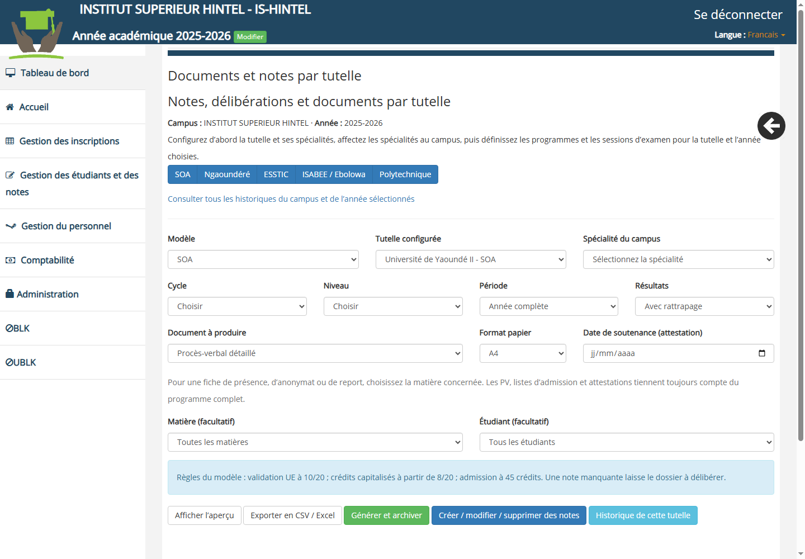

# Intégration Test OK dans SchoolConcept

Version locale du 30 octobre 2026. Le projet Test OK reste inchangé. Les développements utilisent les campus, années académiques, spécialités, niveaux, droits d’accès et enseignants de SchoolConcept.

## Ouvrir le module

Depuis **Gestion des étudiants et des notes → Notes**, cliquer sur l’une des cinq tutelles, ou ouvrir :

`http://127.0.0.1:8080/ISH/app/public/eleves/documents-tutelles`

Sur le serveur hébergé, le chemin applicatif correspondant est `/eleves/documents-tutelles`, après connexion et choix du campus.

Pour consulter les données reprises, choisir **HINTEL (campus n° 1)** et l’une des années **2023-2024, 2024-2025 ou 2025-2026**. Test OK ne contenait pas de notes 2026-2027 ; cette nouvelle année doit être configurée selon la procédure ci-dessous.



## Tutelles et affectations

Les cinq tutelles ont été créées avec les logos repris des sources de Test OK. La tutelle MINSUP existante a été conservée.

| Filière | Tutelle(s) |
| --- | --- |
| Agriculture et élevage | ISABEE — Université d’Ebolowa |
| Gestion | Université de Yaoundé II — SOA |
| Tourisme, hôtellerie, restauration | Université de Yaoundé II — SOA |
| Information et communication | ESSTIC — Université de Yaoundé II |
| Génie civil, dont BTP et cadastre | Ngaoundéré et Polytechnique |
| Génie électrique | Ngaoundéré et Polytechnique |
| Génie informatique | Ngaoundéré et Polytechnique |
| Télécom, réseaux, sécurité et cybersécurité | Ngaoundéré et Polytechnique |
| Génie mécanique | Polytechnique |

Pour les filières communes, les notes reprises sont initialement identiques, puis chaque tutelle possède ses propres sessions. Modifier une note de Ngaoundéré ne modifie pas la note de Polytechnique.

## Configurer une nouvelle année

1. Créer ou vérifier le campus dans **Administration → Campus** et affecter les utilisateurs autorisés.
2. Vérifier les cinq tutelles dans **Administration → Tutelles** : identité, logos et **Modèle des documents académiques**.
3. Affecter les spécialités au campus et aux tutelles concernées.
4. Configurer filières, cycles, niveaux, matières, codes et programmes. Les crédits fractionnaires sont conservés.
5. Définir les regroupements de matières en UE. Une UE mère ne reçoit pas une deuxième fois les crédits de ses matières filles dans les nouveaux documents.
6. Créer les sessions d’examen pour **chaque tutelle et chaque année**, avec les pondérations CC, TPE, session normale et rattrapage. Pour une session normale, CC + TPE + SN doit totaliser 100 % ; pour le rattrapage, CC + TPE + RAT doit totaliser 100 %.
7. Affecter les enseignants aux matières, inscrire les étudiants, puis saisir les notes.

Les matières nouvellement reprises de Test OK doivent recevoir leurs affectations d’enseignants lorsqu’elles n’existaient pas encore dans SchoolConcept. Les affectations existantes restent conservées.

## Créer ou modifier les notes

1. Sélectionner le campus et l’année académique dans l’en-tête du logiciel.
2. Ouvrir **Notes et documents par tutelle**, choisir la tutelle puis la spécialité, le cycle et le niveau.
3. Cliquer sur **Créer / modifier / supprimer des notes**.
4. Choisir la matière et l’évaluation, puis **Afficher**.
5. Saisir les notes **sur 20**, éventuellement l’anonymat et le mois d’examen.
6. Cliquer sur **Enregistrer les notes**.

Le logiciel conserve les contributions pondérées. Par exemple, un CC de 10/20 pondéré à 30 % est stocké à 15 points sur 100. Les documents ne prennent pas ces 15 points pour une note de 15/20.

Une note égale à zéro est une vraie note. Un champ laissé vide conserve la valeur existante. Si une autre personne a modifié une note entre-temps, recharger la page avant de reprendre la saisie. Les verrous actifs sont vérifiés au moment de l’enregistrement. Un enseignant doit être affecté à la matière pour la modifier.

Les anciens formulaires de notes redirigent vers le choix de tutelle pour les formations reprises. Leur import général refuse ces lignes : utiliser le modèle CSV de la session choisie pour éviter de modifier une autre tutelle.

### Importer une liste depuis Excel

Dans l’écran de saisie, télécharger **le modèle CSV de cette classe**, le compléter dans Excel et l’enregistrer en CSV UTF-8. Le fichier doit contenir `id_eleve` ou `matricule`, et `note`. Les colonnes `anonymat` et `mois` sont facultatives.

Choisir le fichier : les champs sont remplis sans enregistrement automatique. Vérifier les lignes puis cliquer sur **Enregistrer les notes**. Un étudiant hors de la liste, une identité ambiguë, un doublon ou une note hors de 0 à 20 arrête la préparation du fichier.

### Supprimer une note

Afficher la matière et l’évaluation concernées, cocher **Supprimer** sur la ligne, puis enregistrer et confirmer. La suppression concerne la note de la session sélectionnée ; sa valeur précédente est conservée dans le journal des opérations académiques.

## Produire les documents

Le module propose vingt-sept familles de documents, selon la période choisie : semestre impair, semestre pair ou année complète. Pour un niveau L3, les semestres impairs et pairs correspondent par exemple à S5 et S6.

Les listes d’admission et attestations sont annuelles. Un relevé ou PV semestriel présente les résultats de la période sans prononcer une admission annuelle.

| Famille | Contenu |
| --- | --- |
| PV détaillé | Résultats, crédits, moyenne et décision |
| PV par UE | Résultats détaillés et synthèse des regroupements |
| Listes d’admission | Admis par ordre alphabétique et ordre de mérite |
| Autres décisions | Non-admis et dossiers à délibérer |
| Relevés de notes | Document individuel ou ensemble de la promotion |
| Attestations de réussite | Étudiants présents dans les admis du contexte retenu |
| Rattrapages | Étudiants concernés, rattrapages effectués, état global |
| Documents d’examen | Présence, anonymat, fiche de report |
| États de notes | CC, session normale, TPE, rattrapage |
| Contrôle du programme | Matières, codes, crédits et pondérations |
| Statistiques | Effectifs et pourcentages par décision |

1. Choisir la tutelle et le contexte pédagogique.
2. Choisir la période et les résultats de session normale ou après rattrapage.
3. Sélectionner le document et le format A4 ou A3.
4. Pour une fiche de présence ou de report, choisir une matière. Pour un relevé individuel, choisir un étudiant.
5. Utiliser **Afficher l’aperçu** pour contrôler le résultat.
6. Utiliser **Générer et archiver** pour conserver une édition.
7. Dans le document, utiliser **Imprimer / enregistrer en PDF**. **Exporter en CSV / Excel** produit les données détaillées dans un fichier exploitable.

Les PV, listes, relevés et attestations utilisent le programme évalué complet ; sélectionner une seule matière ne permet pas de calculer une admission sur cette seule matière. Les fiches préparatoires et l’état du programme permettent aussi d’afficher les matières non encore notées.

## Règles reprises et cas à délibérer

Les règles identifiées dans les listes d’admission de Test OK sont centralisées dans `config/academic_documents.php`.

| Modèle | Capitalisation d’une matière | Admission | Moyenne |
| --- | --- | --- | --- |
| SOA | Dès 8/20 | 45 crédits | Arithmétique |
| ESSTIC | Dès 8/20 | 45 crédits | Arithmétique |
| ISABEE | Dès 10/20 | 45 crédits | Pondérée par les crédits |
| Ngaoundéré | Dès 8/20 | Moyenne strictement supérieure à 10/20 | Moyennes des deux semestres pondérées par les crédits |
| Polytechnique | Dès 10/20 | 45 crédits | Pondérée par les crédits |

La validation d’une matière reste signalée à 10/20. La capitalisation à 8/20 dans certains modèles est donc distincte de cette validation. Le modèle Polytechnique utilise le barème pondéré du traitement ISABEE/Polytechnique ; ces paramètres restent centralisés pour pouvoir appliquer une décision pédagogique différente.

Les grades de F à A+ suivent les intervalles des modèles consultés. Pour SOA, ISABEE et Polytechnique, la MGP linéaire affichée est la moyenne sur 20 divisée par 5, comme dans les anciens relevés.

Lorsqu’une composante requise manque, le dossier reste **À délibérer** au lieu de fabriquer une note. À Ngaoundéré, l’égalité exacte à 10/20 est signalée à délibérer : les anciens fichiers d’admis et d’échoués utilisaient respectivement `> 10` et `< 10`.

Les résultats des anciennes interfaces ne sont donc pas déclarés identiques au chiffre près pour les dossiers incomplets, les doublons ou les fichiers historiques contradictoires. Les vingt-sept familles sont fonctionnelles ; la mise en page reprend les identités et informations des tutelles dans des vues communes, sans reproduire à l’identique chaque ancien fichier PHP.

## Historiques

Le bouton **Historique de cette tutelle** reprend le contexte sélectionné. Le lien **Consulter tous les historiques du campus et de l’année sélectionnés** affiche les éditions du campus courant.

Une édition conserve le contenu HTML imprimable, les logos, le contexte, la date, l’auteur et une empreinte SHA-256. Modifier ensuite les notes ne change pas une ancienne édition. Pour produire les nouveaux résultats, générer une nouvelle édition. La suppression d’une édition est une suppression logique.

## Présentation des nouveaux états

Dans l’historique, **Afficher / imprimer** ouvre la copie originale avec sa présentation et son format d’origine. Pour obtenir la présentation actuelle et choisir réellement le papier, utiliser **Nouvel aperçu A4** ou **Nouvel aperçu A3**, puis imprimer. Ces aperçus sont recalculés à partir des notes actuelles ; ils ne modifient pas l’archive. Pour les anciens relevés et attestations dont les filtres individuels n’étaient pas conservés, repartir du formulaire pour sélectionner l’étudiant. Les nouvelles éditions enregistrent désormais leurs filtres pour les réutiliser.

Tous les états peuvent être produits en **A4 ou A3**, au choix dans le formulaire ou avec les liens A4/A3 de l’aperçu. Les filtres sont conservés lors du changement de format. L’A3 agrandit les textes, les logos, les espacements et les colonnes ; l’A4 utilise une présentation compacte. Les PV détaillés, PV par UE, PV par modules, états globaux des rattrapages, fiches de report et programmes sont en paysage ; les autres états sont en portrait. Les tableaux larges ajustent leur typographie au nombre de matières et restent dans la largeur imprimable. Les en-têtes de tableaux se répètent sur les pages suivantes et les pieds de page disposent d’une marge réservée. Une édition archivée conserve son format de génération.

Les vingt-sept familles d’états utilisent le même habillage : logo `public/img/logo.jpg` à gauche, logos de la tutelle et de sa faculté à droite, nom du campus et en-tête bilingue. Les références de création et d’autorisation reprennent les modèles `perso.header_bts` et `perso.header_soa`. Le pied de page reprend l’adresse et les coordonnées des modèles `perso`, avec la mention de copie conforme sur les relevés.

Les valeurs par défaut se trouvent dans `config/academic_stationery.php` ; les références et coordonnées renseignées sur le campus sont prioritaires. À l’impression avec Chrome/Edge récents, le pied de page est répété dans la marge réservée de chaque page, sans recouvrir les tableaux. Les logos sont incorporés au HTML des nouveaux documents archivés. Les archives déjà créées conservent leur présentation d’origine ; générer une nouvelle édition pour obtenir le nouvel habillage.

## Bilan de la première reprise locale

La migration de données `2026_10_30_000004_import_testok_hintel_sql` a ensuite été appliquée le **30 octobre 2026** sur cette base locale (campus HINTEL n° 1), après sauvegarde PostgreSQL. Elle est enregistrée dans le lot de migrations **25**. Elle a réutilisé **814 étudiants, 944 inscriptions et 40 844 notes**, sans création supplémentaire. Le contrôle complet des notes et des cinq tutelles a réussi : aucune note attendue manquante et aucune erreur de rattachement. Les empreintes avant/après des étudiants, inscriptions, notes, paiements, tutelles et liens de provenance sont identiques.

Les preuves privées sont dans `storage/app/import-testok/avant-application.json`, `apres-application.json` et `cloud-20261030/rapport-migration.json`. Les correspondances propres à cette base ont été sauvegardées dans `cloud-20261030/correspondances-cible.json`. Les anomalies source restent conservées dans `cloud-20261030/anomalies-migration.json`. Cette application locale ne déploie pas la reprise sur le serveur cloud.

Ce bilan décrit la première reprise locale. La migration cloud actuelle conserve les étudiants et inscriptions déjà présents et crée uniquement les fiches réellement absentes, conformément à la dernière consigne.

| Donnée | Traitement |
| --- | --- |
| Étudiants source | 829 |
| Identités rapprochées / intégrées | 814, dont 35 nouvelles fiches |
| Inscriptions source | 1 142 |
| Inscriptions valides reprises | 944 |
| Notes source | 37 325 |
| Notes source valides reprises | 36 391 |
| Enregistrements de notes SchoolConcept | 40 844, compte tenu des sessions de tutelles communes |
| Notes isolées | 934 |
| Inscriptions isolées | 198 |
| Identités non résolues | 15 |
| Sessions source isolées | 33 |

Les fichiers complets, correspondances, rapports et preuves de contrôle sont dans `storage/app/import-testok/`, exclu de Git et protégé contre l’accès HTTP sous Apache.

Pour déployer la reprise du fichier **hintel_gestion_note.sql** sur le serveur cloud sous forme de migration Laravel, suivre [la procédure de migration cloud](MIGRATION_CLOUD.md). Elle fournit un paquet privé vérifié par empreinte, une simulation avec annulation et une migration de données distincte des migrations ordinaires. Les correspondances sont établies dans la base du serveur ; les identifiants locaux ne doivent pas être copiés sur une autre base.

- `source.json` : premier export ayant servi à la reprise.
- `source-complet.json` : export incluant les domaines et les tables facultatives.
- `correspondances.json` : liens entre identifiants Test OK et SchoolConcept, avec les tutelles par programme.
- `anomalies.json` : lignes isolées, données originales et motifs.
- `simulation-valide.json` : rapport avant application.
- `verification.json` : contrôle des 40 844 notes et génération de documents sur les cinq tutelles.
- `verification-navigateur.json` : vérifications des interfaces et impressions dans Chrome.

Les parents, écoles et tutelles des tables Test OK étaient vides. Les tutelles ont donc été créées à partir des modèles et logos du projet. Les six domaines sont repris lorsqu’ils sont rattachés aux spécialités.

La reprise recherche d’abord l’étudiant par matricule unique ou nom complet unique. Elle réutilise sa fiche lorsqu’elle est identifiée ; si aucune fiche ne correspond, elle crée l’étudiant à partir des données source valides. Une identité ambiguë ou une date de naissance invalide pour une nouvelle fiche est isolée, sans création arbitraire. Les inscriptions existantes sont réutilisées par étudiant, année, campus, spécialité, niveau et cycle, sans modifier leurs identifiants, dates ou montants. Une inscription manquante est créée à montant zéro avec la date de reprise ; si une inscription existe déjà pour la même année dans un autre contexte, la ligne est isolée pour vérification. Aucun paiement n’est créé ni remplacé.

Avant validation de la migration, **chaque note retenue** est contrôlée par rapport à sa source : étudiant, campus, année, matière, spécialité, programme, session, évaluation, valeur, anonymat, mois et tutelle. La répartition des tutelles est contrôlée par filière selon les correspondances convenues, y compris les filières communes Ngaoundéré/Polytechnique. Le rapport conserve les effectifs attendus et vérifiés par tutelle ; une erreur de rattachement annule la transaction.

## Réexécuter sur une autre installation

L’application doit déjà disposer du socle multi-campus et des migrations antérieures nécessaires. Exécuter les commandes depuis la racine du projet, avec les accès de cette installation.

```text
php tools/testok/install.php

# Exporter depuis le serveur possédant les sources et la base Test OK.
# Utiliser un PHP équipé de mysqli.
php tools/testok/export.php --source-root=CHEMIN_TESTOK --output=storage/app/import-testok/source.json

# Préparer les correspondances, puis vérifier les rapprochements proposés.
php artisan testok:import --source=storage/app/import-testok/source.json --prepare-map=storage/app/import-testok/correspondances.json

# Simuler les catalogues, puis les conserver après contrôle.
php artisan testok:prepare --source=storage/app/import-testok/source.json --mapping=storage/app/import-testok/correspondances.json --campus=1
php artisan testok:prepare --source=storage/app/import-testok/source.json --mapping=storage/app/import-testok/correspondances.json --campus=1 --commit

# Simuler la reprise des seules lignes valides.
php artisan testok:import --source=storage/app/import-testok/source.json --mapping=storage/app/import-testok/correspondances.json --isolate-invalid --quarantine=storage/app/import-testok/anomalies.json --report=storage/app/import-testok/simulation-valide.json

# Appliquer en transaction uniquement après une simulation sans erreur.
php -d memory_limit=512M artisan testok:import --source=storage/app/import-testok/source.json --mapping=storage/app/import-testok/correspondances.json --isolate-invalid --quarantine=storage/app/import-testok/anomalies.json --report=storage/app/import-testok/simulation-valide.json --commit

php -d memory_limit=512M tools/testok/verify.php
```

Le numéro de campus doit être adapté à l’installation cible ; le campus HINTEL local est le n° 1. L’installateur sélectionne uniquement les trois migrations de cette intégration et ne relance pas les anciens scripts restés en attente. Les noms ambigus peuvent produire une référence Test OK distincte pour éviter une fusion arbitraire. Les données existantes différentes ne sont pas écrasées : une reprise contradictoire s’arrête et annule sa transaction.

## Vérifications

25 tests ciblés ont réussi avec 153 assertions : calculs, grades, MGP et rattrapages, isolation campus/tutelle, vingt-sept familles de vues, archive et empreinte, modification et suppression tracées, conflits de saisie, verrous, protection des anciens formulaires, reprise multi-tutelles et idempotence. Les tests d’intégration utilisent des tables temporaires et annulent leurs transactions.

Le contrôle des 40 844 enregistrements de notes repris ne relève aucun écart de contribution, de tutelle, de campus, d’anonymat ou de mois par rapport à la provenance conservée. Des documents ont été rendus sur des promotions réelles des cinq tutelles. Ces vérifications ne remplacent pas le traitement des lignes restées dans le rapport d’anomalies.

## Nouveaux modèles PV et relevés par modules

Les anciens modèles **PV détaillé**, **PV par UE** et **Relevés de notes** restent disponibles et gardent leur présentation. Deux choix s'ajoutent pour ISABEE, ESSTIC, Ngaoundéré, SOA et Polytechnique : **Procès-verbal par modules (groupes de matières)** et **Relevés de notes par modules (groupes de matières)**.

1. Configurer les groupes de matières : chaque UV du programme est rattachée à sa matière mère dans `groupe_matieres`, pour la spécialité, le niveau et le semestre concernés. Les crédits sont ceux des UV ; une matière mère ne compte pas une deuxième fois.
2. Configurer les sessions d'examen de la tutelle et de l'année choisies, puis saisir les notes des UV. Un groupe ne suffit pas à créer une session manquante : vérifier le programme et les sessions avant l'édition.
3. Dans **Notes et documents par tutelle**, sélectionner la tutelle, la spécialité, le cycle, le niveau, la période et le mode de session.
4. Choisir le nouveau PV par modules ou le nouveau relevé par modules. Pour un relevé individuel, sélectionner l'étudiant ; sans ce filtre, les relevés des étudiants du contexte sont produits.
5. Choisir A4 ou A3, puis **Aperçu**. Le PV présente une en-tête de groupe au-dessus des colonnes de ses UV, puis sa moyenne. Le relevé affiche le groupe, ses UV et une ligne de moyenne après les UV.
6. Imprimer/enregistrer en PDF, **Générer et archiver**, ou **Exporter en CSV / Excel**. Pour ces deux modèles, le CSV ajoute l'identifiant du groupe, sa moyenne et ses crédits sur chaque ligne d'UV. Ne pas additionner les crédits de groupe répétés dans le CSV.

La moyenne d'un module est `somme(note finale UV × crédits UV) / somme(crédits UV)`. Par exemple, 12/20 avec 2 crédits et 18/20 avec 1 crédit donnent **14/20**. Les résultats après rattrapage ou en session normale suivent le mode sélectionné. Chaque groupe est identifié par sa matière mère et son semestre : deux modules de même nom ne sont pas fusionnés. Une UV sans groupe reste affichée séparément ; aucune moyenne de module n'est créée pour elle.

Ces nouveaux modèles incluent aussi les UV ayant une session configurée mais aucune note. Une note manquante rend le module incomplet ; elle n'est pas transformée en zéro. Un total de crédits nul affiche « Non calculable ». Une double affectation à deux groupes dans le même semestre bloque l'édition avec un message demandant de corriger le regroupement. Les décisions et totaux conservent les règles de calcul de la tutelle et ne résultent pas d'une nouvelle règle de compensation entre modules. Une archive existante conserve son contenu : produire une nouvelle édition pour utiliser les nouveaux modèles.
La convention historique 1/2 des regroupements (semestre impair/pair) est compatible avec les sessions S3/S4, S5/S6, etc. Les numéros explicites de semestre et la valeur 0 (tous les semestres) sont également pris en charge. Si deux conventions rattachent la même UV à deux modules différents pour le même semestre, l'édition demande de corriger l'affectation.

Validation des nouveaux modèles : 15 tests de workflow, 636 assertions ; impressions A4/A3 vérifiées sur les cinq tutelles, ainsi que sur une fixture avec deux UV et leur moyenne de module. Les cinq promotions de contrôle issues de Test OK n'ont pas de regroupements affectés à leurs programmes : leurs UV restent séparées tant que ces affectations ne sont pas configurées.

## Anonymats d’examen par tutelle

Le circuit d’Azimut est adapté aux sessions SchoolConcept : ISABEE, ESSTIC, Ngaoundéré, SOA et Polytechnique. Le point d’entrée est **Notes et documents par tutelle → Gérer les anonymats**, également accessible depuis **Notes → Anonymats par tutelle** (`/eleves/notes/anonymats`). Sans contexte sélectionné, ce lien ramène au choix de la tutelle, de la spécialité, du cycle et du niveau.

### Prérequis et génération

1. Choisir le campus et l’année académique dans l’application, puis la tutelle et le contexte pédagogique. Les inscriptions et les sessions d’examen de cette tutelle doivent déjà exister.
2. Ouvrir **Gérer les anonymats**, sélectionner une matière et l’évaluation : session normale ou rattrapage, impair ou pair. S5 relève du semestre impair ; S6 du semestre pair. Les pondérations correspondantes doivent être configurées dans la session.
3. Choisir **Un code par UV / matière** ou **Un code commun aux UV du semestre**. Ces modes sont deux listes distinctes. Conserver le même mode pour les fiches distribuées et la saisie des notes.
4. Cliquer sur **Générer les codes manquants**. En mode par matière, la case **toutes les matières configurées** permet de traiter les UV du semestre en une fois. Aucune note fictive et aucune inscription ne sont créées.
5. Vérifier les correspondances. Une nouvelle génération conserve les codes existants et ajoute les nouveaux inscrits. Les codes historiques déjà présents dans les notes de la même matière, du même campus et de la même évaluation sont repris. Un doublon historique entre étudiants bloque la génération : corriger l’anomalie puis relancer.

La portée d’un code comprend le campus, l’année, la tutelle, la spécialité, le cycle, le niveau, le semestre, l’évaluation, le mode et, en mode par matière, la session d’examen. Les nouvelles séries ne réutilisent pas les codes déjà attribués ou retirés pendant l’année, y compris dans une autre tutelle. Les codes historiques repris peuvent avoir été réutilisés dans plusieurs contextes : il faut toujours sélectionner le contexte de l’épreuve. Les codes nouvellement générés prennent la forme `ANSN5-00001` ou `ANR5-00001` ; l’ordre des noms ne détermine pas leur attribution. La session normale, le rattrapage et les deux semestres restent séparés.

### Fiches, correction et saisie

- **Liste confidentielle des correspondances** : codes, matricules et identités ; destinée à l’administration des examens.
- **Fiche de report par anonymat** : uniquement les codes, des cases de notes et les observations ; destinée à la correction. Son export CSV ne contient pas les identités.
- **Liste de présence** : matricules, identités, signatures et observations ; les codes ne figurent pas sur cette feuille de présence.
- **Fiches individuelles** : une fiche par étudiant avec son code et l’identification de l’épreuve, à conserver séparément de la copie destinée à la correction.

Choisir l’état et le format **A4 / A3**, puis **Aperçu / PDF** ou **Générer et archiver**. Les documents utilisent les logos, en-têtes et pieds de page du campus et de la tutelle. Les éditions archivées restent figées et sont accessibles dans l’historique de la tutelle ; les nouveaux aperçus conservent la matière, le mode d’anonymat et l’évaluation. Les états sont également disponibles dans le sélecteur général des documents.

Pour saisir les résultats, ouvrir **Saisir / modifier les notes par anonymat**, retrouver le code de la copie puis saisir la note **sur 20**. Le logiciel applique la pondération de la session et rattache la note à l’étudiant correspondant. L’écran et ses champs ne contiennent ni nom ni matricule. Un champ vide conserve une note existante ; saisir `0` pour une note nulle. Cocher **Supprimer la note** retire la note, tout en conservant le code. Les liens **Saisir Contrôle continu** et **Saisir TPE**, lorsqu’ils sont configurés, ouvrent la saisie habituelle de ces évaluations. Les liens **PV par modules** et **Relevés par modules** réutilisent les notes ainsi enregistrées.

Les enseignants affectés à la matière peuvent utiliser la saisie anonyme ; ils n’accèdent pas aux nouvelles correspondances, à leur génération ou à leurs archives confidentielles. Pour une évaluation ayant des codes attribués, leur saisie classique est redirigée vers les anonymats et un enregistrement nominatif direct est refusé. Les verrous de notes et les contrôles de modification simultanée s’appliquent aussi à la saisie par code. Les créations de codes, retraits et modifications de notes sont tracés.

Un responsable peut retirer un code **uniquement avant qu’une note existe** pour l’étudiant et l’évaluation concernés. Pour un code commun, ce contrôle porte sur les UV du semestre. Un code retiré n’est pas réattribué. Après une note déjà saisie, conserver la correspondance et utiliser la modification ou la suppression de note.

### Déploiement du module

La migration `2026_10_30_000005_create_academic_exam_anonymats.php` crée `academic_exam_anonymats` et `academic_anonymat_audits`, avec contraintes d’unicité et index de contexte. Elle est incluse dans `php tools/testok/install.php`, qui applique uniquement les migrations structurantes de cette intégration. Elle ne modifie pas les notes, paiements ou inscriptions existants. En local, cette migration est appliquée ; aucune génération d’anonymats sur les étudiants réels n’a été réalisée pendant les vérifications. Les essais utilisent des tables temporaires et des étudiants fictifs.
Validation : le workflow documentaire et d’anonymat passe 24 tests et 818 assertions ; les tests de calcul et de reprise Test OK sont également validés (60 tests ciblés au total). Le navigateur a vérifié les écrans des cinq tutelles et les huit variantes A4/A3 des nouveaux états. La fiche de report et la saisie anonyme ne contiennent ni noms ni matricules. Les contrôles de base confirment zéro anonymat réel généré et les effectifs existants de notes et d’inscriptions conservés.

## Délibérations par tutelle et rapports du jury

Le circuit de délibération d’Azimut est adapté aux sessions SchoolConcept pour les cinq tutelles. Les accès sont **Notes → Délibérations par tutelle**, **Notes → Rapport des délibérations**, ou les boutons **Délibérations** et **Rapport des délibérations** dans **Notes et documents par tutelle**. Les points d’entrée sont `/eleves/notes/deliberations` et `/eleves/notes/deliberations/rapport`. Sans sélection complète, le logiciel demande de choisir explicitement la tutelle et le contexte ; les anciennes pages de délibération ne mélangent plus les sessions des tutelles configurées.

### Préparer la décision

1. Sélectionner le campus et l’année dans l’application. Choisir la tutelle, la spécialité, le cycle, le niveau et la période, puis **Délibérations**.
2. Vérifier les prérequis : inscriptions actives, sessions d’examen de la bonne tutelle, pondérations, notes existantes et groupes de matières lorsque le type porte sur des modules. La note à ajuster doit appartenir au campus courant ; les incohérences de reprise doivent d’abord être corrigées.
3. Choisir le type, le semestre réel du programme (S1 à S10, ou tous ceux de la période), l’examen à ajuster, la portée et la valeur cible. **Session actuellement retenue** suit pour chaque UV le résultat normal ou le rattrapage effectivement retenu par le calcul de la tutelle. Les choix explicites **Session normale** et **Rattrapage** restent disponibles.
4. Indiquer au besoin un intervalle de valeurs actuelles, avec bornes incluses ou exclues. Les bornes laissées vides ne limitent pas la sélection. En base **/100**, notes, bornes et cible sont converties en /20. Pour les types par crédits, les bornes et la cible représentent des crédits.
5. Avec la portée **sélection**, cocher les UV ou les modules souhaités. Pour le mode individuel, sélectionner l’étudiant ; les UV peuvent aussi être limitées à une sélection. Pour attribuer des objectifs différents aux UV d’un étudiant, préparer des décisions séparées par UV ou groupe d’UV.
6. Cliquer sur **Prévisualiser les propositions**. Cette action ne modifie aucune note. Vérifier les valeurs finales avant/après, l’examen ajusté et sa contribution pondérée, ainsi que les crédits et décisions calculés.

| Type | Fonctionnement |
| --- | --- |
| Par matière | Améliore les notes finales existantes des UV correspondant à l’intervalle, jusqu’à la cible choisie. |
| Par module / groupe de matières | Vise la moyenne pondérée par crédits du groupe. Les UV déjà validées à 10/20 sont conservées. Les UV en échec les plus proches de la validation sont ajustées, dans la limite de leur contribution d’examen. |
| Par crédits | Vise le nombre de crédits sur les UV de la portée et du semestre choisis. Les UV les plus proches du seuil de capitalisation de la tutelle sont proposées en premier. |
| Par matières et crédits | Même objectif de crédits, avec possibilité de limiter le calcul aux UV cochées. |
| Par modules et crédits | Limite les UV aux groupes choisis et vise leurs crédits selon le seuil de la tutelle. Une moyenne de module ne donne pas automatiquement tous les crédits du groupe. |
| Par étudiant | Limite les propositions à l’étudiant sélectionné et aux UV de la portée choisie. |

La délibération propose uniquement des améliorations : elle ne baisse pas une note. Un module incomplet ne reçoit pas de moyenne inventée. Les notes absentes ne sont pas créées et les CC/TPE restent conservés. Les objectifs impossibles dans les pondérations sont écartés, ainsi que les ajustements de rattrapage qui ne changeraient pas la note finale parce qu’une normale déjà validée reste prioritaire. Si un objectif de crédits ne peut pas être atteint, aucun ensemble partiel n’est proposé pour cet objectif.

La capitalisation suit les paramètres existants : ISABEE et Polytechnique à partir de 10/20 ; SOA, ESSTIC et Ngaoundéré à partir de 8/20. La validation d’une UV, les moyennes, les grades et l’admission annuelle conservent les règles de la tutelle. Une délibération sur quelques UV ne prononce donc pas automatiquement une admission si le dossier annuel reste incomplet.

### Appliquer les propositions

1. Cocher les propositions retenues. Une proposition par module ou par objectif de crédits constitue un ensemble indivisible de changements : le logiciel ne permet pas d’en appliquer seulement une partie au détriment de l’objectif annoncé.
2. Renseigner le **motif / la décision du jury**.
3. Cliquer sur **Appliquer les propositions cochées et conserver le rapport**. Le logiciel vérifie à nouveau les notes, les inscriptions, les groupes, les sessions, les droits et les verrous avant l’écriture. Un aperçu expire après une heure ; une modification depuis l’aperçu impose de le recalculer.
4. Consulter le rapport ouvert après application. Il décrit le bilan réel cumulé des propositions appliquées. Les bilans affichés pendant l’aperçu correspondaient, eux, à chaque proposition prise séparément.

Exemple : une contribution CC de 15/100 et une contribution d’examen de 20/100 donnent une note finale de 7/20. Pour viser 10/20, le logiciel conserve le CC et propose une contribution d’examen de 35/100, si la pondération de la session le permet. Il ne remplace pas cette contribution par une note brute de 10 dans la base.

Une seconde soumission du même aperçu, des mêmes propositions et du même motif ne répète pas les écritures. Une modification de la sélection après application est refusée. Les changements sont appliqués dans une transaction ; une anomalie empêche de conserver un lot partiellement appliqué. Les codes d’anonymat et les autres métadonnées de notes restent conservés. Les enseignants correcteurs n’appliquent pas ces décisions administratives ; elles nécessitent un utilisateur autorisé à gérer les notes et non identifié comme enseignant.

### Consulter, imprimer et archiver le rapport

Le rapport est limité au campus et à l’année sélectionnés dans l’application, et à la tutelle choisie. Il peut porter sur le contexte pédagogique sélectionné ou sur toutes les spécialités de cette tutelle sur le campus. Les filtres comprennent le type de délibération, le semestre, l’examen normal / rattrapage et le numéro de décision. La présentation **synthétique** donne les effectifs et lignes modifiées par décision ; la présentation **détaillée** ajoute les étudiants, les UV, les modules, les notes finales avant/après, les contributions pondérées et le bilan du dossier. Le motif, la date et l’identifiant de l’utilisateur sont conservés.

Les compteurs distinguent les étudiants, les UV par semestre, les décisions et les modifications de notes. L’écran pagine les décisions ; l’impression et l’export couvrent tous les résultats des filtres, y compris les autres pages.

Utiliser **Imprimer / PDF A4** ou **A3**, **Exporter CSV / Excel**, ou **Archiver ce rapport**. Les impressions utilisent les mêmes logos, en-têtes bilingues et pieds de page que les autres états. Le rapport est également proposé dans la liste générale des documents. Une édition archivée reste figée ; les liens de nouvel aperçu reprennent les filtres de rapport enregistrés.

Le journal structuré conserve les nouvelles décisions appliquées depuis l’activation du module. Il ne reconstitue pas des valeurs avant/après absentes d’anciens historiques. Une correction de note ultérieure ne réécrit pas une décision passée. Les nouveaux aperçus des PV, relevés, attestations et listes utilisent les résultats courants ; les anciennes éditions archivées conservent leurs résultats de génération.

### Migration et validation

La migration `2026_10_30_000006_create_academic_deliberations.php`, incluse dans `php tools/testok/install.php`, crée le journal `academic_deliberations` et les lignes `academic_deliberation_items`. Les modifications de notes sont aussi inscrites dans `academic_note_audits`. La migration est appliquée localement et ne transforme aucune note existante. Aucun lot de délibération n’a été appliqué sur les étudiants réels pendant l’implémentation.

Validation automatisée : **71 tests, 1 120 assertions** sur les calculs, les reprises Test OK, les documents, les anonymats et les délibérations. Les scénarios couvrent notamment les seuils des cinq tutelles, les moyennes de modules, l’absence de double crédit, les cibles irréalisables, la sélection individuelle, les signatures d’aperçu, les conflits de modification, l’isolation campus/année/tutelle, les verrous, la réapplication et les rapports immuables. Les essais utilisent des tables temporaires et des étudiants fictifs.
### Attestations bilingues SOA, ESSTIC, ISABEE, Ngaoundéré et Polytechnique

Dans **Documents et notes par tutelle**, choisir la tutelle, la spécialité, le cycle, le niveau et **Attestations de réussite**. La période est annuelle ; seuls les étudiants admis selon les règles de la tutelle sont édités. Sélectionner un étudiant pour une attestation individuelle.

Le modèle paysage s’inspire du spécimen SOA : cadre bleu et doré, en-têtes français et anglais, logos incorporés, identité, naissance, année, formation et niveau, mention, moyenne, date de délivrance, signatures et pied de page. Le cycle vient du contexte sélectionné : les formations autres que la licence ne sont pas renommées « licence ». Les autorités SOA, ESSTIC, ISABEE, Ngaoundéré et Polytechnique sont définies dans `config/academic_attestations.php` et peuvent être adaptées aux responsables habilités.

Les champs **Référence de l’attestation**, **Date du procès-verbal du jury** et **Date de délivrance** complètent le document. La référence n’est pas attribuée automatiquement : sans saisie, un emplacement reste à compléter. La référence saisie est commune aux étudiants de la génération ; sélectionner un seul étudiant pour une référence individuelle. La date du jury reste vierge si elle est inconnue. La date de délivrance vaut, par défaut, la date du jour. La date de soutenance est facultative et distincte de celle du jury.

Choisir **A4** ou **A3** dans le logiciel avant l’impression. Les cinq modèles sont ajustés en paysage avec une page par étudiant. Les signatures et les cachets du spécimen ne sont pas reproduits : les emplacements restent à compléter par les autorités. Le contact est `hintelinstitut@gmail.com`.

**Générer et archiver** conserve la présentation, les résultats, les dates et la référence de l’édition. Une archive existante conserve son ancien contenu ; utiliser un **Nouvel aperçu A4/A3** pour appliquer la nouvelle présentation aux notes actuelles. 
Le modèle **Ngaoundéré / IUT** reprend le spécimen fourni : logo HINTEL à gauche, université au centre et IUT à droite, mentions bilingues de la réglementation et des conventions, signatures du Directeur de HINTEL et du Directeur de l’IUT, lieu de délivrance Ngaoundéré. Les dates de l’Accord-Cadre et de la Convention Spécifique sont configurées au **17 février 2021**, conformément au spécimen ; elles peuvent être adaptées dans `config/academic_attestations.php` selon la convention applicable. Le logo IUT utilise celui de la tutelle ou, à défaut, `public/img/iut.jpg`. Les dates du jury, de délivrance et de soutenance restent propres à chaque édition ; aucune date ni identité d’étudiant du spécimen n’est recopiée. Les règles d’admission de Ngaoundéré restent inchangées, notamment la nécessité d’un dossier annuel complet.
Le modèle **Polytechnique / ENSPY** reprend la présentation bilingue SOA avec les autorités de Polytechnique : logo HINTEL à gauche, ENSPY au centre et université de Yaoundé I à droite. Le Directeur de l’ENSPY remplace le Doyen de SOA dans la certification et la signature de tutelle. Les références aux conventions de Ngaoundéré ne sont pas utilisées. La référence, les dates, l’éligibilité, les formats A4/A3 et l’archivage suivent le même circuit que les autres attestations.